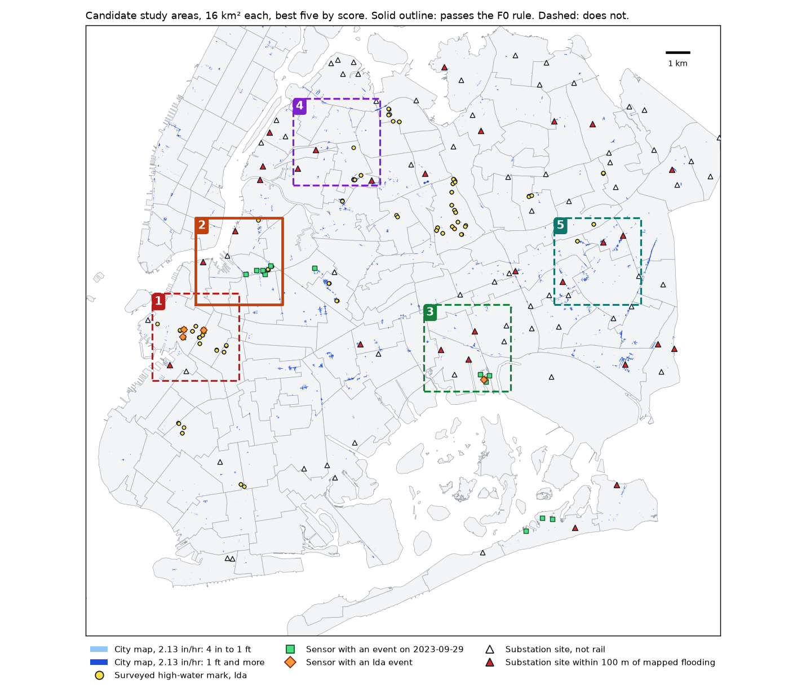
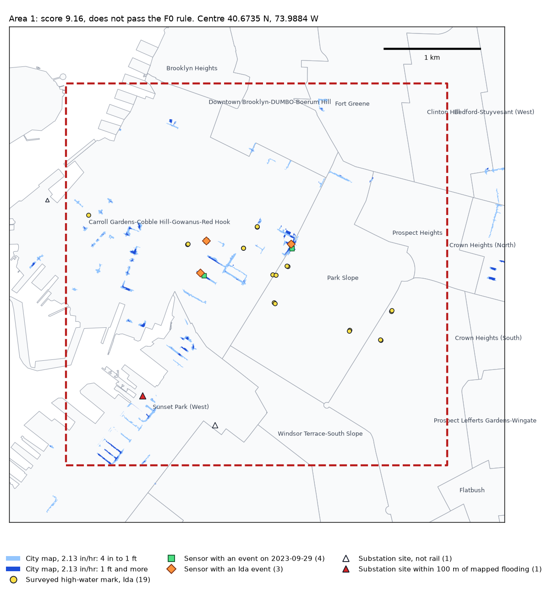
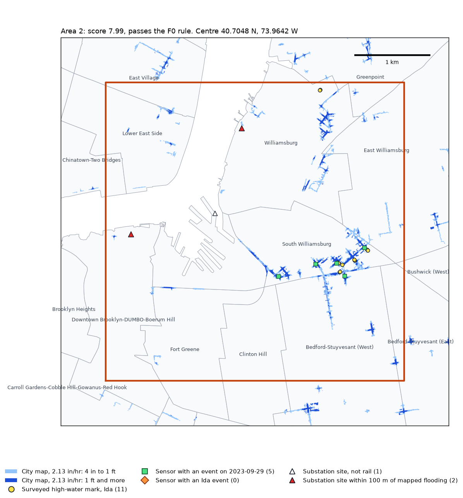
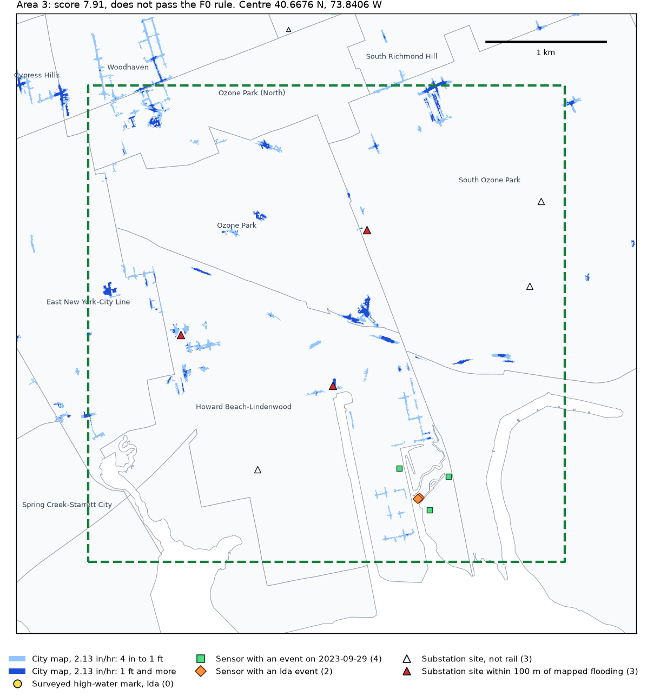
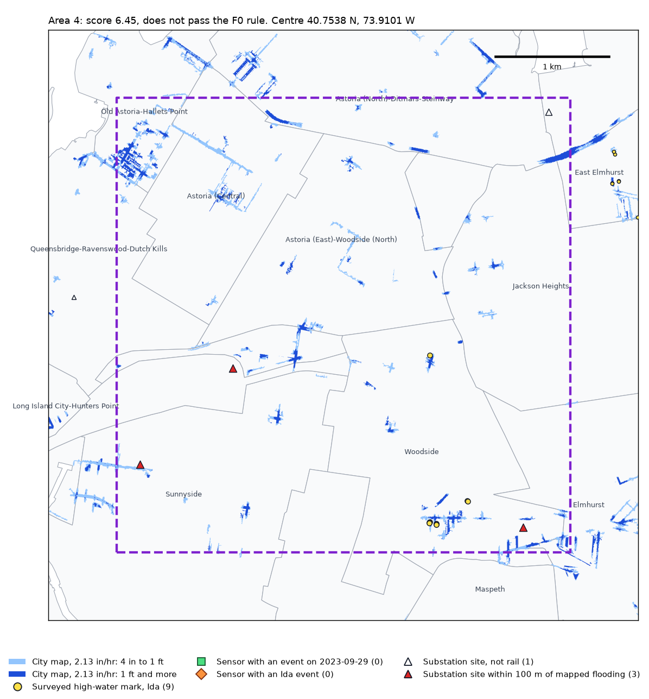
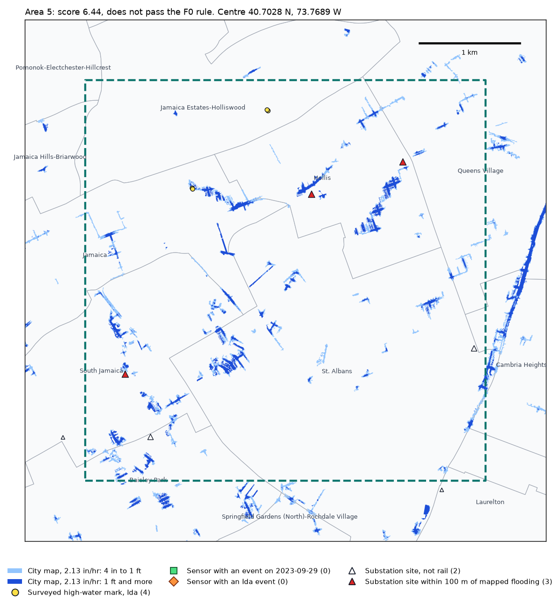

# F0. De-risk, CRC 1.0.0 calls, source facts, area candidates

Date: 2026-11-25 · branch `flood/f0` · crc-sdk 1.0.0, crc-framework 1.0.0 · reviewed 2026-11-25, decisions at the end

Stage F0 of `docs/flood/plan.md`. Its purpose was to test every risky assumption cheaply before anything
is built on it. Numbers below come from the records under `site/flood/tests/records/` and the facts under
`src/flood_lab/facts/`; the gallery (`site/flood/tests/index.html`, `just serve` then `/flood/tests/`)
shows the same records with their figures.

## Result against the pass rule

| Rule (plan F0) | Result |
| --- | --- |
| An area has at least 8 high-water marks, 5 sensors with a 2023-09-29 event and 3 substations (*proposed*) | **Passes, narrowly.** 6 of 1562 candidate areas pass, counting substations as sites that are not rail. The best-scoring area does not pass, so the record's second check fails |
| The toy solver model runs | **Passes**, 13 of 13 runs; water balance within 0.12% |
| Every CRC call in the mapping has a result | **Passes.** 12 probes, all as read |
| No fact of a Tier 1 source is left "not checked" without a reason | **Passes**: 23 facts are not checked, each with its reason on the data card. They are listed below because several need a person |

Two things did not go as the plan assumed and need a decision: the Limited Flood map cannot be read, and
one solver check fails as written by a hair. Both are under "Decisions for Yuri".

## 1. CRC 1.0.0 calls (requirements §9, item 12)

`tools/flood/f0_crc_calls.py`, record `f0-crc-calls`. Twelve probes on made-up data whose expected values
come from numpy or a hand enumeration. All twelve behave as read; `docs/flood/crc-1.0-mapping.md` now
carries the result of each, and says where a detail was not run.

What the run added to the reading:

- **Loss figures must use the point route.** On one toy cell that is dry in 93% of years, curves loaded
  at fixed probabilities (the raster route) gave an expected damage 14% above the exact-knot route, and a
  chance of flooding of 0.10 against 0.07. FH7 already sends loss figures through `from_quantiles`.
- **`from_raster` at the study's size is cheap:** 600,625 cells in 96 to 99 s, peak memory 0.55 GiB.
- **One decreasing cell fails the whole read** and the message does not name the cell (CRC-025-OWN, seen
  again). A running maximum before the call cures it.
- **`compute_risk` matches a hand enumeration** of VaR and CVaR, but each asset has only two loss
  states, so the independence bracket for full loss distributions is code in the extension (FR6, FR10).
- **Evaluation output** has one set of rows for the exposure and one per named response; an asset with
  no curve nearby fails with `outside_max_distance` under nearest matching.
- **Sensor events and map polygons load** (`Observations.from_table`, `Layer.from_table`) and read back
  equal in every field. Coordinates given in UTM metres are refused.

No new candidate finding for the register came out of this block.

## 2. Source facts (FS6)

27 sources, each with a facts file and a generated data card (`docs/flood/data-cards/`). Four lookup
agents read the publishers' pages, metadata and files; the main model reviewed every fact that was not
confirmed and every licence fact, and checked the Groundsource checksum against Zenodo itself. Facts
marked confirmed rest on the address and passage recorded with each; they were not all re-read.

| | Confirmed | Differs | Not checked | Not applicable |
| --- | --- | --- | --- | --- |
| The eight required facts, 27 sources | 157 | 5 | 14 | 40 |
| All facts | 248 | 15 | 23 | 58 |

8 sources read "facts confirmed"; 19 read "facts checked" with their counts. The 27th source, the city's neighbourhood outlines, was added for the maps of section 4 and its facts were read by the main model. No source is yet
"values recomputed": the second readers are F2 and F5.

Where a publisher differs from the requirements, the correction is proposed in requirements §14 (29 rows,
change CH-3). The ones that change later stages:

- **High-water marks:** 159 marks at 83 sites, 108 of them in the Brooklyn and Queens box.
- **The published 0.20 m error** is the calibrated model's fit on 8 marks; before calibration it was
  0.40 m. It is a reference point, not a bar an uncalibrated model should be expected to clear.
- **The USGS depth rasters** are derived from the marks and cannot check them.
- **Lidar:** the city's product is 1 ft in feet; the 1 m product is USGS 3DEP, parts of it flown after Ida.
- **FloodNet at Ida:** nine sensors in the two boroughs, five with an event. Times are GMT.
- **Flood maps:** a third class in the two sea-level-rise layers is tidal flooding, not rainfall depth;
  no storm duration is published for the three intensities.
- **Groundsource:** rows exist for both storms (204, 109 and 191 in the box on the three dates). The
  published file needs its metadata stripped before DuckDB will open it. The publisher's own review
  found 60% of 400 rows accurate.
- **NFIP claims:** version 3 is current; a claim is placed by census block group.
- **ICE Calculator:** its coefficients may not be reused offline; the online tool and API are public.
- **Solver image:** Intel-only, run here under emulation; freeware licence on the binary.

Not checked, and needing a person because the site refuses automated access or states nothing:

| What | Why it matters |
| --- | --- |
| Licence wording of the USGS marks and rasters, the structure inventory, Storm Events, NFIP claims, Atlas 14, the city's lidar | Nothing is shown publicly as public domain on our say-so |
| Williams et al. substation values at 3 m | The high end of the damage-curve envelope (FR2) |
| Hazus functional depth of 4 ft, Table 10-12 | The outage threshold of FM5 |
| FEMA's standard useful life for elevation and flood barriers; toolkit version | The benefit-cost ratio of FM4 |
| Storm duration behind the flood-map intensities | Design of the F3 calibration runs |

## 3. Solver (FH2)

Record `f0-solver-timing`. SFINCS v2.5.0 (`deltares/sfincs-cpu:sfincs-v2.5.0-Hautacam`, linux/amd64,
emulated on this machine) with HydroMT-SFINCS 2.0.0, which is outside the range the requirements guessed
(below 2.0). Toy models on synthetic terrain, 5 m cells with sub-grid tables from 1 m terrain, 50 mm/h
for two hours and one dry hour, a constant drainage rate of 10 mm/h (`qinf`).

| Size | Cells | Wall time, two runs (s) | Peak memory |
| --- | --- | --- | --- |
| 1 km² | 40,000 | 17.8 / 19.7 | 44 MB |
| 4 km² | 160,000 | 104.7 / 113.0 | 125 MB |
| 9 km² | 360,000 | 212.9 / 223.8 | 260 MB |

- **One run at 15 km² (600,000 cells): about 425 s**, extrapolated by a fit through the six runs
  (time grows as cells to the power 1.135). Linear scaling from the largest toy gives 364 s; the larger
  figure is used.
- **Catalogue:** 425 s is under the plan's 10-minute switch, so the target stays at 150 runs. That is
  **17.7 hours of solver time**, one run after another.
- **Running in parallel does not help:** two at once gave 0.96 of sequential throughput, four at once
  0.89. The runs are limited by processor, not memory.
- **Caveat:** real terrain with buildings may force a smaller time step than the toy, which would
  lengthen every run. F3's first real run is the next measurement.
- **Water balance** closes within 0.12% in every run (rule: 1%).
- **Monotone in rainfall: fails as written.** At half the rainfall, 4 of 39,800 cells are deeper, by at
  most 0.084 mm, all at the solver's dry threshold of 0.01 m read from the model file. Among cells wet
  to 0.05 m or more in either run, none is deeper. The record shows the failure; the rule was not changed.
- The drainage rate can vary in space (`qinffile`), which per-district calibration would need; not tested.
- A native build for Apple Silicon was not tried.

## 4. Candidate areas (D1)

Records `f0-area-candidates` and `f0-area-maps`. Squares of 16 km² on a 500 m step; a square is a
candidate when at least 60% of it is land of Brooklyn or Queens, and only marks, sensors and substations
on that land are counted. 1562 candidates were scored. Score: each criterion's count over
its unit, capped at 2, summed (units are proposed values in the record).

**Substations are counted as sites.** One fenced complex is often mapped as several outlines, so outlines
closer than 150 m are one site: 108 outlines that are not rail make
90 sites. 28 of those sites have an
outline within 100 m of flooding on the city's 2.13 in/hr map. This replaced a count of outlines after
the first maps showed that the six "substations" of the then-best area were one complex on the
waterfront, none of it near mapped flooding.

*The five best areas by score over Brooklyn and Queens. Flooding shown is the city's published map, not a
result of this study. No streets are drawn. Limits: counts of what was observed, not of what flooded.*

| # | Centre | Score | Marks | Sensors 2023-09-29 | Sensors Ida | Substation sites | Sites near mapped flooding | Deep flooding, ha | Passes |
| --- | --- | --- | --- | --- | --- | --- | --- | --- | --- |
| 1 | 40.6735 N, 73.9884 W | 9.16 | 19 | 4 | 3 | 2 | 1 | 3.8 | no |
| 2 | 40.7048 N, 73.9642 W | 7.99 | 11 | 5 | 0 | 3 | 2 | 12.3 | yes |
| 3 | 40.6676 N, 73.8406 W | 7.91 | 0 | 4 | 2 | 6 | 3 | 6.9 | no |
| 4 | 40.7538 N, 73.9101 W | 6.45 | 9 | 0 | 0 | 4 | 3 | 13.8 | no |
| 5 | 40.7028 N, 73.7689 W | 6.44 | 4 | 0 | 0 | 5 | 3 | 23.5 | no |

Neighbourhoods with more than 0.4 km² inside each area, from the city's 2020 tabulation areas:

- **Area 1:** Carroll Gardens-Cobble Hill-Gowanus-Red Hook, Clinton Hill, Downtown Brooklyn-DUMBO-Boerum Hill, Fort Greene, Park Slope, Prospect Heights, Sunset Park (West), Windsor Terrace-South Slope.
- **Area 2:** Bedford-Stuyvesant (West), Clinton Hill, Downtown Brooklyn-DUMBO-Boerum Hill, East Williamsburg, Fort Greene, Lower East Side, South Williamsburg, Williamsburg.
- **Area 3:** East New York-City Line, Howard Beach-Lindenwood, Ozone Park, Ozone Park (North), South Ozone Park.
- **Area 4:** Astoria (Central), Astoria (East)-Woodside (North), Astoria (North)-Ditmars-Steinway, Elmhurst, Jackson Heights, Queensbridge-Ravenswood-Dutch Kills, Sunnyside, Woodside.
- **Area 5:** Baisley Park, Hollis, Jamaica, Jamaica Estates-Holliswood, Queens Village, South Jamaica, St. Albans.

**No area has everything.** 6 candidates pass the rule (8 marks, 5 sensors on
2023-09-29, 3 substation sites), all of them around area 2. The best-scoring area does not pass.

- **Area 1** has the best evidence of depth: 19 surveyed marks and sensors on both storms. It has two
  substation sites, one near mapped flooding. It misses the rule by one sensor and one site.
- **Area 2** passes: 11 marks, 5 sensors on 2023-09-29, 3 substation sites of which 2 are near mapped
  flooding. No sensor there recorded Ida, so Ida depth rests on the marks alone. Its marks and sensors sit
  in the east (the South Williamsburg and Bushwick edge) and its substations on the western waterfront.
- **Area 3** is the Jamaica Bay candidate the requirements started from: 6 substation sites, 3 near mapped
  flooding, but no surveyed mark at all, so depth could not be validated against a survey.
- **Areas 4 and 5** have substations and some marks but no sensor that recorded either storm.

*Area 1. Marks and Ida sensors cluster around the Gowanus Canal; one substation site near mapped flooding.*

*Area 2. The only area that passes the rule. Flooding, marks and sensors in the east; substations in the west.*

*Area 3. Most substation sites and most of them near mapped flooding; no surveyed mark.*

*Area 4. Marks and substations, no sensor event on either storm.*

*Area 5. Largest mapped deep flooding of the five; few marks, no sensor event.*

Limits of the scoring: "near mapped flooding" uses the city's 2.13 in/hr map only, as an indication of
exposure, not a finding; the Limited Flood map is not counted; 30 substations on this land carry no type
tag and are counted; rail traction substations (20 on this land) are not; a square of another shape or
size (D1 allows 10 to 20 km²) was not tried.

## 5. The Limited Flood map

The city publishes four stormwater flood maps in one file (NYC Open Data `9i7c-xyvv`). Three were read.
The fourth, "Limited Flood (1.77 inches per hr) with Current Sea Levels", was not.

**What is wrong with it.** Each map is an ESRI file geodatabase, a folder of about 46 files. In the
Limited map's folder one file, the table that holds the polygons (`a00000009.gdbtable.cdf`), is in ESRI's
compressed form; the other three maps hold theirs uncompressed. ESRI's "compress" tool makes a
geodatabase smaller and read-only, and the format is proprietary. The open reader (GDAL 3.12.4, driver
OpenFileGDB) opens the folder, lists no layer, and says: "a .gdbtable.cdf file using Compressed Data
Format (CDF) that is unhandled by the OpenFileGDB driver, but could be handled by the FileGDB driver."
The publication looks like an oversight on one layer, not a choice: the other three are plain.

**Why it matters.** Requirement FH3 calibrates the drainage allowance, the stand-in for the sewers, on
the two maps that assume today's sea level: Limited (1.77 in/hr) and Moderate (2.13 in/hr). With two maps
one allowance has to reproduce flooded area at two rainfall intensities, which tests whether a single
number can stand in for the sewers. With one map the allowance is simply fitted to it, and the only
remaining check is the Extreme map (3.66 in/hr), which assumes 2080 sea level and so is not a clean test.
Nothing else in Tier 1 uses the Limited map.

**What was tried.**

| Route | Result |
| --- | --- |
| The open reader, GDAL OpenFileGDB | Refuses the compressed table (message above) |
| GDAL's FileGDB driver, which wraps ESRI's own library, from conda-forge in a container | No package provides it: conda-forge has no FileGDB plugin, by search of `libgdal*`, `*fgdb*`, `*filegdb*` |
| Another format on the NYC Open Data record | The record has only the one zip |
| The same polygons from a city agency on ArcGIS Online | The Mayor's Office of Climate and Environmental Justice publishes the Moderate and Extreme maps as polygons, not the Limited one. NYC Emergency Management publishes the Limited map only as map tiles (a picture) |
| Copies by students and other third parties | Found for the Moderate map; none for the Limited map; not used in any case |

**The tile service, which is the nearest thing to a second copy.** NYC Emergency Management's "Limited
Flood with Current Sea Levels" (ArcGIS Online item `10107aa652904218a30e5ba7c09f8ab9`, credited to DEP,
edited 2025-06-06) is a set of PNG map tiles down to zoom level 19, about 0.3 m per pixel, with a legend
of the same two classes (4 in to under 1 ft; 1 ft and greater). Flooded area per class could be recovered
from the tile colours at well under the model's 5 m cell. Two cautions: it is a rendering, so class edges
are anti-aliased and the colours must be mapped back to classes; and its terms say "No data or metadata
provided shall be disclosed, given, sold, otherwise transferred or made available directly or indirectly
to any third party for any purpose, except as permitted in writing by the New York City Emergency
Management", although the same text classes the data as public. So it could inform a calibration kept
inside the lab, but nothing derived from it could be published without the agency's written permission.

**Options.**

| Option | Cost | What it gives |
| --- | --- | --- |
| (a) Ask the city for a re-export. The dataset page gives StormwaterResiliency@cityhall.nyc.gov | One email from Yuri; an unknown wait | The publisher's own polygons, publishable under the Open Data terms. It would also fix the file for everyone |
| (b) Someone with ArcGIS Pro opens the geodatabase and exports it | Minutes for a person with a licence | The publisher's own polygons |
| (c) ESRI's File Geodatabase API, which ESRI distributes as a binary library, used directly or through a GDAL built against it | A time-boxed attempt, about two hours, outcome uncertain; whether ESRI's terms allow it must be read first | The publisher's own polygons, by command, repeatable |
| (d) Recover the two classes from the city's tiles | About three hours; needs a decision on the terms above | A raster of the same map, for internal calibration only |
| (e) Calibrate on the Moderate map alone | Nothing | F3 proceeds; the "one allowance, two intensities" test is lost and the report says so |

**Recommended.** (a) today, since it costs one email and is the only route that repairs the source; (c) as
a time-boxed attempt at the start of F2, where the flood-map reader is written; (e) as the fallback so that
F3 is not blocked. (d) only if you want it and are content that its result stays unpublished.

## 6. Other engines: install trials (FX2, FX4)

Two time-boxed trials, nothing written to the repository; logs are in
`data/cache/flood/f0/trials/` (git-ignored) and summarised here.

**Oasis LMF (FX4): runs.** `oasislmf` 2.5.9 with the PiWind example model, tag 2.5.9.

- On macOS the run hangs after the ground-up step: the kernel tools wait on named pipes in a way that
  never sees the end of the stream on this system. With a three-line workaround and one process it
  completes in 58 s.
- In a Linux container (arm64, unmodified, one process) it completes in 78 s, and its loss tables are
  byte-identical to the patched native run. With eight processes it filled the container's memory and
  was stopped.
- Read from the output, PiWind's ten locations (total insured value 3.4 million): average annual loss
  235,819 ground-up and 28,990 insured (analytical mean); ground-up loss at 100 years 3,400,000 on both
  the occurrence and the aggregate curve; at 10 years 349,520 (occurrence) and 673,200 (aggregate).
- So the plan's condition is met: **F10 keeps Oasis as a run, in a Linux container with one process,**
  not a design note. A model of our own needs events, occurrence, footprint, vulnerability and damage
  bins as CSV converted to binary with the bundled `csvtobin`.

**FloodAdapt (FX2): installs and imports headless; no scenario was run.** `flood-adapt` 1.1.13.

- **Licence: the requirements are wrong.** PyPI's classifier says CC0, but the LICENSE file inside the
  package is GPL-3.0.
- It pins hydromt-sfincs below 2.0 (resolved 1.2.2 on hydromt 0.10.1), so it cannot share an environment
  with the lab's builder (2.0.0). Whether its older builder can read a model folder written by 2.0.0 is
  untested; the 2.0.0 notes promise only the reverse.
- It expects SFINCS 2.1.1 and Delft-FIAT 0.2.1 as external programs found through two environment
  variables. A two-line wrapper makes the lab's SFINCS 2.5.0 image answer; FloodAdapt's version check
  flags the mismatch but is not called automatically. Solver version is therefore a known cause of
  disagreement for F10, as FH2 foresaw.
- Delft-FIAT 0.2.1 did not install natively (its GDAL bindings failed to compile); a container or
  conda-forge route was not tried.
- The example database could not be fetched (the publisher's bucket refused an anonymous request).
- A rain event and an "elevate" measure were built, validated and saved, which shows the package works
  without its Windows interface.
- **For F10 this is the engine at risk:** running one event with one measure needs FIAT installed some
  other way and a model built or converted for the older builder. Its 4 hours in the plan look low.

## 7. Disk and memory (FG7)

Free disk on 2026-11-25 after F0: 30Gi. The flood cache holds 1.8G; the solver image and
the builder environment about 1.6 GB more.

| Item | Budget | Basis |
| --- | --- | --- |
| F1 terrain and assets | 2 GB | 3DEP tiles are about 190 MB each; one or two cover an area |
| F3 model, replay rainfall | 3 GB | MRMS files read by window and not kept whole |
| F4 rainfall record for the catalogue | 10 GB | AORC is 3.7 GB a year for the whole grid; only a regional window is read, and if that passes the budget only storm days are kept. This is the item most likely to need a decision |
| F4 solver runs | 3 GB | Peak depth and a record per run are kept, not the full output (a 9 km² run folder is about 60 MB) |
| Everything else in Tier 1 | 2 GB | |
| **Total** | **20 GB** | |

The validation cache (19 GB) does not need clearing now. The trigger is free disk below 10 GiB; then F0's
rule applies (clear only what is needed, say what was removed).

Memory is not a constraint for the solver (0.26 GB at 9 km²) or for CRC's raster read (0.55 GiB).

## Decisions for Yuri

1. **Study area (D1, D2, D12).** No area has everything (section 4, with maps). The choice is between
   depth evidence and substations: area 1 has the most marks and sensors on both storms but two
   substation sites; area 2 passes the rule with three sites, two near mapped flooding, and no Ida
   sensor; area 3 by Jamaica Bay has six sites and no surveyed mark. Recommended: area 2, because
   substations are the first asset class (D5) and it is the only area where both depth and assets can
   be studied. If the investment case may rest on buildings instead, area 1 gives the better-validated
   depths. A rectangle of up to 20 km² joining parts of areas 1 and 2 was not tried and can be.
2. **The Limited Flood map** (section 5). Recommended: you email the city for a re-export, I make a
   time-boxed attempt with ESRI's own library at the start of F2, and F3 calibrates on the Moderate map
   alone if neither has worked by then.
3. **Monotonicity rule (FH8).** Proposed: "no cell wet to 0.05 m or more is deeper at lower rainfall, and
   no cell at all is deeper by more than 1 mm". As written the rule fails on 4 cells by under 0.1 mm.
4. **Corrections to the requirements (CH-3).** The 29 rows of §14; accept, change or decline.
5. **Rail traction substations.** Left out of the utility case by default; say if they should be in.
6. **Outage cost (FM5).** The ICE coefficients may not be used offline. Options: use the public online
   tool or its API per scenario and store the response; or drop the dollar figure and report
   customer-hours. Recommended: the API, with customer-hours beside it.
7. **Storm catalogue (D9) and emulator (D10).** D9 at 150 runs costs about 18 hours of solver time on this
   machine. Confirm D9; D10 is Tier 2 and decided at F8.
8. **Facts that need a person** (table in section 2): who reads the licence pages and the two
   publications that refuse automated access.

## Decisions taken at the stop (2026-11-25)

Yuri chose the study area and said to proceed. The other decisions follow this report's recommendations;
each can be reversed (change CH-4 in `docs/flood/changes.md`).

| # | Decision |
| --- | --- |
| 1 | **Study area: area 2**, the Williamsburg square (D1). D2 and D12 stand |
| 2 | Limited Flood map: Yuri emails the city (on his list); ESRI's library is tried at the start of F2; F3 calibrates on the Moderate map alone if neither has worked; the map tiles possibly, for internal use only |
| 3 | Monotonicity rule: 1 mm tolerance, and strict for cells wet to 0.05 m. The solver record now passes under it |
| 4 | Corrections CH-3 accepted; requirements version 3 |
| 5 | Rail traction substations left out |
| 6 | Outage cost through the ICE Calculator's public API, with customer-hours beside it |
| 7 | Storm catalogue confirmed at 150 runs |
| 8 | Facts that need a person: still open, listed in section 2 |

## What was not done

- No second reader yet for any source (F2, F5); nothing is "values recomputed".
- The Limited Flood map was not read.
- The storm duration behind the flood-map intensities is not known.
- A native solver build, a spatially varying drainage rate, and repeatability of two identical runs were
  not tested.
- The 311 "recent changes" page, the Stage IV publisher's own pages and the MRMS grid spacing were not read.
- PNG copies of the figures: the repository has no image exporter for plotly, so figures are HTML.
- The depth colour scale of FP7 is not built; F0's figures use plotly's default blues.
- The blind review did not check the facts files against the publishers or the wording of §14.

## Changes proposed to the plan

- Figures live under `docs/flood/figures/`; the gallery copies them under `site/flood/tests/figures/`.
- A second reader's record is named `second-reader-<source id>.json`.
- F0's thresholds stay as proposed, with the rule counting substation sites that are not rail, on
  Brooklyn or Queens land.
- hydromt-sfincs 2.0.0 and RainyDay pinned by commit replace the versions guessed in requirements §8.

## Review before the stop

One fresh Opus agent reviewed the whole stage diff without being told what to expect. It reported ten
findings; none changed a headline number. Fixed before this report: the pass rule counted rail
substations while the score did not; every source was labelled "facts confirmed"
whatever its outcomes; checksum outcomes were uneven; five CRC probes tested less than the mapping said;
figures changed on every rebuild; the shared writer had changed the bytes other projects would write; two
statements in the timing record were typed, not read. It confirmed by its own recount the mark counts
per window, the deep-flood hectares (within 5% of an exact intersection), the time-zone conversion, the
water balance and the checksums of all 96 cached files.

## Checks

`just test`: 329 passed, 3 skipped; parked count unchanged (8 test files and 3 tests). `just lint` clean.
`just site-flood` passes: 4 records, 27 sources.

## Models and tokens

| Task | Model | Tokens |
| --- | --- | --- |
| Coordination, CRC block, record format, area scoring, fact verdicts, requirements §14, this report | main session (Fable 5.2) | not visible to the session |
| Facts: NYC Open Data sources | Sonnet | 223,692 |
| Facts: marks, substations, structures, terrain | Sonnet | 197,120 |
| Facts: Groundsource, Storm Events, claims, claim-date rule | Sonnet | 183,744 |
| Facts: rainfall, curves, tools | Sonnet | 227,562 |
| Route to the Limited Flood map | Sonnet | 74,629 |
| Solver environment, toy models, timing | Opus | 168,353 |
| Facts loader, data cards, gallery, site check | Opus | 119,517 |
| Blind review of the stage | Opus | 184,852 |
| Fixes from the review | Opus | 134,239 |
| FloodAdapt and Oasis install trials | Opus | 186,602 |
| **Agents in total** | 5 Sonnet, 5 Opus | **1,700,310** (Sonnet 906,747; Opus 793,563) |
