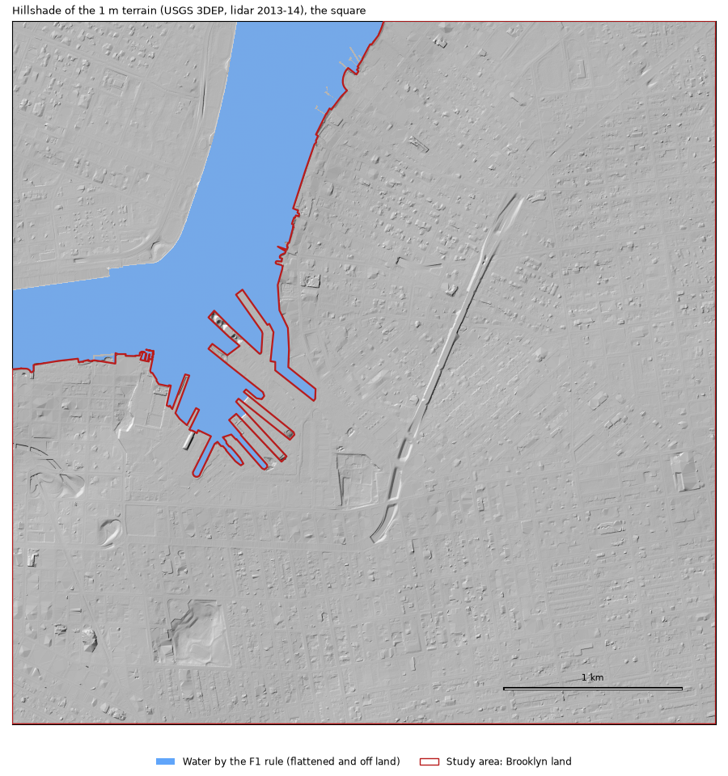
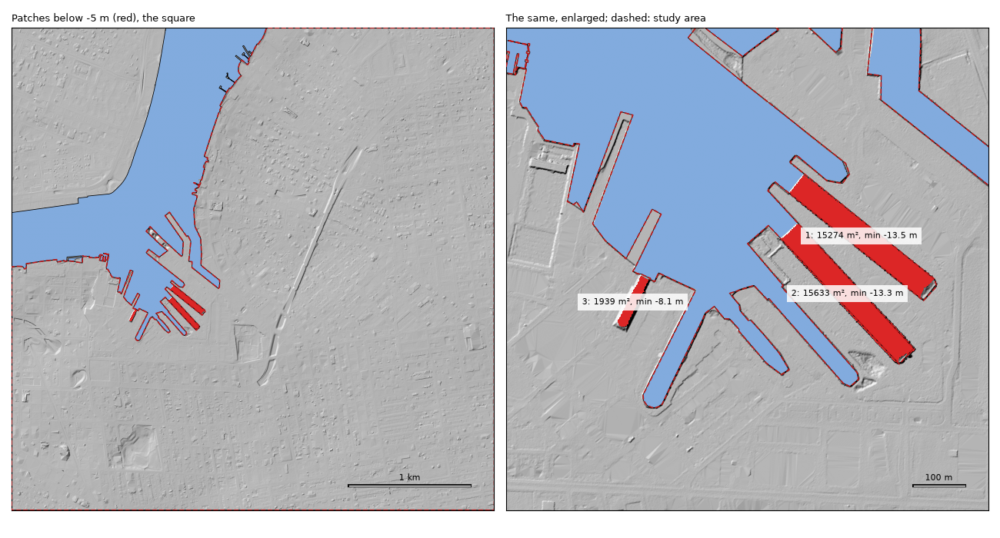
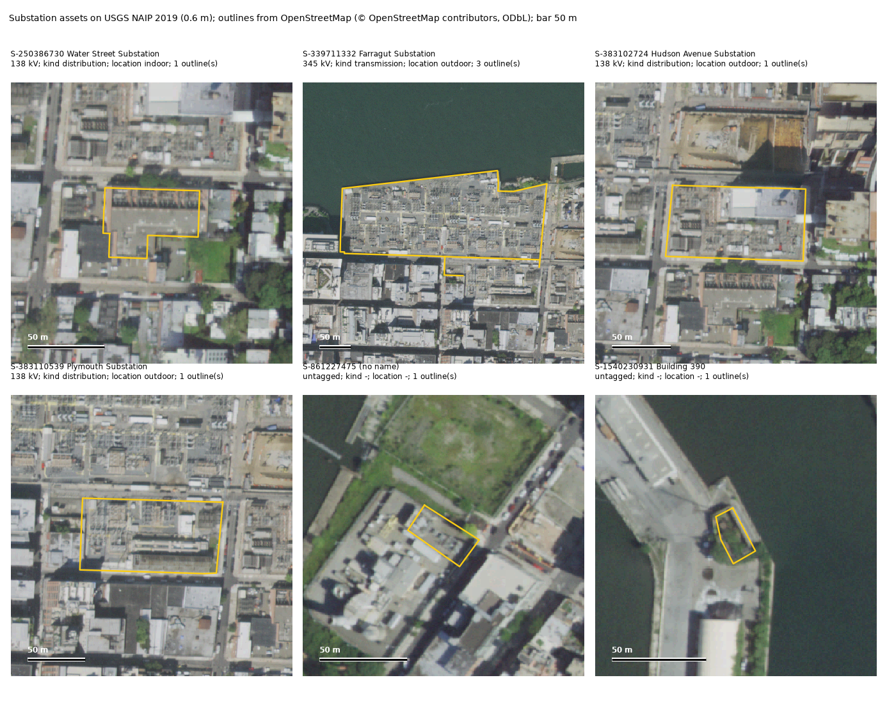
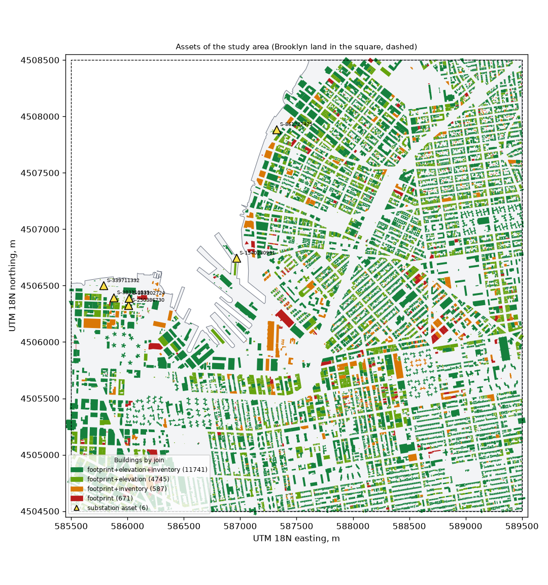
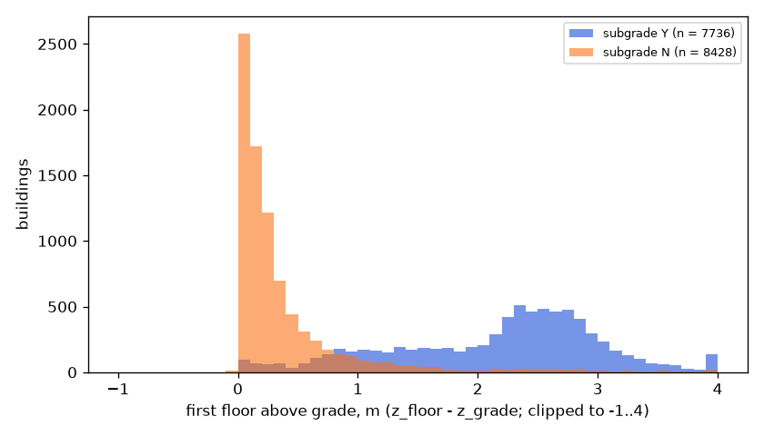

# F1. Terrain and assets

Date: 2026-11-25 · branch `flood/f1` · crc-sdk 1.0.0, crc-framework 1.0.0 · awaiting review

Stage F1 of `docs/flood/plan.md`, for the study area decided at the F0 stop: the Brooklyn land in the
4 km square centred at 40.7048 N, 73.9642 W (`src/flood_lab/domain.py`). Numbers below come from the
records `f1-terrain` and `f1-assets` under `site/flood/tests/records/`; the gallery shows the same records
with their figures.

## Result against the pass rule

| Rule (plan F1) | Result |
| --- | --- |
| Every asset has a ground elevation | **Passes.** 17,750 of 17,750 |
| At least 95% of footprints matched to the elevation table (*proposed*) | **Fails as written: 92.9%.** Of buildings proper it is 95.9%; the shortfall is 526 garages, which the city's table does not cover. Decision 1 below |
| Every substation has been looked at and the sheet is in the report | **A review is recorded for every substation**, by the coordinating model. A person has not yet looked, and the record shows that check as not judged. The sheet is below |

The terrain record passes all seven of its checks. The assets record is not passed: the match rate fails,
and the check that a person has looked at the substations is not judged.

## 1. Terrain (FD1, FD2)

*Hillshade of the 1 m terrain with the study area outlined. Limit: bare-earth terrain flown in 2013 and
2014; buildings are not in it, and anything built or regraded since is not shown.*

- **Source:** USGS 3DEP 1 m, project NY_CMPG_2013, flown 2013-08-06 to 2014-04-21, before both storms.
  NAVD88, metres. No pixel in the square lacks a value.
- **Study area:** 12.52 km², 78.3% of the square. Water is 11.4% of the square; the rest is Manhattan.
- **Elevation of the study area:** from −13.07 m to 31.37 m, mean 10.09 m.
- **Units and datum check out.** At 17,728 building footprints the terrain differs from the city's own
  ground elevation by a median of +0.04 m (5th to 95th percentile −0.45 to +0.75 m); 83.2% are within
  0.5 m. A wrong unit or vertical datum would show as a shift of metres.
- **Horizontal position carries about 1.1 m of datum offset.** The tile is in NAD83 and the project grid
  in WGS84. The software available treats the two as equal; the most accurate operation it knows gives
  1.10 m at the centre (0.40 m west, 1.02 m north), assuming the tile's NAD83 is the 2011 realisation,
  which its metadata does not say. The tile's own pixels were kept, with no resampling. A fifth of a 5 m
  cell; the record states it.
- **Water rule:** a pixel is water only if it sits exactly at the flattened level of −1.62 m and lies
  outside every neighbourhood outline. 18,151 flat pixels inside the outlines and 51,183 outside but not
  flat are left as land.
- **The 5 m grid** holds the mean, minimum and maximum of each cell's 25 pixels: 640,000 cells. For
  2,000 cells drawn at random the three values equal a recomputation from the 1 m terrain by another
  route (largest difference under a micrometre).
- **Sub-grid tables build on the real terrain** with HydroMT-SFINCS 2.0.0: 45 s, 1.06 GB peak memory,
  215 MB written. Their cell minimum is not exactly the minimum of the 25 pixels (98.2% of cells agree
  within 0.1 m; extremes −4.68 and +1.14 m): the builder samples the terrain at 0.5 m in a way that was
  not read. F3 should know this before trusting the tables in steep cells.

**Three pits at the Brooklyn Navy Yard.** The terrain has three patches more than 5 m below sea level,
two of them about 330 by 50 m with flat floors near −12.8 m, the third 107 by 22 m at −8 m and wholly on
study-area land. They sit in slips at the Navy Yard and no flattened-water pixel touches them. The
likeliest reading is dry docks that were drained when the lidar was flown; that is a guess from their
shape and place, not checked against any map. A flood model would pour water into them. F3 must decide
how to treat them (fill to the surrounding quay level, or leave and exclude from results).

*The three patches below −5 m. Limit: what they are is inferred from shape and location only.*

## 2. Substations (FD3, FD4)

Twelve OpenStreetMap substation outlines lie in the square. Four are rail traction substations and are
left out. The other eight make six assets, a named substation being one asset.

*Each substation asset on USGS NAIP imagery of 2019 (0.6 m) with its OpenStreetMap outline. Limit: one
date, six years old, and a picture from above cannot show whether equipment is live or what is inside a
building. Outlines © OpenStreetMap contributors.*

| Asset | Voltage | Kind | Indoor | Ground, m NAVD88 | Decision | Value low / mid / high |
| --- | --- | --- | --- | --- | --- | --- |
| Farragut | 345 kV | transmission | no | 3.19 | kept | $15.8M / $96.7M / $592M **[P]** |
| Hudson Avenue | 138 kV | distribution | no | 6.53 | kept | $9.1M / $58.8M / $380M **[P]** |
| Plymouth | 138 kV | distribution | no | 6.67 | kept | $9.1M / $58.8M / $380M **[P]** |
| Water Street | 138 kV | distribution | yes | 9.50 | kept | $9.1M / $58.8M / $380M **[P]** |
| (no name), Williamsburg waterfront | untagged | untagged | no | 4.33 | kept | none |
| Building 390, Navy Yard | untagged | abandoned | unknown | 2.08 | **removed** | none |

- **The four named substations are one place.** Farragut, Hudson Avenue, Plymouth and Water Street are
  Con Edison substations on adjoining blocks at the East River in Vinegar Hill: their centres are 62 to
  281 m apart (Water Street to Hudson Avenue 62 m; Water Street to Farragut 281 m). They would be
  affected by the same water. The substation case of this study is this one complex, not a spread of
  sites.
- **They stand on a slope to the river:** Water Street at 9.5 m, Hudson Avenue and Plymouth near 6.6 m,
  Farragut at 3.2 m on the bulkhead. Rain runs towards Farragut; the river is its other exposure, which
  this study does not model (coastal surge is out of scope).
- **The review** was done by the coordinating model on the contact sheet and on sharper New York State
  imagery of 2018 kept outside the repository (its licence was not read). What was seen is recorded per
  asset in `src/flood_lab/assets/substation_review.toml`. Building 390 was removed: a roofless ruin that
  OpenStreetMap itself tags as abandoned. The unnamed yard was kept: an open-air transformer yard beside
  a plant with stacks, which may serve that plant and not customers. **Yuri has not yet looked.**
- **Values are placeholders, and are kept out of the standard exposure column.** `BuildingTIV` is empty
  for the substations; the range and its tag are in the lab's own columns, so no export can carry the
  figure without its label. No public figure gives the replacement value of any of these. Each range
  is bracketed by a grid operator's estimate for a new outdoor substation of that voltage (MISO, 2024)
  and Con Edison's forecast for a new indoor New York City substation (2023 petition); the mid figure is
  their geometric mean. The range spans a factor of about forty.
- **Voltage** is the highest tagged: Plymouth and Water Street are 138/27 kV.
- **Customers served (FD7):** left empty. No public figure exists and none was invented. A placeholder
  would need population by block and a rule assigning blocks to substations; with four substations at one
  place such a rule would be arbitrary.

## 3. Buildings (FD5)

| | Count |
| --- | --- |
| Footprints in the fetched box | 22,960 |
| Buildings with their centre on the study area | 17,744 |
| With a row in the city's elevation table | 16,486 (92.9%) |
| With a structure-inventory point | 12,328 (69.5%) |
| With both | 11,741 |
| With neither | 671 |

- **Elevation table.** Matched by the city's building number, one to one. Of the 1,258 unmatched, 525 are
  garages and 301 were built in 2020 or later (238 after the table's 2022 survey). Among buildings proper
  the match is 95.9%; among those built before 2021 it is 97.3%.
- **Ground elevation** comes from the table for 16,164 buildings (4,893 of them marked by the city as
  estimated) and from the terrain for 1,580 (no row, or a zero meaning not measured).
- **Table against terrain:** median −0.08 m over 16,164 buildings (5th to 95th percentile −1.07 to
  +1.09 m). For the grades the city marks as estimated the median is −0.35 m.
- **First floor above grade:** median 2.34 m where the city flags space below grade, 0.19 m where it does
  not. A third of a metre of water at the door means something different for these two groups, which is
  what FR3's basement variant is for.
- **Structure inventory.** It has no building number, so it is joined by position: 14,455 points fall in a
  footprint, 3,119 go to the nearest footprint within 15 m, 86 stay unmatched. The inventory divides one
  building's value over several records, so a building's value is the sum of its records: $48.4 billion
  in all. 2,480 buildings hold several records. For 1,923 of them the inventory itself ties the records
  to one footprint ($23.9 billion summed); for 557 the tie is our attribution by position ($7.5 billion
  summed, against $5.0 billion if only the largest record were taken), which is the part of the total
  that rests on a judgement. Every occupancy class among a building's records is kept. These are the
  inventory's modelled, depreciated values at August 2025 prices.
- **5,416 buildings have no value** (no inventory point). No loss can be computed for them until a value
  is assigned, and none was invented.
- The inventory's own foundation heights take only four values and are not used; first-floor heights come
  from the city's table.
- **Not measured stays empty.** For 322 buildings the city's table has a zero grade, meaning not
  measured; their ground elevation is from the terrain and their subgrade flag is left empty. Where the
  city marks a grade as estimated it does not say whether the grade or the floor was estimated, so the
  first-floor height of those 4,893 buildings carries the same doubt.

*Buildings coloured by which joins succeeded, substations marked. Limit: it shows the joins, not exposure
to flooding.*

*First-floor height above grade from the city's table, by the subgrade flag. Limit: about a third of the
grades are the city's estimates.*

## 4. The asset table (FD6)

`site/flood/data/assets_oed.csv`: 17,750 rows (6 substations, 17,744 buildings), described in
`docs/flood/assets-table.md`. The sixteen Open Exposure Data column names were checked against the
specification, version 5.0.0, and all exist. Codes used: peril OSF (flash, surface or pluvial flood),
first-floor height unit 2 (metres), occupancy 1300 for substations. Building occupancy and construction
codes are empty: no mapping from the inventory's classes was read.

## Decisions for Yuri

1. **The 95% rule.** Proposed: apply it to buildings proper (95.9%, passes) and state that garages are
   outside the elevation table. Or keep the rule as written and accept a fail. Or drop the 526 garages
   from the asset table, since they carry no value and no first-floor height.
2. **Look at the contact sheet** and say whether the two judgement calls stand: Building 390 removed, the
   unnamed transformer yard kept.
3. **The substation case is one complex.** Accept it as the study's substation case, with buildings
   carrying most of the loss figures; or revisit the area. I recommend accepting it: the complex is a
   major one and the evidence of flooding is in this area.
4. **Substation values.** Is a placeholder range bracketed by the two published figures acceptable for
   the first public version (this is question 4 of the requirements)?
5. **Buildings with no value (5,416).** Leave them without a loss and say so; or assign a placeholder from
   footprint area and the inventory's values per square metre for the same occupancy, marked [P].
   Recommended: leave empty for now and decide at F6, when it is known how many of them get wet.
6. **Inventory records attributed by position.** 557 buildings get a summed value from records that the
   inventory does not itself tie to one footprint ($7.5 billion against $5.0 billion by the largest
   record). Recommended: keep the sum and show the split, as now.
7. **Changes to the requirements (CH-5):** a named substation is one asset; a building's value is the
   sum of its inventory records; no placeholder in a standard exposure column. Accept or change.
8. **The Navy Yard pits** (for F3): fill them to quay level in the model, or leave them and exclude them
   from results.

## What was not done

- No person has looked at the substations yet.
- Customers served per substation is empty.
- What the three pits are was not checked against a map.
- How the solver's builder derives its sub-grid minimum was not read.
- The terrain facts file still describes the datum offset as "about a metre at most"; the measured 1.10 m
  is in the terrain record.
- Licences of the city's lidar and of New York State's imagery were not read; neither is used in a
  committed product.
- MISO's 2026 cost tables could not be opened; the 2024 edition was used.
- Building occupancy and construction class in Open Exposure Data codes.

## Review before the stop

One fresh Opus agent reviewed the whole stage diff without being told what to expect, and recomputed the
main numbers itself. It found them sound: terrain sampled at 200 buildings agrees with its own read of
the terrain and of the source tile to 0.07 mm; building centres to under a millimetre; the elevation-table
join and the feet-to-metres conversion for 50 buildings with no mismatch; the study area 12.5215 km²; the
substation centres, value ranges and totals; 20 cells of the 5 m grid.

It reported nine issues, all fixed before this report except where noted:

- **Building values were understated by $7.2 billion.** Only the largest inventory record per building
  was kept, by the coordinator's own instruction, although the inventory's publisher says it divides one
  building's value over several records. Now summed, with the occupancy classes kept.
- The assets record did not list the terrain it depends on. Now listed with its checksum.
- The asset build clipped to its own copy of the study area. Now it uses the committed outline; the
  building count is unchanged.
- The review file said a person had filled it. It now says who looked, and a separate check records
  that no person has yet.
- A substation's placeholder value sat in the standard exposure column. Now empty there.
- The subgrade flag was filled with "N" where nothing was measured. Now empty.
- The grouping rule in the requirements did not match the code. The requirement is reworded (CH-5) and
  the record states the rule and the distances.
- Two checks could not fail. One is relabelled for what it can catch and a recomputation by another
  route was added; the other says so in its note.
- **Not fixed:** several facts with no claim in the requirements are labelled "confirmed" on the data
  cards, which blurs "the requirement's claim was confirmed" with "this was read from the source". It
  affects F0's cards too and needs a change to the outcome wording; proposed for F2.

## Checks

`just test`: 363 passed, 3 skipped; parked count unchanged (8 test files and 3 tests). `just lint` clean.
`just site-flood` passes: 6 records, 32 sources.

## Models and tokens

| Task | Model | Tokens |
| --- | --- | --- |
| Coordination, the grid and asset-table contracts, value ranges, substation review, fact verdicts, this report | main session (Fable 5.2) | not visible to the session |
| Fetch and facts: terrain tile, imagery sources | Sonnet | 151,186 |
| Fetch and facts: footprints, elevation table, structure inventory, cost sources | Sonnet | 176,575 |
| Terrain, grid, sub-grid tables, their checks | Opus | 200,172 |
| Substations, contact sheet, buildings, asset table (it used one Sonnet lookup for the OED specification, 60,836 tokens by its own report) | Opus | 220,112 |
| Blind review of the stage | Opus | 174,579 |
| Fixes from the review | Opus | 170,750 |
| **Agents in total** | 2 Sonnet, 4 Opus | **1,093,374** (Sonnet 327,761; Opus 765,613) |
