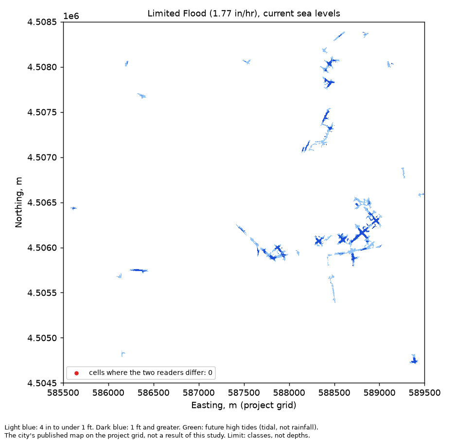
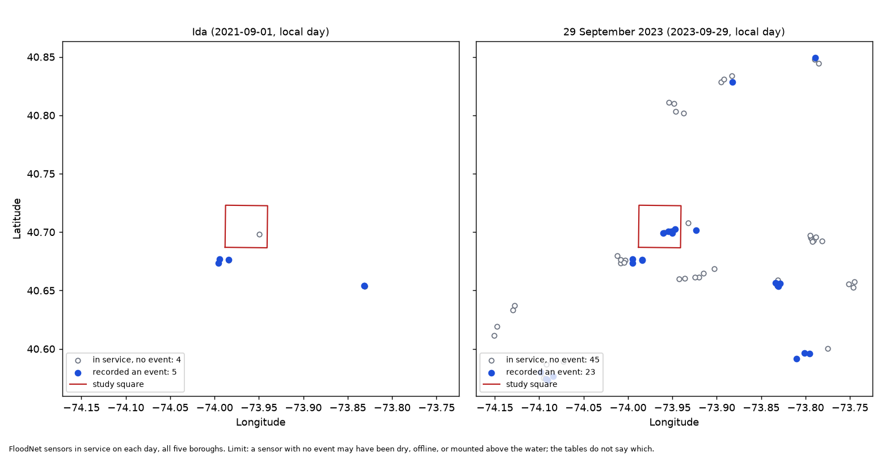
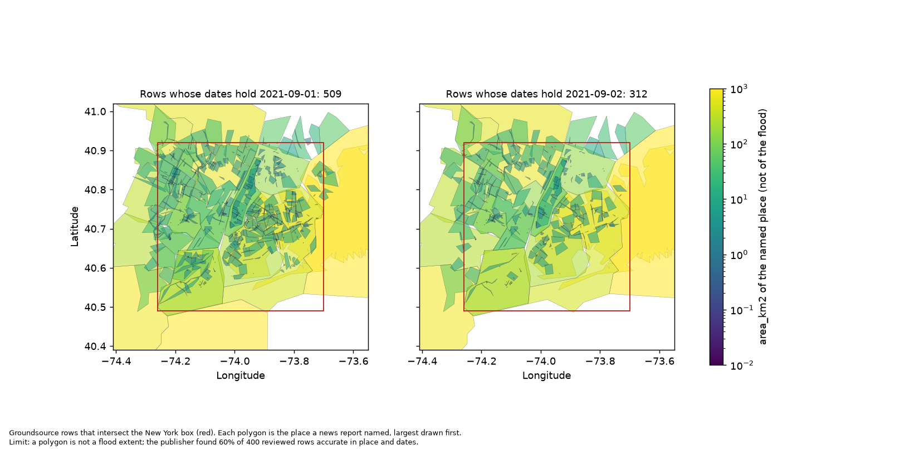
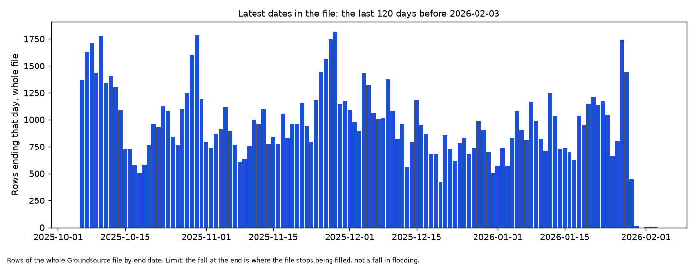

# F2. Sources: what goes into CRC and what does not

Date: 2026-11-25 · branch `flood/f2` · crc-sdk 1.0.0, crc-framework 1.0.0 · reviewed 2026-11-25, decisions at the end

Stage F2 of `docs/flood/plan.md`. It reads the three sources that are the lab's own (the city's
stormwater flood maps, FloodNet, Groundsource), checks each loader against a second reader written
without sight of it, and puts into CRC what CRC 1.0.0 can hold. Numbers below come from the records
`second-reader-*.json` and `f2-primer.json` under `site/flood/tests/records/`; the gallery shows the same
records with their figures (`just serve`, then `/flood/tests/`).

## Result against the pass rule

| Rule (plan F2) | Result |
| --- | --- |
| Zero differing cells and rows between loader and second reader | **Passes.** 0 of 640,000 cells in each of four flood-map scenarios; 0 of 3,611 FloodNet events; 0 of 6,785 Groundsource rows |
| A shifted polygon and a dropped row are both caught | **Passes.** Every deliberate fault is reported as a difference, a 2 m shift included |
| What was loaded into CRC reads back equal to what was put in | **Passes.** 3,231 flood-map polygons and 3,611 FloodNet events |
| The primer's script runs offline | **Passes** |

All four records pass (42 checks).

## 1. The Limited Flood map is read

F0 could not open the Limited Flood map (1.77 in/hr), which the city stores in ESRI's compressed format.
It is now read through ESRI's own File Geodatabase library, as decided at the F0 stop.

- **Terms, read first.** ESRI's repository and the `license/` folder of the download give the Apache
  License 2.0. A second file there covers ESRI's sample code only. Nothing asks for an ArcGIS licence or
  limits what is done with data read through the library. The library is kept in the cache and never
  committed.
- **Route.** A short program (`tools/flood/limited_flood_map/dump_gdb.cpp`) asks the library for each
  row's class and vertices; `export.py` assembles the rings into polygons and writes a GeoPackage in the
  cache, with a provenance file beside it.
- **Proof.** The same route on the uncompressed Moderate map gives the same two rows as GDAL's open
  reader: area per class equal to 15 digits, and no area in one reading that is not in the other.
- **Content.** Two rows, classes 1 and 2, EPSG:2263. Citywide: 39.0 million sq ft in the shallow class
  and 20.7 million in the deep class, about half of the Moderate map's 78.1 and 40.1 million.
- **Who ran it.** Yuri. The session's permission system refused to let the agent start a second agent
  for this task and then refused to let it run the compiled program. Both refusals were respected; the
  agent wrote the code and Yuri ran `uv run python tools/flood/limited_flood_map/export.py`.

**Curved segments: read, and they do not matter here.** ESRI can store an arc between two vertices,
and the export takes vertices only, so an arc becomes a straight line. Yuri's second run of the export
(2026-11-25 23:33 GMT) read the raw shapes:

| Row | ESRI's curve flag | Curved segments | Area stored by ESRI, sq ft | Area of the vertices, sq ft | Relative difference |
| --- | --- | ---: | ---: | ---: | ---: |
| Limited, class 1 | set | 1 | 39,019,037.80 | 39,019,066.34 | 7.3e-7 |
| Limited, class 2 | not set | 0 | 20,705,858.70 | 20,705,858.70 | 6e-15 |
| Moderate, class 1 | set | 0 | 78,077,947.64 | 78,077,947.64 | 6e-15 |
| Moderate, class 2 | set | 0 | 40,126,224.83 | 40,126,224.83 | 1e-15 |

The Limited map has one curved segment among 262,310 points. Its ends are 14.1 ft apart, it lies about
15 km south-west of the study square, and reading it as a straight line changes the citywide class-1
area by 28.5 sq ft. Inside the square the export is the publisher's geometry exactly. The curve flag
alone says nothing: it is set on both Moderate rows, which hold no curved segment.

So FH3 can calibrate on two maps (Limited and Moderate, both at current sea level), which was the point.
A re-export by the city would still repair the file for everyone; the email is on Yuri's list.

## 2. City flood maps (FS1)

`src/flood_lab/sources/nyc_flood_maps.py`; record `second-reader-nyc-stormwater-flood-maps`.

Depth classes on the 800 by 800 project grid (5 m cells, the whole 4 km square, water and Manhattan
included). A cell takes the class its centre lies in.

| Scenario | Cells 4 in to 1 ft | Cells 1 ft and over | Tidal cells | Area, ha (shallow / deep / tidal) | Polygons in CRC |
| --- | ---: | ---: | ---: | --- | ---: |
| Limited (1.77 in/hr), current sea level | 4,417 | 2,424 | 0 | 10.99 / 6.08 / – | 314 |
| Moderate (2.13 in/hr), current sea level | 8,393 | 5,081 | 0 | 20.95 / 12.74 / – | 547 |
| Moderate (2.13 in/hr), 2050 sea level | 8,904 | 6,355 | 4,008 | 22.19 / 15.95 / 10.10 | 680 |
| Extreme (3.66 in/hr), 2080 sea level | 24,620 | 26,960 | 4,925 | 61.54 / 67.48 / 12.38 | 1,690 |

*The city's Limited Flood map on the project grid, with the cells where the two readers differ (none).
Limit: the city's published classes, not depths and not a result of this study.*

- **The third code is kept apart.** "Future high tides" in the two sea-level-rise scenarios is tidal
  flooding, not a rainfall depth. It is a mask of its own and never enters a depth class. No cell is
  both tidal and in a depth class.
- **Into CRC** as a map layer (`Layer.from_table`), polygons cut to the square, one row per polygon, the
  class code as the value and its meaning as the label. Every polygon, value and label reads back equal.
  They are not loaded as curves: a depth class is not a probability curve.
- **Rasters committed** for F3: `site/flood/data/city_flood_maps/*.tif` (six files, 76 kB).
- **Positions carry the terrain's convention.** The maps are moved from the city's grid to NAD83 UTM
  and read as project-grid coordinates, as the terrain was in F1. Maps and terrain therefore stay
  aligned with each other; both sit about 1.1 m from true WGS84 positions.

## 3. FloodNet (FS3)

`src/flood_lab/sources/floodnet.py`; records `second-reader-floodnet-flood-events` and
`second-reader-floodnet-sensors`.

- **Table.** 3,611 events at 322 sensors, 2020-11-16 to 2026-11-09: sensor, start and end in GMT, New
  York day, peak depth in metres, duration, position. Committed as `site/flood/data/floodnet_events.csv`.
- **The clock matters.** For 824 events the New York day is not the GMT date. Ida's five events start
  between 00:11 and 02:03 GMT on 2 September, which is the evening of 1 September in New York.
- **Into CRC** as observations (`Observations.from_table`): the sensor is support and station, the start
  is the time, the peak depth the value. All 3,611 read back equal. Duration and end time have no place
  in an observation and stay in the lab's table.
- **The publisher's own columns disagree in places.** In 52 events the largest value of the depth
  profile differs from the peak-depth column by more than 0.006 in; in 9 of them by more than an inch,
  the largest by 14.3 in. Both readers take the peak-depth column, as the statement says. F5 compares
  model depths with these, so it should know. In 7 events the duration differs from end minus start by
  0.02 minutes, which looks like rounding.

| Local day | Sensors in service, city | With an event | In service, Brooklyn and Queens | With an event | In service, study square | With an event |
| --- | ---: | ---: | ---: | ---: | ---: | ---: |
| 2021-09-01 (Ida) | 9 | 5 | 9 | 5 | 1 | 0 |
| 2023-09-29 | 68 | 23 | 44 | 17 | 7 | 5 |

*Sensors in service on each storm day and whether each recorded an event. Limit: a sensor with no event
may have been dry, offline or mounted above the water.*

The counts for Brooklyn and Queens are F0's. The square's are new: on 29 September 2023 five of seven
sensors recorded water, up to 0.64 m; at Ida the one sensor in the square recorded nothing.

## 4. Groundsource (FS2)

`src/flood_lab/sources/groundsource.py`; record `second-reader-groundsource`.

- **Table of dated places**, not loaded into CRC: 5,772 rows whose polygon touches the New York box and
  1,013 for the Alameda County box, out of 2,646,302 in the file. Kept in the cache
  (`f2/groundsource_places.parquet`); the file's md5 equals the publisher's and is checked before
  reading.
- **Rows by day, New York box:** 509 hold 2021-09-01 (468 with their centre in the box), 312 hold
  2021-09-02, 264 hold 2023-09-29. Alameda has none on those days. These equal F0's counts.
- **`area_km2` is the named place, not the flood.** The median place in the New York box is 2.2 km²; 27%
  of rows name a place larger than the study area.
- **The metadata fault** that stops DuckDB is a mis-spelt key (`geometry_type` for `geometry_types`). The
  loader reads the five documented columns with pyarrow and ignores the metadata; the second reader uses
  DuckDB with its GeoParquet conversion switched off. Neither alters the publisher's file.

*Rows whose dates hold 1 and 2 September 2021, coloured by the size of the named place. Limit: each
polygon is a place a news report named, not a flood extent.*

*Rows by end date over the file's last 120 days. Limit: the fall at the end is where the file stops being
filled.*

## 5. What CRC 1.0.0 held and what it did not

| Source | What the lab has | Held by CRC 1.0.0 | Not held |
| --- | --- | --- | --- |
| City flood maps | Polygons with a class code, per scenario | `Layer.from_table`: geometry, a numeric value, a label. Read back equal | The class as a category: the code is stored as a dimensionless number, because none of the built-in measurements is a category (a custom measurement was not tried). The scenario's rainfall and sea level are in the variable's name only |
| FloodNet | One row per sensor and event | `Observations.from_table`: station, time, value, position. Read back equal | Duration and end time of an event; the fact that a sensor was in service and recorded nothing |
| Groundsource | A date range and a polygon per row | Nothing | The whole record |

**What a CRC type for dated polygons would need**, from this stage's use of Groundsource:

1. A geometry with a **start and an end date**, not one time stamp.
2. A statement of **what the geometry is**: the extent of the thing observed, or the place it was reported
   for. For Groundsource it is the second, and reading it as the first is the main way to misuse it.
3. **No value required.** A row asserts that something happened; it has no magnitude.
4. Provenance per row (the report it came from) and a place for the publisher's stated accuracy.
5. Queries by "which records touch this asset or cell on this day", with the choice between polygon
   and centroid left to the caller.

A layer with a time range would cover points 1 and 3. This is a note for the design discussion with
RiskThinking, not a finding.

**Candidate findings (FG9): none entered.** Every CRC call behaved as F0 read it. One detail worth
knowing: an observation's `station_id` is empty unless a station column is named explicitly, even when
`support_id` is the sensor. The blind review caught that the first version of the loader left it empty.

## 6. Second readers: how independent they are

The second readers (`src/flood_lab/reference/`) were written by an Opus agent that was given the
publishers' files and a contract of what to return, and was not shown the loaders.

| Source | Loader's route | Second reader's route |
| --- | --- | --- |
| Flood maps | GDAL's rasteriser | A point-in-polygon test of every cell centre with shapely |
| FloodNet | pandas, the zone database through pandas | The standard library's `csv`, `datetime`, `zoneinfo` |
| Groundsource | pyarrow | DuckDB |

What the two share, and so cannot check in each other:

- Both open the city's geodatabases with the same GDAL driver, the only open reader of the format.
- For the Limited map both open the same export. The second reader recomputes only the step from the
  export to the grid; the step from the city's file to the export rests on the proof of section 1.
- Both use the same grid frame, the same boxes and the same rule for "in service". These are the
  contract. An error in the contract is shared.

The reviewer of the stage added a third reading by routes of its own (GDAL's command line and an
even-odd ring test with no shapely or rasterio; a hand-written clock rule with no zone database) and
matched all 640,000 cells of all four scenarios, all 3,611 events and the Groundsource counts.

## 7. Primer and data cards

- **Primer** `docs/primers/point-observations.md` (FS5), with its script
  (`python -m flood_lab.checks.f2_primer`, record `f2-primer`) and three figures. It is linked from the
  older primer. Its main table puts one question to both sources for the study square: on the day of Ida
  the one sensor recorded nothing while 16 reports named places of 16 km² or less in or around it; on 29
  September 2023 five of seven sensors and 22 such reports; on an ordinary day chosen in advance, none.
- **Transformation statements** are on the four data cards, taken from each loader's own docstring so
  the card cannot drift from the code.
- **Wording fix carried over from F1.** A fact the requirements made no claim about now reads "read, no
  claim", not "confirmed", on the cards and in the gallery, and the level line counts them apart: for
  example "facts confirmed (8 read with no claim)".
- **Levels (FS7).** The four sources now read "values recomputed by a second reader in F2 (passed)".
  Nothing was added to the validation inventory: these are the lab's sources, not crc-sdk's.

## Decisions for Yuri

1. **Run the export once more** (`uv run python tools/flood/limited_flood_map/export.py`) so the curve
   question of section 1 is settled by a reading. If it shows curved segments in the study square, the
   remedy is to turn each arc into short straight pieces before the grid; a few lines.
2. **Accept the Limited map as read through ESRI's library** for F3's calibration, with the city's
   re-export still requested. Recommended.
3. **FloodNet peak depth.** Keep the publisher's peak-depth column (as now), or take the largest value of
   the depth profile, for the 52 events where they differ. Recommended: keep the column and flag those
   events, and let F5 look at the nine large ones if any falls on a storm day in the square.
4. **Groundsource table.** Keep it in the cache until the page needs it (as now), or commit the 6,785 rows.
   Its licence (CC BY 4.0) allows either.
5. **Second reader of the Limited map.** Accept that it covers only the step from the export to the grid,
   stated on the record; or wait for the city's file. Recommended: accept.
6. **Merge `flood/f2` into `main`.**

## Decisions taken at the stop (2026-11-25)

Yuri ran the export again and agreed with decisions 2 to 6 (change CH-7 in `docs/flood/changes.md`).

| # | Decision |
| --- | --- |
| 1 | Export rerun by Yuri: one curved segment, outside the study square; section 1 has the reading |
| 2 | The Limited map as read through ESRI's library is accepted for F3's calibration. The email to the city for a re-export stays on Yuri's list |
| 3 | FloodNet peak depth stays the publisher's column; the 52 events where the profile disagrees are flagged for F5 |
| 4 | The Groundsource table stays in the cache until the page needs it |
| 5 | The Limited map's second reader covers the step from the export to the grid; accepted, and stated on the record |
| 6 | `flood/f2` merged into `main`; requirements version 5 |

## Open changes (D16)

`docs/flood/changes.md` had no open row at the stop. Two changes from this stage were accepted as CH-7:

- FS1: the Limited Flood map is read from an export made through ESRI's File Geodatabase library, with its
  proof; section 14's row "open until a route is found" is closed.
- FS3: in CRC the sensor is both support and station; the lab's table, not CRC, holds duration.

## What was not done

- No sensitivity of the class rasters to the 1.1 m frame question; a 2 m shift changes 1,520 to 9,366
  cells per scenario, which shows the comparison would notice one, not which frame is right.
- The storm duration behind the map intensities is still not known (F3 assumes one hour, tagged).
- The second readers' real-file tests and the loaders' tests use small constructed files; no test covers
  `export.py` beyond its ring assembly.
- `pyogrio`, `shapely` and `duckdb` reach the environment through other packages (an extra, and crc-sdk),
  not as direct dependencies of the lab. `pyproject.toml` was left as it is.
- Facts that need a person (F0, section 2) are unchanged. No person has yet looked at the substation
  contact sheet.

## Review before the stop

One fresh Opus agent reviewed the stage's diff without being told what to expect and recomputed the
main numbers itself (section 6). It found no wrong count. It reported ten defects, all fixed:

- The Limited export's curve report had been written but never run, and a note named the wrong row as
  the only one flagged. The note is corrected and section 1 says what is and is not known.
- The tool's README still said the export had not been run.
- The record said both readers open the city's geodatabase, which is not so for the Limited map.
- The primer said the ten places centred outside the square were all large ones; six are small
  neighbours. Corrected, with the counts now in the record.
- The loader said the sensor was the station in CRC and did not pass it. Now passed and checked.
- The Groundsource checksum was taken after loading, and the flood-map zip's checksum was never
  compared. Both are now checked first and stop the run on a mismatch.
- The study area's size was typed in the primer script. It is read from the F1 record.
- The level line still counted "read, no claim" as confirmed.

Also taken from its doubts: a 2 m shift added to the deliberate faults; a hole in the export is now given
to the ring that holds a point of its inside, not one that only touches it; one test renamed to say what
it tests; tests added for the new wording, the statements and the ring assembly.

## Checks

`just test`: 421 passed, 3 skipped; parked count unchanged (8 test files and 3 tests). `just lint` clean.
`just site-flood` passes: 11 records, 32 sources. Free disk 28 GiB; the flood cache holds 3.0 GB.

## Models and tokens

| Task | Model | Tokens |
| --- | --- | --- |
| Coordination, contracts, the three loaders and their CRC loads, the check script, the export tool, comparison verdicts, the primer, fixes from the review, this report | main session (Fable 5.2) | not visible to the session |
| ESRI's terms, library versions and platforms | Sonnet | 62,283 |
| Second readers and their tests, without sight of the loaders | Opus | 171,155 |
| Blind review of the stage | Opus | 227,925 |
| **Agents in total** | 1 Sonnet, 2 Opus | **461,363** (Sonnet 62,283; Opus 399,080) |

The attempt on the Limited map was meant for an Opus agent; its launch was refused, so the main session
wrote it. The fixes from the review were made by the main session, not an agent.
