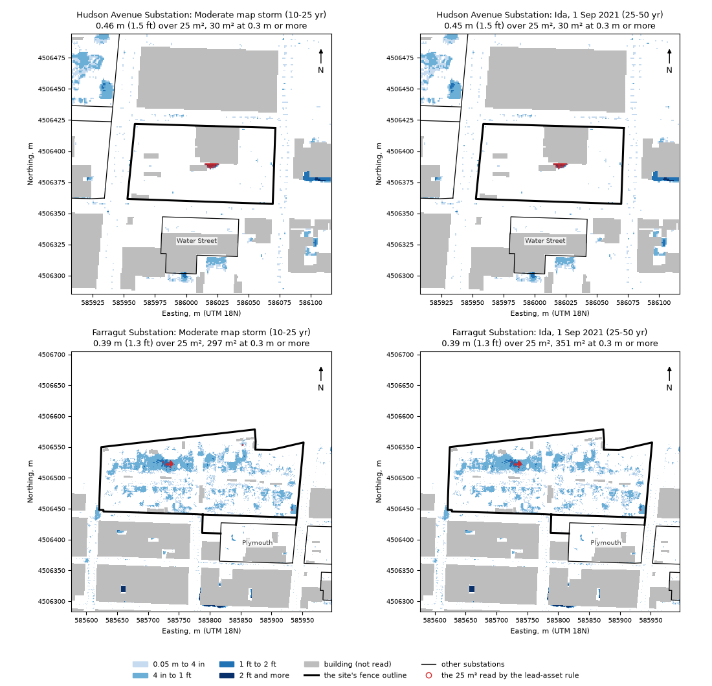
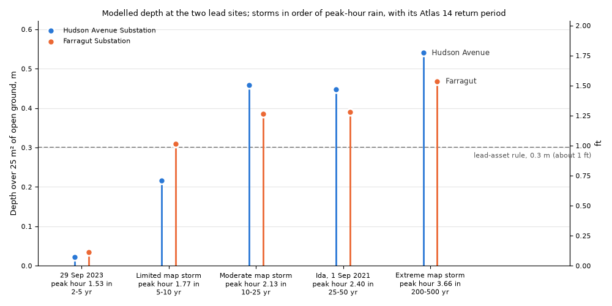

# F3 follow-up: the two lead substation sites

Asked for by Yuri on 2026-11-26 when he kept both Hudson Avenue (the lead asset by the rule) and
Farragut: maps of the two sites, the asset details, depths and return periods. Branch
`flood/f3-asset-maps`, from `main` after the F3 merge. Built by `just flood-f3-sites`; every number
here is in the record `site/flood/tests/records/f3-sites.json` (gallery, "F3"). No new solver run:
the five frozen F3 runs at 30 mm/h are read.

## The assets

| | Hudson Avenue | Farragut |
| --- | --- | --- |
| OpenStreetMap | way/383102724, one outline | way/339711332 and two fence lines (383110529, 383110530) |
| Kind, voltage | distribution, 138 kV | transmission, 345 kV |
| Fenced area (closed outlines) | 6,994 m² | 38,862 m² |
| Ground at the asset point, NAVD88 | 6.53 m (21.4 ft), terrain | 3.19 m (10.5 ft), terrain |
| Seen from above (model's review, 2026-11-25) | Open-air equipment on three sides of one building; outdoor | Open-air switchyard on the East River bulkhead; outdoor |
| Value, low / mid / high **[P]** | $9.1 M / $58.8 M / $380 M | $15.8 M / $96.7 M / $592 M |
| Customers served | not public (FD7) | not public (FD7) |
| Equipment heights above grade | not known; none assumed | not known; none assumed |

The two sites are about 250 m apart, with Water Street and Plymouth between them; the four are one
complex. Values are the asset table's placeholders, bracketed by two published figures for other
substations.

## Depth and return period

Depth over 25 m² of open ground inside the outlines (the lead-asset rule's reading), in metres and
feet. Return period: the storm's peak hour on NOAA Atlas 14 (partial-duration series, 60-minute row),
named by the two tabulated columns it falls between.

| Storm | Peak hour | Return period of the peak hour | Hudson Avenue | Farragut |
| --- | ---: | --- | --- | --- |
| 29 Sep 2023 (replay) | 1.53 in | 2-5 yr | 0.02 m (0.07 ft) | 0.03 m (0.11 ft) |
| Limited map storm, 1 h | 1.77 in | 5-10 yr | 0.22 m (0.71 ft) | 0.31 m (1.01 ft) |
| Moderate map storm, 1 h | 2.13 in | 10-25 yr | 0.46 m (1.50 ft) | 0.39 m (1.27 ft) |
| Ida, 1 Sep 2021 (replay) | 2.40 in | 25-50 yr | 0.45 m (1.47 ft) | 0.39 m (1.28 ft) |
| Extreme map storm, 1 h | 3.66 in | 200-500 yr | 0.54 m (1.77 ft) | 0.47 m (1.53 ft) |

Area at 0.3 m or more: Hudson Avenue 20 to 31 m² in every storm from Limited up, a single pocket
beside its building. Farragut 31 m² (Limited), 297 (Moderate), 351 (Ida) and 917 (Extreme), spread
along the yard. Peak water level on the 25 m² read: Hudson Avenue 6.5 to 6.9 m NAVD88, Farragut 3.0
to 3.2 m.

The replays over longer windows: Ida's wettest 2 and 3 hours both fall between 100 and 200 years;
29 September 2023's between 5 and 10 years (2 hours) and 10 and 25 years (3 hours). Ida's depth at
both sites is about the Moderate storm's although its peak hour is rarer. At Hudson Avenue the water
on the 25 m² stands at 6.78 m in both storms, which suggests the pocket fills to the level where it
spills; that was not checked.

Checks in the record: depth rises from Limited to Moderate to Extreme at both sites (within 1 mm);
both sites meet the 0.3 m rule in Ida (informational).

## Limits

- A storm's return period is not the return period of the depth it causes. The depth-frequency
  curve per site comes from the catalogue in F4.
- Atlas 14 is a point estimate at one service point (40.7048 N, 73.9642 W); the radar rain is the
  mean over the 4 km square.
- The Atlas 14 table fetched in F3 stops at 3 hours, so whole-storm totals (Ida 146 mm in 17 h;
  29 September 132 mm in 29 h) are not placed.
- Depth is a 5 m solver's level less the 1 m terrain of 2013-2014, with one drainage allowance
  **[P]**. Without equipment heights, depth cannot yet be read as damage.
