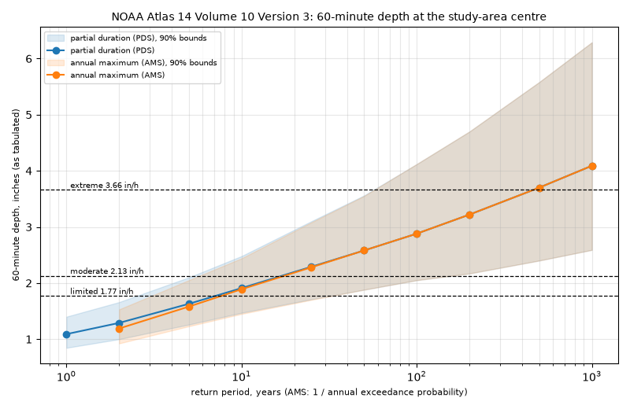

# F3. Solver model, drainage calibration: stopped before the freeze

Date: 2026-11-25 · branch `flood/f3` · crc-sdk 1.0.0, crc-framework 1.0.0 · SFINCS v2.5.0, HydroMT-SFINCS 2.0.0
· **stopped: a pass rule fails (FH8, monotonicity); decisions below**

Stage F3 of `docs/flood/plan.md`. The model of the square is built on the real terrain and calibrated against
the city's two current-sea-level flood maps. The stage stopped before the freeze and before the two storm
replays, because the monotonicity check of FH8 fails ("A stage", step 5: a pass rule fails, stop and report).
The failure is diagnosed below. It is a property of the solver's momentum term at the rims of ponds, not a
defect of the build, and it has a one-line remedy that Yuri decides. Numbers come from the record `f3-model`
(`site/flood/tests/records/f3-model.json`); the gallery shows it with its figures.

## Result against the pass rule

| Rule (plan F3, FH8) | Result |
| --- | --- |
| Water balance within 1% in every run | **Passes.** 14 of 14 runs; the largest residual is 0.017% of the rain |
| CSI of 0.5 or better against the two calibration maps (*proposed*) | **Fails.** 0.285 (Limited) and 0.391 (Moderate) at the proposed allowance. The plan's next step, one value per sewer district, could not be tried: no official district layer exists (section 4). The plan says to report the mismatch and continue with the best fit |
| Monotonicity (FH8): at lower rain no cell deeper by more than 1 mm, and no cell wet to 0.05 m deeper at all | **Fails.** Limited against Moderate at 30 mm/h: 71 compared cells deeper by more than 1 mm, 148 wet cells deeper at all, at most 11.8 mm. The same at every allowance tried. **This is what stopped the stage** |
| The calibration value is frozen before any validation | **Not done.** 30 mm/h is proposed, not frozen (`src/flood_lab/hazard/allowance.toml` says so) |
| The two replays | **Not run.** The radar rainfall for both storms is downloaded and turned into solver forcing; the runs wait for Yuri's word |

## 1. The model (FH2)

`src/flood_lab/hazard/sfincs_model.py`; record of the build `data/cache/flood/f3/model/base/base.json`.
Every choice is a placeholder **[P]** and is listed in the record.

- **Grid and terrain:** the whole 4 km square, 640,000 cells of 5 m, all active; sub-grid tables from the
  1 m USGS terrain of F1 (10 levels, 0.5 m pixels). Built in 53 s, 1.26 GB peak memory.
- **Navy Yard pits (F1's open item): filled.** The two dry docks (lowest −13.5 m and −13.3 m) are filled
  to the median level of a ring around them, 1.80 m: 16,368 and 16,463 pixels. The third patch (lowest
  −8.1 m) is filled to its ring's median, −1.02 m. That is below the start water level, so the patch
  holds water like the slips beside it. Walls are filled only where they lie below datum and within
  15 m of the pit, so the quays keep their height. A first version grew each fill over all connected low
  ground and raised about 0.19 km² of quay; it was caught and corrected before any run counted. The
  pits' cells are left out of every comparison.
- **Buildings:** the city's 22,960 footprints in the fetched box are raised 5 m as obstacles.
  Rain on a roof stays there until the allowance drains it, as a roof drain feeds the sewer.
- **Water:** F1's water pixels are ordinary terrain, below the boundary level, so the river is full at
  the start (`zsini` 0 m NAVD88).
- **Boundaries:** water level held at 0 m NAVD88 **[P]** where the square's edge crosses the river (256
  cells). Outflow only on the land edges (2,936 cells): water may leave and none comes in. Water from
  outside the square cannot enter, which is a stated limit.
- **Roughness:** Manning's n 0.025 above datum and 0.02 below. **Not from land cover as FH2 asks;** see
  CH-14.
- **Drainage allowance:** SFINCS's uniform constant infiltration `qinf`. It drains up to that rate from
  the water standing in a cell, during and after the rain. Cells whose lowest level is below −1 m
  (river, slips) are not drained.
- **Water balance:** four cross-sections one cell inside the edges measure all that leaves; storage
  comes from the solver's volume output.

**Time per run, re-measured on the real terrain** (F0's 425 s was from toy terrain). A two-hour
simulation (one hour of rain, one dry hour) took 107 to 372 s. It is slower when wetter, because the
average time step falls from 0.63 s to 0.38 s. At the proposed allowance it took 260 s (Limited) and
330 s (Moderate), **about 2.2 to 2.8 minutes per simulated hour**. A catalogue storm is many hours long,
so this matters for F4 (section 7).

## 2. Calibration (FH3)

*Modelled area per class against the allowance, with the city's areas as dashed lines (top), and the
critical success index (bottom). Limit: the city's maps are themselves a model's output, and the one-hour
storm is an assumption.*

- **How the comparison is made.** Compared cells: Brooklyn land in the square, centre not under a
  footprint, not a pit, not water (332,670 cells). A cell's modelled depth is the peak level less the
  terrain at the cell's centre pixel, which is where the city's class is read. **The model's wet patches
  under a quarter acre are removed before comparing.** That is the city's own stated rule for its maps
  ("areas of at least 0.25 contiguous acres"). Applying it to the model compares like with like; the
  unfiltered scores are in the record beside the filtered ones. Two checks support the choice of cells:
  the city's maps leave buildings out (5% of their wet land cells have a centre in a footprint, against
  34% of all land cells), and reading depth as the mean over the cell's open ground gives the same CSI
  (0.386 against 0.391), while the deepest pixel gives a worse one (0.286).
- **Storm:** 1.77 and 2.13 in/hr held for one hour **[P]** (the city publishes no duration; §14), then
  one dry hour.
- **Objective:** the smallest sum, over both maps and both classes, of the squared log ratio of modelled
  to city area. Tried 20, 25, 30, 35, 40 and 50 mm/h.

| Allowance, mm/h | Limited: area error | Limited: CSI wet | Moderate: area error | Moderate: CSI wet | Sum of area errors |
| ---: | ---: | ---: | ---: | ---: | ---: |
| 20 | 1.856 | 0.302 | 0.883 | 0.394 | 2.74 |
| 25 | 0.853 | 0.322 | 0.471 | 0.408 | 1.32 |
| **30** | **0.045** | **0.285** | **0.127** | **0.391** | **0.17** |
| 35 | 0.970 | 0.127 | 0.018 | 0.345 | 0.99 |
| 40 | 17.6 | 0.000 | 0.862 | 0.253 | 18.5 |

- **Proposed: 30 mm/h.** At 30 the areas are 12.4 ha shallow and 6.3 ha deep against the city's 10.3 and
  5.8 (Limited), and 22.6 and 15.6 against 18.3 and 11.7 (Moderate).
- **One value is a compromise.** Limited alone fits best near 30 and Moderate alone near 35. An
  allowance that has to rise with the rain says the city's sewer does not behave as a constant rate.
- **Where the water is: CSI stays near 0.3 to 0.4 at every allowance.** The model finds the city's main
  flooded corridors, around Flushing Avenue and the streets north of it and along Kent Avenue. It also
  wets places the city does not, most of all in the Brooklyn Navy Yard and at the Vinegar Hill waterfront.
  - Leaving the Navy Yard out (NTA BK0261) raises CSI to 0.344 (Limited) and 0.497 (Moderate). The
    city's maps do show some flooding there (206 cells on the Limited map, 376 on Moderate), so it is not
    wholly masked. The city masks large non-residential lots, but which ones is not published. The
    calibration keeps the Navy Yard in and reports this as a sensitivity.
  - The calibration curve and the hit-and-miss map are the evidence. Location agreement is the weak part
    of a drainage-allowance model; Kasaei et al. 2025 report their 0.20 m only after calibrating on
    marks.

*Hit, miss and false alarm per compared cell at the proposed allowance. Limit: a one-cell shift between
the two maps counts as both a miss and a false alarm.*

## 3. The check that stopped the stage: monotonicity (FH8)

Each pair below differs only in rain (Limited 44.96 mm/h, Moderate 54.10 mm/h).

| Pair | Compared cells deeper at the lower rain by over 1 mm | Wet cells deeper at all | Largest excess |
| --- | ---: | ---: | ---: |
| 20 mm/h | 15 | 111 | 11.7 mm |
| 25 mm/h | 19 | 95 | 12.3 mm |
| 30 mm/h | 71 | 148 | 11.8 mm |
| 35 mm/h | 3 | 45 | 1.9 mm |
| 30 mm/h, momentum advection off | 1 | 49 | 1.005 mm |

- **Where:** the excess cells are in ponds 0.8 to 1.6 m deep that fill to their rim, most of them near
  the Williamsburg waterfront (587,000 to 587,200 E, 4,507,000 to 4,507,700 N). Their peak level differs by millimetres between the two storms.
- **Why:** with the solver's momentum advection switched off, the excess falls to one cell at 1.005 mm.
  The rest are below a millimetre: as at F0, where 4 toy cells were deeper by under 0.1 mm. So the
  failure is inertial overshoot at pond rims. Water arriving faster runs past the rim and drains back,
  so a pond can end a hair lower after more rain.
- **What advection off costs:** nothing that shows in the fit. The area error at 30 mm/h is 0.040 and
  0.111, against 0.045 and 0.127 with advection; CSI is 0.287 and 0.390, against 0.285 and 0.391; time
  per run is 245 s and 298 s, against 260 s and 330 s.
- **The rule as written still fails without advection,** by 49 wet cells under a millimetre, because its
  second clause allows no excess at all in a wet cell. F0 met the same and the threshold was left
  unchanged.

## 4. Per-district calibration: no source

FH3 says one value per sewer district if a single value fails. A search of NYC Open Data (21 queries) and
DEP's pages found no official sewershed or combined-sewer drainage-area layer. DEP's sewer page refused
automated access, and that was not worked around. The one related layer is DEP's MS4 map (`j57c-rqtq`).
It shows only areas draining to separate storm sewers: 10 small polygons covering 0.30 km² of the square.
An unofficial atlas ("Open Sewer Atlas NYC") says of itself that it is not official and partly outdated;
it was not fetched. Downloads are in `data/cache/flood/f3/sewersheds/`.

## 5. Return periods of the three intensities (§9 item 4)

*NOAA Atlas 14 Volume 10 Version 3 at the study area's centre (40.7048 N, −73.9642), 60-minute depths
with 90% bounds. Limit: a point estimate; the city's intensities carry no published duration.*

| Intensity | Held 30 min | Held 60 min | Held 2 h |
| --- | --- | --- | --- |
| 1.77 in/hr (Limited) | 1 to 2 years (PDS) | **5 to 10 years** | 50 to 100 years |
| 2.13 in/hr (Moderate) | 2 to 5 years | **10 to 25 years** | 200 to 500 years |
| 3.66 in/hr (Extreme) | 25 to 50 years | **200 to 500 years** | above 1000 years |

These are brackets between tabulated values, not interpolations, and the partial-duration (PDS) and
annual-maximum (AMS) series agree at 60 minutes. The first reading in F0, at another point, put 3.66 in/hr
between 100 and 500 years; here it is between 200 and 500. The duration assumption decides the return
period: held for two hours, the Limited storm is a 50- to 100-year event. That is why the
duration-sensitivity runs matter.

## 6. Replays and the lead-asset question: prepared, not run

- **Radar rainfall:** MRMS multi-sensor hourly accumulation (Pass 2, 0.01°) for Ida (17 hours,
  2021-09-01 18Z to 2021-09-02 10Z) and 2023-09-29 (29 hours), none missing. Checksums are in
  `data/cache/flood/f3/mrms/manifest.json`. At the study area's centre pixel the window totals are 144.5 mm
  (Ida; peak hour 57.2 mm, ending 02Z on 2 September) and 147.7 mm (2023-09-29; peak hour 48.8 mm, ending
  13Z).
- **Not confirmed (FS6):** that each file's stamp is the END of its hour. NSSL's table gives the stamp
  format only; the VLab guides that state it refused automated access. The forcing assumes end of hour,
  and the record says so.
- **Solver forcing:** built for both storms (`data/cache/flood/f3/forcing/*.nc`, with summaries). The two
  runs take about 40 and 70 minutes and are one command (below).
- **What one run without the freeze already shows (Moderate map storm, 20 mm/h, an early run, not a
  result).** On the 25 m² measure, Farragut's open ground reached 1.25 m and Hudson Avenue 0.54 m, so the
  substation complex is not dry in a design storm. Water Street read 0.06 m, Plymouth 0.18 m and the
  unnamed yard 0.10 m. That run predates the dock-wall fix and the proposed allowance; it is not
  evidence for Friday's rule. The replays are.
- **Depth at assets** (`src/flood_lab/hazard/at_assets.py`) reads the depth exceeded on 25 m² of a site's
  open ground (**[P]**; one deepest pixel is too easily a pit or a lidar artefact). It also leaves out
  pixels in cells at least half under footprints. In such a cell the whole cell's rain lands on its
  sliver of ground, giving up to 4 m at the 99th percentile in cells three-quarters roofed. Closed
  depressions with no outlet but the allowance, such as a sunken road section, also fill to several
  metres. That is how the model behaves, and F5's marks will test it.

## 7. Beside F3: F4's preparation (no F4 code on this branch)

- **RainyDay** runs at commit `ff2b809` (2026-09-28, MIT) in its own Python 3.8 environment, with no conda
  (`data/cache/flood/f4/rainyday/SETUP.md`, `requirements.lock`). A smoke run on 10 days of rainfall
  finished. It expects one NetCDF file per day with `rainrate` in mm/h, time stamps at the end of the
  hour, and latitude and longitude ascending. At this commit a lower-case `tempscaling` key is required
  even though the message says it has a default; noted for F4.
- **AORC download:** script written and tested on 2023 (0.24 GB, 2,273 objects, about 14 minutes). The
  window 38–44 N, 78.5–69.5 W for 2002–2025 lists at **5.54 GB** (budget 10 GB), about 5.5 hours one object
  at a time. **Not started:** the stop applies to the whole build.
- **A fact differs (FS6):** the AORC v1.1 store's grid runs 20.0 to 55.0 N and −130.0 to −60.0. The facts
  file (`rainfall-aorc`, coverage) says 25 to 53 N and −125 to −67, from the registry's description of
  the source grid. The shape and chunks match. It changes nothing for this window. The coverage row
  should be corrected to the store's own coordinates (proposed in CH-15).
- **Run time and the catalogue.** At about 2.5 minutes per simulated hour, a 24-hour catalogue storm
  takes about an hour, and 150 such storms about 150 hours. That is not possible by Tuesday.
  - 60 storms of 12 hours is about 30 hours.
  - The storm duration that RainyDay writes (`DURATION`) and the dry time after it set the cost; F4 has
    to choose them with this in view.
  - A coarser cell is the other lever, but F0 chose 5 m for the sub-grid.

## Decisions for Yuri

1. **FH8, the stop.** Recommended: **switch momentum advection off** (`advection = 0`; the fit is
   unchanged, as shown above), and **read FH8's second clause with the same 1 mm tolerance** as the first,
   so that a wet cell may be deeper by up to 1 mm. The 30 mm/h pair then passes. The alternative is to
   keep advection and set the tolerance to 2 cm, but that would hide real errors of that size.
2. **The allowance: 30 mm/h, then freeze.** With decision 1 the frozen runs are rerun with advection off
   (2 runs, about 10 minutes); the value does not move.
3. **CSI below 0.5.** Accept 0.29 and 0.39 (0.34 and 0.50 without the Navy Yard) as the best fit, and
   report the mismatch as the plan says? There is no per-district fallback without an official source.
   Options: (a) accept and say so on the page (recommended); (b) try the unofficial sewer atlas, labelled
   as such; (c) ask DEP for its sewershed layer.
4. **The model choices tagged [P]:** pits filled to the quay, buildings raised 5 m, boundary at 0 m
   NAVD88, Manning's 0.025 and 0.02, the quarter-acre filter on the model, and 25 m² for the lead-asset
   measure. Each is in the record. Roughness from land cover is CH-14.
5. **Then the replays and sensitivities, unattended, in one command** (about 3 hours): Ida and
   2023-09-29 at the frozen value; the Extreme map check; 30-minute and 2-hour storms;
   boundary at +1 m.
6. **AORC download** (5.5 hours, 5.5 GB) may start at the same time; it uses the network, not the
   processor.

## Open changes (D16)

| ID | What | Assessment |
| --- | --- | --- |
| CH-14 (new, from F3) | FH2 asks for roughness from land cover; F3 used two constants (land, water). A land-cover source (the city's 2017 land cover, or NLCD) would need its own fact check | The fit is set by the allowance; roughness moves timing more than peak area. Proposed: keep two constants for Tier 1, with a sensitivity run at n = 0.035 on land; land cover later if F5's marks show a timing problem |
| CH-15 (new, from F3) | Correct `rainfall-aorc` coverage to the store's coordinates (20.0–55.0 N, −130.0 to −60.0) | Facts only; no build depends on it |

## What was not done

- The freeze, the two replays, the Extreme map check, and the duration and boundary-level sensitivities:
  all wait for decision 1.
- Per-district calibration: no source (section 4).
- The roughness sensitivity (CH-14).
- The F3 layers are not yet registered in `site/layers.json`.

## Review before the stop

See the section added after the blind review below.

## Checks

`just test` 452 passed, 3 skipped (parked count unchanged: 8 files, 3 tests); `just lint` clean;
`just flood-f3` rebuilds the record and figures from the cache, offline.

## Models and tokens

| Task | Model | Tokens |
| --- | --- | --- |
| Model design and build, calibration, comparison rules, diagnosis, depth at assets, hazard interface, report | Opus 5.5 (main session) | not available to the session |
| Atlas 14 at the study area | Sonnet | 45,461 |
| MRMS radar rainfall, both storms | Sonnet | 67,648 |
| Sewer-district layer search | Sonnet | 39,094 |
| AORC download script (F4 preparation) | Sonnet | 59,169 |
| RainyDay environment (F4 preparation) | Opus | 112,076 |
| F3 check script, figures, unit tests | Opus | 194,893 |

The main model this session is Opus 5.5, not Fable 5.2 (concern 11 of `docs/flood/demo-concerns.md`):
the freeze is one of the two decisions that concern suggests a Fable session for, and it has not been
taken here.
