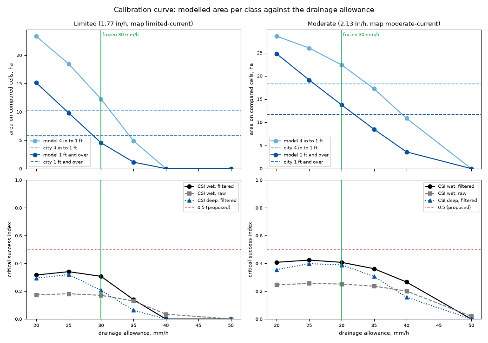
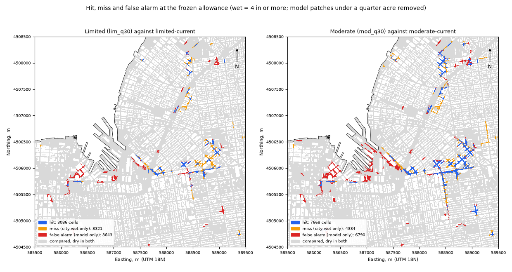
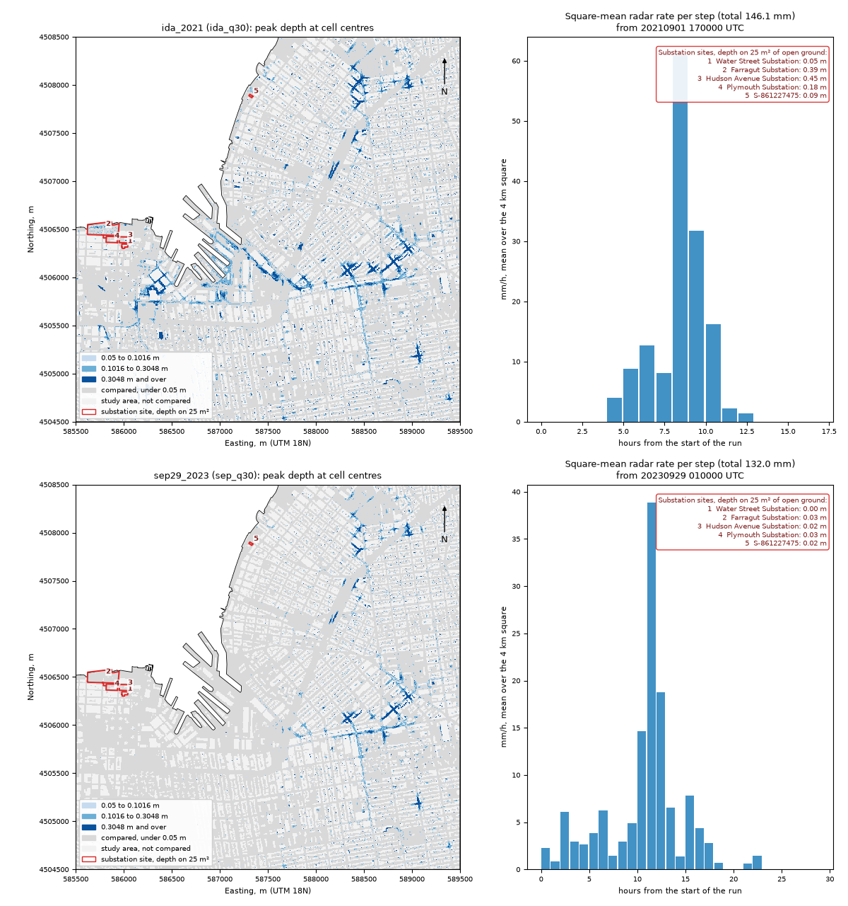
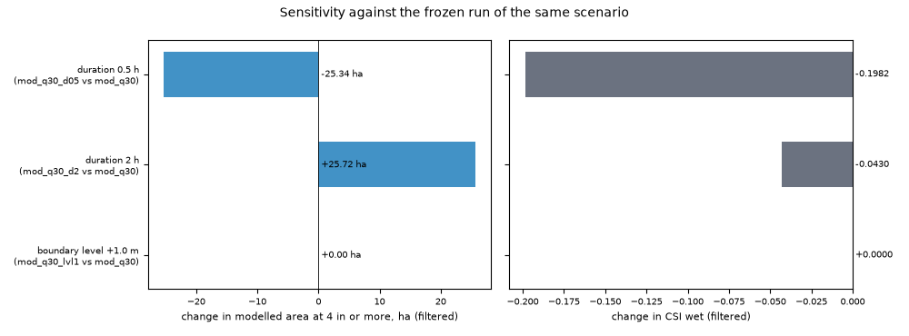

# F3. Solver model, drainage calibration, replays

Date: 2026-11-25 · branch `flood/f3` · crc-sdk 1.0.0, crc-framework 1.0.0 · SFINCS v2.5.0, HydroMT-SFINCS 2.0.0
· stopped on FH8 on 2026-11-25; decisions taken by Yuri on 2026-11-26 (CH-16); then frozen and replayed

Stage F3 of `docs/flood/plan.md`. The model of the square is built on the real terrain and calibrated against
the city's two current-sea-level flood maps. The stage stopped on 2026-11-25 because the monotonicity check
of FH8 failed as written. The failure is millimetre noise, diagnosed in section 3 after the blind review
corrected the first diagnosis. Yuri took the four decisions on 2026-11-26 (section "Decisions taken"); the
allowance was then frozen and the replays and sensitivities ran (section 6). Numbers come from the record `f3-model`
(`site/flood/tests/records/f3-model.json`); the gallery shows it with its figures.

## Result against the pass rule

| Rule (plan F3, FH8) | Result |
| --- | --- |
| Water balance within 1% in every run | **Passes.** 14 of 14 runs; the largest residual is 0.017% of the rain |
| CSI of 0.5 or better against the two calibration maps (*proposed*) | **Fails.** 0.307 (Limited) and 0.408 (Moderate) at the proposed allowance. The plan's next step, one value per sewer district, could not be tried: no official district layer exists (section 4). The plan says to report the mismatch and continue with the best fit |
| Monotonicity (FH8): at lower rain no cell deeper by more than 1 mm, and no cell wet to 0.05 m deeper at all | **Fails as written.** At 30 mm/h the first clause passes (largest excess 0.82 mm), the second fails: 41 wet cells deeper by less than a millimetre. At 20, 25 and 35 mm/h, 2 to 4 cells exceed 1 mm, by at most 3.8 mm. **This is what stopped the stage** |
| The calibration value is frozen before any validation | **Done** on 2026-11-26: 30 mm/h (`src/flood_lab/hazard/allowance.toml`) |
| Monotonicity with the 1 mm tolerance on both clauses (CH-16) | **Passes at the frozen 30 mm/h** (largest excess 0.82 mm). The pairs at 20, 25 and 35 mm/h, which are not used, keep 2 to 4 cells over 1 mm and are shown as failed in the record |
| The two replays | **Run** (section 6). Ida meets the lead-asset rule at two substation sites; 2023-09-29 leaves every site under 0.04 m |

A fact also differs from the facts file: AORC's grid extent (section 7, CH-15). It touches F4's source,
not F3, and changes nothing in the window used.

## 1. The model (FH2)

`src/flood_lab/hazard/sfincs_model.py`; record of the build `data/cache/flood/f3/model/base/base.json`.
Every choice is a placeholder **[P]** and is listed in that record.

- **Grid and terrain:** the whole 4 km square, 640,000 cells of 5 m, all active; sub-grid tables from the
  1 m USGS terrain of F1 (10 levels, 0.5 m pixels). The last build took 87 s with a 1.10 GB peak (`base.json`).
- **Navy Yard pits (F1's open item): filled.** The two dry docks (lowest −13.5 m and −13.3 m) are filled
  to the median level of a ring around them, 1.80 m: 16,368 and 16,463 pixels. The third patch (lowest
  −8.1 m) is filled to its ring's median, −1.02 m. That is below the start water level, so the patch
  holds water like the slips beside it. Walls are filled only where they lie below datum and within
  15 m of the pit, so the quays keep their height. A first version grew each fill over all connected low
  ground and raised about 0.19 km² of quay; it was caught and corrected before any run counted. Every cell
  with any pixel in a pit is left out of the comparisons.
- **Buildings:** the city's 22,960 footprints in the fetched box are raised 5 m as obstacles. Rain on a
  cell lands on the cell; in a cell that is all roof it stands on the roof until the allowance drains it,
  and in a cell that is mostly roof it gathers on the cell's open ground (section 6).
- **Water:** F1's water pixels are ordinary terrain, below the boundary level, so the river is full at
  the start (`zsini` 0 m NAVD88). So is any cell whose lowest level is below 0 m: the slips and the
  river's edge. Such cells hold standing water from the first second and are not compared (section 2).
- **Boundaries:** water level held at 0 m NAVD88 **[P]** where the square's edge crosses the river (256
  cells). Outflow only on the land edges (2,936 cells): water may leave and none comes in. Water from
  outside the square cannot enter, which is a stated limit.
- **Roughness:** Manning's n 0.025 above datum and 0.02 below. **Not from land cover as FH2 asks;** see
  CH-14.
- **Drainage allowance:** SFINCS's uniform constant infiltration `qinf`. It drains up to that rate from
  the water standing in a cell, during and after the rain. Cells whose lowest level is below −1 m
  (river, slips) are not drained.
- **Water balance:** four cross-sections one cell inside the edges measure all that leaves; storage
  comes from the solver's volume output.

**Time per run, re-measured on the real terrain** (F0's 425 s was from toy terrain). A two-hour
simulation (one hour of rain, one dry hour) took 107 to 372 s. It is slower when wetter, because the
average time step falls from 0.63 s to 0.38 s. At the proposed allowance it took 260 s (Limited) and
330 s (Moderate), **about 2.2 to 2.8 minutes per simulated hour**. A catalogue storm is many hours long,
so this matters for F4 (section 7).

## 2. Calibration (FH3)

*Modelled area per class against the allowance, with the city's areas as dashed lines (top), and the
critical success index (bottom). Limit: the city's maps are themselves a model's output, and the one-hour
storm is an assumption.*

- **Compared cells (330,615):** Brooklyn land in the square, centre not under a footprint, no pixel in a
  pit, not water, and lowest level not below the start water level. The last condition came from the
  blind review: 1,879 cells hold water from the start, and before they were left out they counted as
  deep flooding the city does not show (1.7 ha, the flat line at 40 and 50 mm/h in the first draft).
- **Depth at a cell** is the peak level less the terrain at the cell's centre pixel, which is where the
  city's class is read. Reading it as the mean over the cell's open ground gave the same CSI in a test on
  the first draft (0.386 against 0.391); the deepest pixel gave a worse one (0.286). The city's maps leave
  buildings out: 4.3 to 5.0% of their wet land cells have a centre in a footprint, against 33.6% of all
  land cells. These checks are not in the record; they were run once on the cache.
- **The model's wet patches under a quarter acre are removed before comparing,** counting only compared
  cells, so the river cannot hold a small patch up by touching it. That is the city's own stated rule for
  its maps ("areas of at least 0.25 contiguous acres"). The unfiltered scores are in the record beside
  the filtered ones.
- **Storm:** 1.77 and 2.13 in/hr held for one hour **[P]** (the city publishes no duration; §14), then
  one dry hour.
- **Objective:** the smallest sum, over both maps and both classes, of the squared log ratio of modelled
  to city area. Tried 20, 25, 30, 35, 40 and 50 mm/h.

| Allowance, mm/h | Limited: area error | Limited: CSI wet | Moderate: area error | Moderate: CSI wet | Sum of area errors |
| ---: | ---: | ---: | ---: | ---: | ---: |
| 20 | 1.609 | 0.317 | 0.762 | 0.408 | 2.37 |
| 25 | 0.631 | 0.341 | 0.367 | 0.424 | 1.00 |
| **30** | **0.087** | **0.307** | **0.067** | **0.408** | **0.15** |
| 35 | 3.138 | 0.140 | 0.104 | 0.362 | 3.24 |
| 40 | 88.5 | 0.000 | 1.643 | 0.267 | 90.1 |

- **Proposed: 30 mm/h.** At 30 the areas are 12.3 ha shallow and 4.6 ha deep against the city's 10.3 and
  5.8 (Limited), and 22.4 and 13.8 against 18.3 and 11.7 (Moderate).
- **One value is a compromise.** Limited alone fits best near 30 and Moderate alone between 30 and 35.
  An allowance that has to rise with the rain says the city's sewer does not behave as a constant rate.
- **Where the water is: CSI peaks at 0.34 (Limited) and 0.42 (Moderate) over the allowances tried.**
  The model finds the city's main flooded street corridors (the blue clusters east of 588,000 E in the
  map below). It also wets places the city does not, most of all in the Brooklyn Navy Yard.
  - Leaving the Navy Yard out (NTA BK0261) raises CSI at 30 mm/h to 0.356 (Limited) and 0.509
    (Moderate). The city's maps do show some flooding there (206 cells on the Limited map, 376 on
    Moderate), so it is not wholly masked. The city masks large non-residential lots, but which ones is
    not published. The calibration keeps the Navy Yard in and reports this as a sensitivity.
  - Location agreement is the weak part of a drainage-allowance model; Kasaei et al. 2025 report their
    0.20 m only after calibrating on marks.

*Hit, miss and false alarm per compared cell at the proposed allowance. Limit: a one-cell shift between
the two maps counts as both a miss and a false alarm.*

## 3. The check that stopped the stage: monotonicity (FH8)

Each pair differs only in rain (Limited 44.96 mm/h, Moderate 54.10 mm/h), on the compared cells.

| Pair | Cells deeper at the lower rain by over 1 mm | Wet cells deeper at all | Largest excess |
| --- | ---: | ---: | ---: |
| 20 mm/h | 3 | 34 | 1.3 mm |
| 25 mm/h | 4 | 40 | 3.8 mm |
| 30 mm/h | 0 | 41 | 0.82 mm |
| 35 mm/h | 2 | 29 | 1.9 mm |
| 30 mm/h, momentum advection off | 0 | 32 | 0.83 mm |

- **The first draft of this report had the cause wrong.** It counted 71 cells over 1 mm at 30 mm/h and
  put them down to momentum overshoot at pond rims, with switching advection off as the remedy. The
  blind review showed, and a recount confirmed, that all 71 were cells holding water from the start
  (lowest level below 0 m, mostly in the Navy Yard slips). Their level differs between runs by the rain
  that fell on them; that is not flooding. Left out (section 2), no cell at 30 mm/h exceeds 1 mm, and
  switching advection off changes nothing material (CSI 0.309 and 0.407, area errors 0.083 and 0.056;
  computed once on the cache, not in the record). Advection stays on as built.
- **What remains is millimetre noise:** a handful of cells at 20 to 35 mm/h by 1.3 to 3.8 mm, and a few
  dozen wet cells by under a millimetre. F0 met the same on toy terrain (4 cells, under 0.1 mm), and the
  rule was left unchanged then.
- **Not yet looked at:** where the 2 to 4 cells over 1 mm lie at 20, 25 and 35 mm/h.

## 4. Per-district calibration: no source

FH3 says one value per sewer district if a single value fails. A search of NYC Open Data (21 queries) and
DEP's pages found no official sewershed or combined-sewer drainage-area layer. DEP's sewer page refused
automated access, and that was not worked around. The one related layer is DEP's MS4 map (`j57c-rqtq`).
It shows only areas draining to separate storm sewers: 10 small polygons covering 0.30 km² of the square.
An unofficial atlas ("Open Sewer Atlas NYC") says of itself that it is not official and partly outdated;
it was not fetched. Downloads are in `data/cache/flood/f3/sewersheds/`.

## 5. Return periods of the three intensities (§9 item 4)

*NOAA Atlas 14 Volume 10 Version 3 at the study area's centre (40.7048 N, −73.9642), 60-minute depths
with 90% bounds. Limit: a point estimate; the city's intensities carry no published duration.*

| Intensity | Held 30 min | Held 60 min | Held 2 h |
| --- | --- | --- | --- |
| 1.77 in/hr (Limited) | 1 to 2 years (PDS) | **5 to 10 years** | 50 to 100 years |
| 2.13 in/hr (Moderate) | 2 to 5 years | **10 to 25 years** | 200 to 500 years |
| 3.66 in/hr (Extreme) | 25 to 50 years | **200 to 500 years** | above 1000 years |

These are brackets between tabulated values, not interpolations, and the partial-duration (PDS) and
annual-maximum (AMS) series agree at 60 minutes. The first reading in F0, at another point, put 3.66 in/hr
between 100 and 500 years; here it is between 200 and 500. The duration assumption decides the return
period: held for two hours, the Limited storm is a 50- to 100-year event. That is why the
duration-sensitivity runs matter.

## 6. Replays (FH4), the lead-asset rule, and the sensitivities

*Peak depth at cell centres in the two replays at 30 mm/h, substation sites outlined and numbered, and
the square-mean radar rate per hour. Limit: hourly radar rain held constant over each hour smooths the
peaks inside an hour; the end-of-hour time stamp is not confirmed from a primary source.*

- **Radar rainfall:** MRMS multi-sensor hourly accumulation (Pass 2, 0.01°), 17 hours for Ida and 29 for
  2023-09-29, none missing (`data/cache/flood/f3/mrms/manifest.json`). Square-mean totals in the forcing
  are 146.1 mm (Ida, peak hour 60.9 mm/h) and 132.0 mm (2023-09-29, peak hour 38.8 mm/h). The first build
  of the forcing dropped the first radar hour; the review caught it and it was rebuilt with each hour
  labelled at its start.
- **Not confirmed (FS6):** that each file's stamp is the end of its hour. NSSL's table gives the stamp
  format only; the VLab guides that state it refused automated access. Peak depth hardly depends on it;
  the sensor timing of F5 does.
- **Run times:** Ida 1,570 s for 18 simulated hours, 2023-09-29 1,819 s for 30 hours.

**Depth at the substation sites** (the depth exceeded on 25 m² of open ground; cells under roofs or
holding water from the start are not read):

| Site | Ida: depth on 25 m² | Ida: area at 0.3 m or more | 2023-09-29: depth on 25 m² |
| --- | ---: | ---: | ---: |
| Hudson Avenue | 0.447 m | 30 m² | 0.022 m |
| Farragut | 0.390 m | 351 m² | 0.034 m |
| Plymouth | 0.179 m | 10 m² | 0.025 m |
| Unnamed Williamsburg yard | 0.094 m | 0 | 0.016 m |
| Water Street | 0.047 m | 2 m² | 0.000 m |

- **The lead-asset rule (0.3 m, demo-concerns §2) is met in the Ida replay,** at Hudson Avenue and
  Farragut, on rain alone. By the demo plan's rule the lead asset is the site with the greatest modelled
  depth: **Hudson Avenue** (0.45 m). Farragut is close behind and has more than ten times the area under
  0.3 m or more. The four named substations are one complex at Vinegar Hill (F1). Which of the two
  leads the card is worth a look before F6; the measure (25 m²) is a placeholder.
- **This first ran wrong.** Farragut's outline reaches a slip; read with standing water, it gave 1.25 m.
  The depth code now leaves out cells that hold water from the start, as the comparisons do (CH-16).
- **Buildings:** 4,375 of 17,750 have water of 0.3 m or more at their walls in the Ida replay, and 2,120
  on 2023-09-29 (the deepest pixel in a 2 m band; cells mostly under roofs are not read). F6 sets each
  against its own first-floor height.
- **Wet area on compared cells, 4 in or more:** 73.3 ha in Ida and 31.5 ha on 2023-09-29.

**Extreme map check (3.66 in/hr for one hour, against the city's 2080 map, rain classes only):**
modelled 37.1 ha shallow and 51.0 ha deep against the city's 46.9 and 55.3; CSI wet 0.484, area error
0.062. It agrees better than either calibration map, though that map carries 2080 sea level.

*Change against the frozen Moderate run. Limit: one run per setting.*

- **Duration decides the answer.** The Moderate intensity held for 30 minutes wets 25.3 ha less at 4 in
  or more, and held for 2 hours 25.7 ha more (against 36.1 ha). CSI falls in both cases (0.21 and 0.37
  against 0.41), so the one-hour storm fits the city's maps best of the three. With Atlas 14 (section 5)
  this says the city's maps are most likely one-hour storms, but that is an inference, not a fact.
- **The river level does not matter here:** with the boundary 1 m higher, the wet area changes by
  0.003 ha.

## 7. Beside F3: F4's preparation (no F4 code on this branch)

- **RainyDay** runs at commit `ff2b809` (2026-09-28, MIT) in its own Python 3.8 environment, with no conda
  (`data/cache/flood/f4/rainyday/SETUP.md`, `requirements.lock`). A smoke run on 10 days of rainfall
  finished. It expects one NetCDF file per day with `rainrate` in mm/h, time stamps at the end of the
  hour, and latitude and longitude ascending. At this commit a lower-case `tempscaling` key is required
  even though the message says it has a default; noted for F4.
- **AORC download:** script written and tested on 2023 (0.24 GB, 2,273 objects, about 14 minutes). The
  window 38–44 N, 78.5–69.5 W for 2002–2025 lists at **5.54 GB** (budget 10 GB), about 5.5 hours one object
  at a time. **Not started:** the stop applies to the whole build.
- **A fact differs (FS6):** the AORC v1.1 store's grid runs 20.0 to 55.0 N and −130.0 to −60.0. The facts
  file (`rainfall-aorc`, coverage) says 25 to 53 N and −125 to −67, from the registry's description of
  the source grid. The shape and chunks match. It changes nothing for this window. The coverage row
  should be corrected to the store's own coordinates (proposed in CH-15).
- **Run time and the catalogue.** At about 2.5 minutes per simulated hour, a 24-hour catalogue storm
  takes about an hour, and 150 such storms about 150 hours. That is not possible by Tuesday.
  - 60 storms of 12 hours is about 30 hours.
  - The storm duration that RainyDay writes (`DURATION`) and the dry time after it set the cost; F4 has
    to choose them with this in view.
  - A coarser cell is the other lever, but F0 chose 5 m for the sub-grid.

## Decisions put to Yuri at the stop (2026-11-25)

1. **FH8, the stop.** Recommended: **give the rule's second clause the same 1 mm tolerance as the
   first** (a wet cell may be deeper at the lower rain by up to 1 mm, as for any cell). The proposed
   30 mm/h pair then passes. The other pairs keep 2 to 4 cells over 1 mm (at most 3.8 mm), which the
   record shows. The alternative, a tolerance of 5 mm on both clauses, passes every pair. Also confirm
   that cells holding water from the start are left out of the comparisons (section 2).
2. **The allowance: 30 mm/h, then freeze.** Nothing needs rerunning; the frozen runs exist.
3. **CSI below 0.5.** Options: (a) accept 0.31 and 0.41 (0.36 and 0.51 without the Navy Yard) as the best
   fit and say so on the page, as the plan allows (recommended); (b) try the unofficial sewer atlas,
   labelled as such; (c) ask DEP for its sewershed layer.
4. **The model choices tagged [P]:** pits filled to the quay, buildings raised 5 m, boundary at 0 m
   NAVD88, Manning's 0.025 and 0.02, the quarter-acre filter on the model, and 25 m² for the lead-asset
   measure. Each is in the record. Roughness from land cover is CH-14.
5. **Then the replays and sensitivities, unattended, in one command** (about 3 hours), followed by the
   record: `just flood-f3-batch data/cache/flood/f3/queue_after_decision_1.json`, then `just flood-f3`.
   They are Ida and 2023-09-29 at 30 mm/h, the Extreme map check, 30-minute and 2-hour storms, and the
   boundary at +1 m. The Ida replay answers Friday's lead-asset question.
6. **AORC download** (5.5 hours, 5.5 GB) may start at the same time; it uses the network, not the
   processor. CH-15 corrects the differing fact.

## Decisions taken at the stop (2026-11-26)

Yuri: "agree with all 4". Entered as CH-16, requirements version 7 (section 16).

1. FH8's second clause takes the same 1 mm tolerance as the first.
2. The allowance is frozen at 30 mm/h (`src/flood_lab/hazard/allowance.toml`, `frozen_on = 2026-11-26`).
3. CSI below 0.5 is accepted as the best fit and will be stated on the page; the per-district fallback
   is dropped.
4. The replays and sensitivities run (section 6).

CH-14 (roughness) and CH-15 (AORC coverage fact) stay open: they were not among the four.

## Questions for Yuri now

1. **Merge F3 into main** (requirements version 7, tag `flood-requirements-v7` at the merge)?
2. **Lead asset:** Hudson Avenue by the rule (0.45 m over 25 m², 30 m² at 0.3 m or more), or Farragut
   (0.39 m, 351 m²)? Recommended: keep the rule and Hudson Avenue, and show Farragut beside it, since the
   four substations are one complex; F6 can carry both through.
3. **CH-14 and CH-15** (below): accept as assessed?

## Open changes (D16)

| ID | What | Assessment |
| --- | --- | --- |
| CH-14 (new, from F3) | FH2 asks for roughness from land cover; F3 used two constants (land, water). A land-cover source (the city's 2017 land cover, or NLCD) would need its own fact check | The fit is set by the allowance; roughness moves timing more than peak area. Proposed: keep two constants for Tier 1, with a sensitivity run at n = 0.035 on land; land cover later if F5's marks show a timing problem |
| CH-15 (new, from F3) | Correct `rainfall-aorc` coverage to the store's coordinates (20.0–55.0 N, −130.0 to −60.0) | Facts only; no build depends on it |

## What was not done

- Per-district calibration: no official source (section 4); dropped (CH-16).
- The roughness sensitivity (CH-14, open).
- The F3 layers are not yet registered in `site/layers.json`.
- Where the 2 to 4 cells over 1 mm lie in the unused pairs (20, 25, 35 mm/h).

## Review before the stop

A fresh Opus agent reviewed the diff without being told what to expect. Its findings, and what was done:

| Finding | Done |
| --- | --- |
| Every monotonicity excess over 1 mm was in cells holding water from the start, not at pond rims; the first diagnosis and its remedy (advection off) were wrong | Confirmed by recount (71 of 71). Such cells are left out of every comparison; section 3 rewritten; decision 1 changed |
| The same cells counted as deep flooding, and the quarter-acre filter ran over the river, so 766 cells touching it were never filtered | Both fixed; every number in sections 2 and 3 recomputed from the regenerated record. 30 mm/h is still the best fit |
| The recommended remedy would not have passed the pair (1.005 mm > 1 mm) | Moot after the fix; the new recommendation was checked against the record |
| The replay forcing dropped the first radar hour | Fixed and rebuilt (section 6) |
| The forcing-path fix and CH-14/CH-15 were not in the commit | Committed with this report |
| Build time and memory in the report were from an earlier build | Corrected from `base.json` (87 s, 1.10 GB) |
| The record's first note called the value both frozen and not frozen; the pair check ignored solver options | Fixed in `f3_model.py` |
| Run files not written atomically; the pit mask used the centre pixel only | Both fixed |
| Numbers in the report that are not in the record | Each is now marked with where it comes from |

## Checks

`just test` and `just lint` pass (182 flood tests; parked count unchanged at 8 files and 3 tests);
`just flood-f3` rebuilds the record and figures from the cache, offline.

## Models and tokens

| Task | Model | Tokens |
| --- | --- | --- |
| Model design and build, calibration, comparison rules, diagnosis, depth at assets, hazard interface, report | Opus 5.5 (main session) | not available to the session |
| Atlas 14 at the study area | Sonnet | 45,461 |
| MRMS radar rainfall, both storms | Sonnet | 67,648 |
| Sewer-district layer search | Sonnet | 39,094 |
| AORC download script (F4 preparation) | Sonnet | 59,169 |
| RainyDay environment (F4 preparation) | Opus | 112,076 |
| F3 check script, figures, unit tests | Opus | 194,893 |
| Blind review of the stage's diff | Opus | 198,380 |

The main model this session is Opus 5.5, not Fable 5.2 (concern 11 of `docs/flood/demo-concerns.md`).
The freeze is one of the two decisions that concern suggests a Fable session for, and it has not been
taken here.
