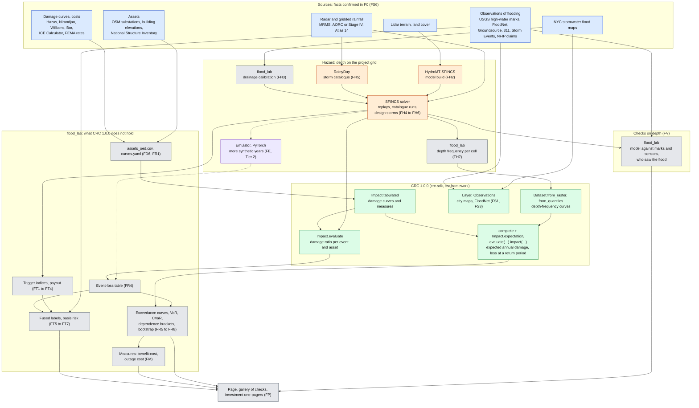
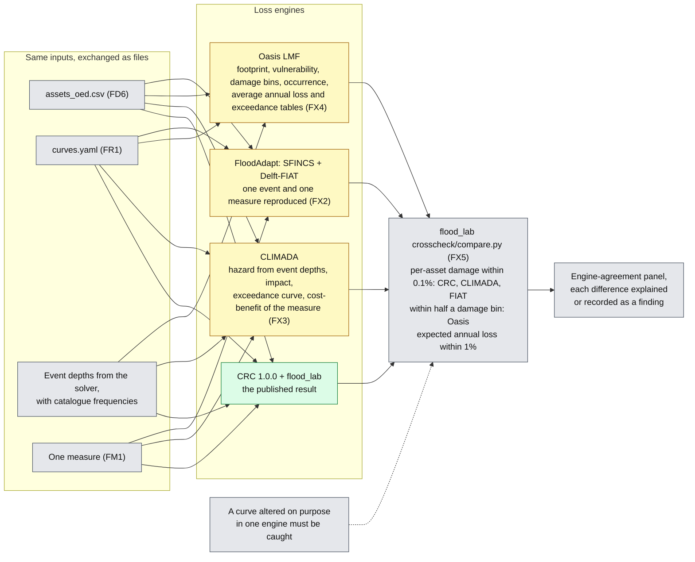

# Requirements: Flood Loss & Trigger Lab

Version 1, 2026-11-25 (tag `flood-requirements-v1`); first draft 2026-11-24. Author: Yuri Shlyakhter, with Claude.
Handoff document for the Claude Code build in crc-lab. The stages, hours, tests and the way of working
are in `docs/flood/plan.md`. Nothing here is started.

Revised on 2026-11-25 for crc-sdk 1.0.0 and crc-framework 1.0.0, which crc-lab moved to after the first
draft. What each requirement asks of CRC 1.0.0 is in `docs/flood/crc-1.0-mapping.md`; those calls were read
in the code and are run for the first time in F0. Proposed changes after this version go through
`docs/flood/changes.md`. Requirement IDs are never reused or renumbered.

Read first, in this order: `AGENTS.md` (repository rules, which all apply; its section "State on crc-sdk
1.0.0" says which parts of crc-lab do not run), this file, `docs/flood/plan.md`,
`docs/flood/crc-1.0-mapping.md`, `docs/validation/method.md` (the verification method reused here),
`docs/algorithms.md` §11–12 (the hail damage and annual-loss calculations this project parallels).

## 1. Purpose

A fourth project in crc-lab: a rain-driven (pluvial) flood study of one New York City neighbourhood that goes
from storm to street depth to dollars to a parametric payout, with Climate Risk Commons (CRC) as the loss
engine. It has two audiences and must serve both from the same numbers.

- **A parametric flood insurance company.** What such a reader should see: an event set with an event-loss
  table, trigger indices compared on a real storm where a real policy did not pay, honest treatment of
  noisy labels, and a neural-network emulator with a held-out test.
- **Resilience investment advisors.** What such a reader should see: a per-substation investment case with
  loss before and after a hardening measure, outage cost, and a benefit-cost ratio with its uncertainty.

No company is named as an audience anywhere in the code, the reports or the page. Companies are named only
as the publisher of a cited public source.

It must also show two things about Yuri's own work: how far CRC 1.0.0 takes a new hazard source and a new
loss calculation, shown with what went in and what did not; and that every number is checked, with the
level of each check stated (source facts confirmed, or values recomputed by an independent reader; FS4,
FS6).

## 2. Decisions

| # | Decision | Status |
| --- | --- | --- |
| D1 | Study area: one 10–20 km² neighbourhood in Brooklyn or Queens, chosen in stage F0 by a scoring rule; search starts inside the Jamaica Bay watershed | Recommended by Claude; **confirm with Yuri before F0 ends** |
| D2 | Storms: remnants of Ida (2021-09-01) for depth validation; 2023-09-29 for the trigger case study | Recommended; confirm with D1 |
| D3 | CRC (crc-sdk 1.0.0, crc-framework 1.0.0) is the loss engine: it computes every damage ratio and every per-asset expectation. CRC 1.0.0 has no event-loss table and no portfolio aggregation, so `flood_lab` builds those from CRC's ratios in its own code, documented in `docs/algorithms.md` and recomputed by hand. What CRC lacks is written up as design feedback. Other engines are donors and cross-checks | Decided by Yuri; revised 2026-11-25 |
| D4 | The depth solver is reused, not written: Deltares SFINCS built with HydroMT-SFINCS. It sits behind an interface a licensed model could replace | Decided by Yuri |
| D5 | Assets: electrical substations first, buildings second | Decided by Yuri |
| D6 | Resilience measures are modifications of the damage curve; report loss before and after and a benefit-cost ratio | Decided by Yuri |
| D7 | Cross-check engines: CLIMADA and Oasis LMF (Yuri's choice), and Delft-FIAT through Deltares FloodAdapt (added after the literature review) | Decided; FloodAdapt as the FIAT route is new, confirm |
| D8 | Into CRC goes what CRC 1.0.0 can hold: FloodNet sensor events, the city flood maps as a map layer, and the catalogue's depth-frequency curves. Google Groundsource stays a `flood_lab` table with its reference reader (1.0.0 has no record with a date and a polygon), and a primer shows how to work with it and with point observations in general (FS5). The F2 report says plainly what CRC could and could not hold. Google's runoff reanalysis enters the Fremont chapter only | Decided by Yuri; revised 2026-11-25 |
| D9 | Frequency comes from a stochastic storm catalogue (storm transposition), not from uniform design storms. Design storms are kept as a comparison | New, from the literature review; **confirm** |
| D10 | A neural-network emulator of the solver extends the catalogue | New, from the literature review; **confirm** |
| D11 | Every stage ends with a visual test on a generated gallery page, a report, and a stop for review | Decided by Yuri |
| D12 | Fremont, California is a short closing chapter, not the study area | Recommended; confirm with D1 |
| D13 | Target is Tier 1 (F0 to F8 and F11). Tiers 2 and 3 stay specified; Yuri decides on them at the F8 stop, with measured run times and token use per stage | Decided by Yuri, 2026-11-25 |
| D14 | Each stage is built on its own short-lived branch (`flood/f<n>`), pushed for backup and merged into `main` only on Yuri's go at the stop. The flood page is not linked from the landing page before F11 | Decided by Yuri, 2026-11-25 |
| D15 | Source validation by Claude Code: every source used has its facts confirmed from the primary source (FS6); a source whose values feed a published number also gets a second, independent reader (FS4) | Decided by Yuri, 2026-11-25 |
| D16 | The requirements stay open to Yuri's own outside evaluation for missing sources and techniques; proposals enter through `docs/flood/changes.md` and are decided at stage stops | Decided by Yuri, 2026-11-25 |

## 3. Scope

**In scope.** Pluvial flooding in the study area; two storm replays; a storm catalogue; per-cell depth
frequency; substations and buildings; expected annual loss, 1-in-100 loss, VaR and CVaR; two hardening
measures; outage cost; four trigger indices and basis risk; an emulator; three cross-check engines; a public
page with a test gallery; a Fremont riverine chapter; an optional news-extraction stage; an optional
sewer-uncertainty stage.

**Out of scope.** Flood mapping from satellite imagery; coastal surge; climate scenarios beyond one rainfall
scaling; the city's real sewer network (not public); engineering-grade or regulatory use of any depth;
anything commercial using CRC Open data (CC BY-NC 4.0).

### Flow: sources, frameworks and checks

Two diagrams. The first follows the data from its sources to the results and shows which software does
each step. The second shows how the other loss engines are used: as checks on the same inputs, never as
the source of a published number (D3, D7).

**From sources to results.** Colours: blue is a source, grey is `flood_lab`'s own code, orange is the
depth solver and its tools, green is CRC 1.0.0, purple is the emulator (Tier 2).

**How the other engines check the result (F10, Tier 2; not part of the Tier 1 target).** Every engine is
given the same four inputs as files and runs in its own environment (FG4). Only CRC's result is
published; the others are compared with it (FX1, FX5).

What each engine adds as a check, and what it cannot show:

| Engine | Stage | What agreement shows | What it does not show |
| --- | --- | --- | --- |
| CLIMADA | F10 | The damage ratios, the expected annual loss and the exceedance curve computed by `flood_lab` on CRC's ratios match an independent implementation; the measure's benefit matches its cost-benefit module | That the depths or the curves are right: both engines are given the same ones |
| Oasis LMF | F10, or a design note if the F0 trial fails | The event-loss table and its annual and exceedance figures match an insurance-market engine, within its damage-bin resolution | Anything finer than a damage bin |
| FloodAdapt (SFINCS with Delft-FIAT) | F10 | One event and one measure give the same per-asset damage through FIAT; a second build of the same solver model gives the same depths | Frequency: one event only. A difference in solver version is a known cause of disagreement (FH2) |
| Second readers, hand recomputation | F2, F5, F6 (Tier 1) | The inputs were read correctly and three assets' losses can be recomputed to the cent | (This is the check Tier 1 relies on; the engines above come after it) |

In Tier 1 the only contact with the other engines is F0's time-boxed install trials of Oasis and
FloodAdapt, which decide whether F10 is feasible as written.

## 4. Tags

Every number in code, parameters and reports carries one of these, as in `requirements-hail-impact-v0.md`.

- **[S]** stated in the source named beside it.
- **[I]** inference or calculation from source values.
- **[P]** placeholder with no source; must stay labelled as a placeholder everywhere it appears.
- **[V]** taken from a research summary or secondary rendering; verify against the primary source before use.

Facts in this file come from research reports written on 2026-11-24, not from files Claude Code has
opened. A verification pass the same day checked 32 claims against primary sources: those it confirmed are
tagged **[S]** with the source location; the rest stay **[V]**. Section 9 lists what to verify first. If a source cannot be reached or does not
say what this file claims, stop and report; do not substitute a number.

## 5. Conventions

- Lengths in metres; depth in metres above ground; rainfall in millimetres and mm per hour. Convert the
  city's inches once, at the reader.
- Project grid: 5 m cells in UTM zone 18N (EPSG:32618), with 1 m terrain used as sub-grid information **[P]**
  (cell size may change after the F0 timing test).
- A cell is **wet** at 0.05 m or more **[P]**. The city's map classes are 0.1016 m (4 in) and 0.3048 m (1 ft)
  **[S]**.
- Dates are local days, America/New_York, for New York data; America/Los_Angeles for Fremont.
- Return period T means annual exceedance probability 1/T, as in crc-docs.
- A **scenario** is either a named event (`ida_2021`, `sep29_2023`), a catalogue event id, or a design storm.
- Money in 2026 US dollars; state the index used for any conversion.

## 6. Functional requirements

### General (FG)

- **FG1.** New package `src/flood_lab/`, page `site/flood/`, docs `docs/flood/`, reports
  `docs/flood/reports/F<n>-<slug>.md`, tests `tests/flood/`. Add the package to the wheel list in
  `pyproject.toml` and to the separation test in `tests/test_projects.py` as `"flood_lab": {"lab_common"}`:
  `flood_lab` may import `lab_common` only, and never `crc_lab`, `crc_data_explorer` or
  `data_source_check`. Inside the package only `sources/` and `risk/` import `crc_sdk` or `crc_framework`,
  and only by 1.0 names (`just upstream-surface` flags any other); `reference/` and `crosscheck/` never
  do. A test holds both rules. `just test` is green today with 8 test files and 3 tests parked for the
  1.0 port (`tests/conftest.py`); the flood lab must not add to that count.
- **FG2.** Every output file is written atomically and has a JSON record: inputs with checksums, grid,
  software versions (crc pins, solver, builder), parameters with their tags, numbers produced, pass or fail.
  Pages and reports are generated from records, never typed. The writer: `lab_common.texas`, where
  `write_json_atomic` lives, does not import on crc-sdk 1.0.0, so F0 adds `src/lab_common/io.py`
  (`write_json_atomic`, `write_text_atomic`) and `texas.py` takes the writer from it. The record format is
  `flood_lab`'s own (`records.py`); the validation project's cannot be imported.
- **FG3.** Every dataset gets a data card: source, date fetched, licence, coverage, known biases, and the
  outcome of each fact checked under FS6.
- **FG4.** Heavy or conflicting dependencies run in their own environments and exchange files only: the
  solver (Docker image or binary), HydroMT, PyTorch, CLIMADA, Oasis, FloodAdapt. Use the
  `uv run --no-project --with ...` pattern already used by `just v1-probes`, on Python 3.12; any such
  environment that pulls rasterio repeats the main environment's constraint (`rasterio<1.5.2` on macOS,
  see `pyproject.toml`). The main environment's pins do not change.
- **FG5.** `just flood-<stage>` rebuilds one stage; `just flood-checks` rebuilds every visual test and the
  gallery from cached data, offline.
- **FG6.** One stage at a time. Each ends with its report and a stop. Do not start the next stage without
  Yuri's go.
- **FG7.** Disk and memory are budgeted. The machine is an Apple M3 with 8 cores, 16 GiB of memory and
  about 37 GiB of free disk on 2026-11-25 (19 GiB more is held by `data/cache/validation/`). Downloads
  and runs go under `data/cache/flood/` (already git-ignored). F0 sets a budget per dataset and for the
  solver runs; a stage stops before it would pass the budget.
- **FG8.** Everything the page needs is committed. The pages workflow runs `flood_lab.check_site` and
  never the solver; `just site` gains `site-flood`.
- **FG9.** A CRC behaviour met on the way that differs from its documentation, or that a user would not
  expect, is a candidate finding: it is entered in `src/data_source_check/sources/crc_sdk/findings.toml`
  (next free number CRC-039; statuses as in `core/records.py`) with a draft in `local/upstream-review.md`.
  Nothing is sent upstream until Yuri has reviewed the draft.
- **FG10.** Long reads and runs use `caffeinate -i` and are resumable: publishers drop connections, and
  crc-sdk 1.0.0 does not try a download a second time (CRC-038-FWK).

### Data and assets (FD)

- **FD1.** Study area polygon and project grid, chosen by the F0 scoring rule and recorded with the counts
  that justified it.
- **FD2.** Terrain: 1 m lidar digital elevation model for the area, with its vintage and vertical datum
  recorded.
- **FD3.** Substations from OpenStreetMap (`power=substation`): point, yard polygon where mapped, voltage
  where tagged, and a flag for indoor or enclosed. Each is checked by eye on aerial imagery in F1; removals
  are recorded with a reason.
- **FD4.** Substation replacement value as a low, mid and high figure per voltage class **[P]** until a
  public source is found (utility rate cases or grid-operator cost guides); the source or the placeholder tag
  is shown wherever the value is.
- **FD5.** Buildings from the city's Building Elevation and Subgrade table (grade elevation, first-floor
  elevation, subgrade-space flag) joined to footprints, with occupancy, basement and replacement value from
  the USACE National Structure Inventory.
- **FD6.** One asset table, `assets_oed.csv`, in Oasis Open Exposure Data column names, plus extra columns
  for substation fields. All four engines read this file or an export of it. It carries WGS84 longitude
  and latitude beside the project-grid coordinates: CRC's `Assets` accepts WGS84 points only.
- **FD7.** Customers served per substation for outage cost: **[P]** allocation by population in the nearest
  substation's area unless a public figure is found. Label it a placeholder.

### Sources, and what goes into CRC (FS)

- **FS1.** NYC Stormwater Flood Maps: a reference reader that shares no code with crc-sdk reads the four
  scenario polygons; a loader rasterises the depth classes onto the project grid for `flood_lab`
  (calibration in FH3, the `HazardSource` of FH1) and loads the polygons into CRC as a map layer with
  `Layer.from_table`. They are not loaded as curves: a depth class is not a probability curve, and the
  four scenarios mix rainfall intensities with sea levels, so they are not one probability axis. A
  transformation statement is written for the loader. The four layers are Limited Flood (1.77 in/hr, current
  sea levels), Moderate Flood (2.13 in/hr, current sea levels), Moderate Flood (2.13 in/hr, 2050 sea level
  rise) and Extreme Flood (3.66 in/hr, 2080 sea level rise); they show areas of at least 0.25 contiguous
  acres with 4 inches or more **[S]** (NYC Open Data `9i7c-xyvv`, About page, updated 2024-10-17). The
  class codes, the storm duration behind each intensity, the model used and the terms of use are **[V]**:
  read the data dictionary and the Stormwater Resiliency Plan.
- **FS2.** Groundsource: reader for the Zenodo Parquet file with checksum check; filter to the New York and
  Alameda County boxes; a `flood_lab` table of dated places (date range, place polygon, `area_km2`). It is
  not loaded into CRC: 1.0.0 has no record that holds a date and a polygon, and the F2 report says so,
  with what a type for it would need. Document that `area_km2` is the area of the named place, not of
  the flood.
- **FS3.** FloodNet: readers for the flood-events table and the sensor-deployment table; a per-sensor,
  per-event peak depth and duration table; the same table loaded into CRC with `Observations.from_table`
  and read back.
- **FS4.** Second reader. For each source whose values feed a published number, an independent reader
  that shares no code with the loader recomputes the loaded values, and the outcome follows
  `docs/validation/method.md`: confirmed, differs, not checked, not applicable. Each comparison has a
  test that breaks a rule on purpose and must then differ. Sources: the flood maps, Groundsource and
  FloodNet (F2); the USGS Ida high-water marks, on which FV1's error figures rest, and the radar rainfall
  that forces the replays, one event window decoded twice (F5). The second reader is written by an agent
  that is not shown the loader (plan, "How to work").
- **FS5.** Primer `docs/primers/point-observations.md`, with a script that runs from cached data: FloodNet
  as sensor observations in CRC; Groundsource as dated places (what a row is, what `area_km2` means,
  centroid against polygon, who reports and who does not, the latest dates in the file); what may be asked
  of such data (did something happen here on this day) and what may not (how deep, how often); and how
  both relate to CRC's curves. The older `docs/primers/event-sources-in-crc.md` describes the 0.11
  interface and is linked from it, not extended.
- **FS6.** Facts. For every source a stage uses, these are read from the primary source and recorded with
  an outcome each (the four of FS4): identifier and address, licence or terms of use, fields with units,
  coverage in space and time, release or version, checksum of the file fetched. The outcomes are on the
  data card and in the gallery. A fact that differs from this file stops the stage until this file is
  corrected. F0 does this for every source of Tier 1, so no stage starts on an unread source; the sources
  of F9 to F14 are checked in their own stage. The §7 table names the stage and the level for each source.
- **FS7.** The two levels are named wherever a check is reported: "facts confirmed" (FS6) and "values
  recomputed" (FS4). A source with facts only is never described as verified by recomputation.

### Hazard (FH)

- **FH1.** `HazardSource` interface: `depth(scenario) -> raster in metres on the project grid`, with a
  record. Implementations: city map classes, solver run, emulator. A licensed model would be one more
  implementation.
- **FH2.** SFINCS model built by script with HydroMT-SFINCS: terrain with sub-grid, roughness from land
  cover, buildings as obstacles, rainfall forcing, a drainage allowance in mm per hour subtracted from
  rainfall. Pin versions. The latest SFINCS release is v2.5.0 (2026-11-02) **[S]** (Zenodo
  doi:10.5281/zenodo.23883210). Releases v2.3.0 and v2.4.0 have a documented fault in curve-number
  infiltration when `storecumprcp = 0` **[S]** (same record); do not use them with that option. Which
  version FloodAdapt pins is **[V]**: read its `pyproject.toml` in F0 and, if it differs, record the
  difference as a known cause of disagreement in F10.
- **FH3.** Drainage allowance calibrated so that the modelled area in each depth class matches the city
  maps at the two **current-sea-level** scenarios only. One value for the area unless the fit fails, then
  one per sewer district. The 3.66 in/hr map is a check, not a calibration target, because it includes
  future sea level. The value is frozen before any validation. The published
  Ida model for Jamaica Bay also represented infiltration and stormwater conveyance as a single drainage
  rate **[S]** (Kasaei et al. 2025), so this simplification has a peer-reviewed precedent; cite it.
- **FH4.** Storm replays for D2, forced by gridded radar rainfall (MRMS or Stage IV; record which and its
  resolution).
- **FH5.** Storm catalogue by stochastic storm transposition with RainyDay over a gridded hourly rainfall
  record (AORC or Stage IV): a transposition domain with a written justification, N synthetic years, and the
  storms that matter for the area. Target 150 solver runs **[P]**, set by the F0 timing test.
- **FH6.** Six uniform NOAA Atlas 14 design storms (2, 5, 10, 25, 100, 500 years) run as a comparison only.
- **FH7.** Per-cell depth frequency derived empirically from the catalogue, with a point mass for dry years;
  loaded into CRC as curves that are not fitted. Report how many catalogue events wet each cell. Two
  routes, both used:
  - The grid: `Dataset.from_raster`, one GeoTIFF per probability on the project grid (EPSG:32618 is
    accepted). Rules that follow from 1.0.0's reader: the nodata value is never 0, or dry cells vanish;
    every cell is non-decreasing across the probabilities before the call, because one decreasing pixel
    fails the whole read (CRC-025-OWN); a cell needs two valid values. The probability set is the same for
    every cell, so a cell's dry-year mass falls between two knots and is approximated.
  - Asset points: `Dataset.from_quantiles`, where knots may differ per point, so the dry-year mass is an
    exact knot. Loss figures use this route. F0 measures the difference between the two routes on a toy
    grid and F6 reports it at the assets.
  Between knots CRC 1.0.0 interpolates linearly in probability (0.x used the logarithm of return period);
  every recomputation uses the same rule and says so.
- **FH8.** Water balance closes within 1% in every run; depth is non-decreasing with rainfall scaling in a
  monotonicity test.

### Validation against observations (FV)

- **FV1.** Ida: modelled depth against the USGS surveyed high-water marks in the area; report bias and
  root-mean-square error beside the 0.20 m of the published research model **[S]** (Kasaei et al. 2025,
  HESS 29:2043, abstract).
- **FV2.** Both storms: modelled peak against measured peak at each FloodNet sensor that recorded the event.
- **FV3.** Ida: comparison with the published Jamaica Bay depth map where it overlaps, after its licence is
  read and recorded.
- **FV4.** No retuning in this stage. If error exceeds 0.5 m root-mean-square **[P]**, the write-up says the
  depth layer cannot support substation-level claims.
- **FV5.** "Who saw the flood": for each storm, counts and locations inside the area from Groundsource, NOAA
  Storm Events, 311 complaints, FloodNet and surveyed marks, on one chart and one map.

### Risk in CRC (FR)

- **FR1.** Damage curves in one file, `curves.yaml`, each with source, tag, native hazard metric and
  confidence. Exporters write the same curves for CRC, CLIMADA, Oasis and Delft-FIAT. For CRC a curve is
  `Impact.tabulated(points, input=DepthAboveGround, output=Ratio)`: linear between points, and a depth
  outside the table is an error, so every table runs from 0 m to a stated maximum depth **[P]** that no
  modelled depth exceeds (tested against the catalogue).
- **FR2.** Substations: an envelope of curves, never a single curve, with the choice of curve exposed as
  a scenario setting. The sources disagree by a factor of three to five at 3 m.
  - **Low: Hazus-type** (FEMA 2013), as compiled in the Nirandjan et al. 2024 database, curves F2.1–F2.3
    (same shape for the three substation size classes). Damage begins at flood onset, 0 m; control-room
    damage is greatest at 2.13 m; switchgear is assumed 0.91 m above ground **[S]** (NHESS 24:4341,
    §3.1.1). Reported anchor values: about 7% at 1.2 m and 15% at about 3 m **[S as reported]**
    (Karagiannakis et al. 2025, §4.4.1; the Hazus table itself was not read). Read every point from Zenodo
    doi:10.5281/zenodo.13889558 **version 1.1.0**, file
    `Table_D2_Hazard_Fragility_and_Vulnerability_Curves_V1.1.0.xlsx`, sheet `F_Vuln_Depth` (CC BY 4.0);
    the last row of F2.1–3 was corrected in 1.1.0, so do not copy values from the preprint or 1.0.
  - **High: expert-derived, minimum and maximum** (Williams et al. 2025, JFRM 18(2):e70045, §3.2.2). At
    3 m: substation 0.52–0.76, distribution substation 0.51–0.77, grid exit point 0.49–0.70 **[S]**.
    Values at 0.5, 1 and 2 m are in the paper's Fig. 7 and Data S4, not yet read. These curves are
    specific to New Zealand, and the article's licence is reported as CC BY-NC-ND **[V]**: cite the
    values, do not copy the supplement into the repository, and see question 7.
  - **Alternative: lognormal fragility** (Bor et al. 2026, arXiv 2605.23053, Table 1; a preprint), for
    substations above 345 kV, anchored. Median depth, dispersion and damage ratio by state: slight
    0.50 m, 0.40, 0.05; moderate 1.00 m, 0.40, 0.20; extensive 1.50 m, 0.40, 0.50; complete 3.00 m, 0.40,
    1.00 **[S]**. Compute the expected damage ratio from these in code and test it.
  - The Hazus "functional depth" at which a substation is taken out of service is 4 ft (1.22 m) for the
    default slab-on-grade low- and high-voltage classes **[S as reported]** (Hazus Inventory Technical
    Manual 4.2 SP3, Table 10-12). Use it as the outage threshold in FM5 after reading the table.
- **FR3.** Buildings: Hazus depth-damage functions by occupancy, depth measured from first-floor elevation,
  with the basement variant where the subgrade flag is set.
- **FR4.** Loss per event per asset: the damage ratio comes from CRC (`Impact.evaluate` on the event's
  depths); the event-loss table is `flood_lab`'s own, since CRC 1.0.0 has none: event id, annual rate or
  synthetic year, asset id, depth, damage ratio for each curve, loss (ratio times value).
- **FR5.** From the event-loss table, in `flood_lab` code: expected annual loss, occurrence and aggregate
  exceedance curves, 1-in-100 loss, VaR and CVaR at 99%. Also from CRC's curves, per asset, and both
  shown: expected annual damage as `curve.complete(TailCompletion(...))` then `Impact.expectation`, with
  the tail completion a stated choice **[P]**; and loss at 10, 100 and 500 years from
  `evaluate(assets).return_periods(...).impact(...)`. Rows that CRC returns as failures (a query outside
  a curve's knots, an asset no cell covers) are counted and reported, never dropped silently.
- **FR6.** Dependence brackets: portfolio 1-in-100 loss under "all assets at the same return period" and
  under independence, with the event-table result between them. CRC 1.0.0's `compute_risk` sums
  independent two-state outcomes and gives VaR and CVaR; it is not an annual loss. F0 tests whether it
  can serve as the independence bracket; if not, the bracket is own code.
- **FR7.** Three assets recomputed by hand in a notebook must match to the cent. The notebook is written
  by an agent that is not shown the code it checks.
- **FR8.** Sampling uncertainty: bootstrap interval on expected annual loss and on the 1-in-100 loss from
  resampling synthetic years.

### Resilience measures (FM)

- **FM1.** Raise equipment by h: damage at depth d becomes the baseline damage at d − h. Heights 0.3 m and
  0.9 m **[P]**.
- **FM2.** Perimeter wall of height H: zero damage below H, baseline curve once overtopped. H = 1.2 m **[P]**.
  In a table that is interpolated linearly the step is two points one millimetre apart; a test reads the
  curve on both sides of H.
- **FM3.** Measure cost as a low, mid, high range **[P]** until sourced.
- **FM4.** Benefit-cost ratio = present value of avoided expected annual loss ÷ cost, at 7% (FEMA's required rate
  since 2025-04-08 **[S]**, FEMA "News and Notes About Benefit-Cost Analysis", posted 2025-06-17) with 3.1% as a sensitivity, over a stated project life **[P]**. Also a
  distribution of the ratio from the synthetic years.
- **FM5.** Outage cost per substation event from the Berkeley Lab ICE Calculator's customer damage
  functions × customers served × a duration scenario; limited to interruptions of 24 hours or less, which
  is the tool's range **[S]** (ICE 2.0 released 2025-04-28, 2.2 in February 2026; customer classes are
  residential and non-residential). Whether the damage-function coefficients may be used offline is **[V]**. Reported separately from physical damage.
- **FM6.** A zero-height measure reproduces the baseline exactly; no measure raises any asset's loss.

### Triggers and basis risk (FT)

- **FT1.** Four indices for the study area per event or day: (a) share of the area flooded above a depth,
  the form the New York pilot used **[S]** (Swiss Re, "A historic first for New York City", 2023: payment
  when the inundated proportion of a neighbourhood exceeds a set threshold); (b) largest connected flooded
  area, the form of the City of Fremont's policy **[S]** (The Insurer, 2025-03-12); (c) share of FloodNet sensors above a depth; (d) peak one-hour rainfall.
- **FT2.** Thresholds set from the catalogue to a common frequency of about once in ten years. The two real
  storms are used to test discrimination, never to set frequency.
- **FT3.** A payout schedule (minimum at the threshold, linear to a limit) **[P]**, applied identically to
  each index.
- **FT4.** The 2023-09-29 question answered on one panel: would each index have paid?
- **FT5.** Labels for "a damaging flood happened here on this day" from Groundsource, 311, FloodNet, Storm
  Events and flood-insurance claims. Storm Events are read by a small reader of NOAA's files for the New
  York counties in `flood_lab`; the hail project's `crc_lab.storm_events` is frozen on the 0.11 interface
  and may not be imported. Claim dates corrected by the rule of the DELUGE preprint **[S]**
  (Kawakami et al. 2026, arXiv 2607.16050, §3.1.1; not peer reviewed): compute the daily maximum hourly
  AORC rainfall at the claim location; keep day d if it exceeds 10 mm; otherwise take the day in d−3 to
  d+3 with the largest such value if that exceeds 10 mm; otherwise drop the claim. In that paper 81.1% of
  claims were kept, 12.9% moved and 6.0% dropped; report the same three shares here.
- **FT6.** Candidate days are all days above a radar rainfall screen, not only the two storms. Fuse the
  sources into a probability of a flood day with a latent-class model (Dawid–Skene) and report each
  source's estimated sensitivity and specificity. Treat a day with no news report as unlabelled, not as
  negative.
- **FT7.** Score each index against the fused label with precision, recall and the area under the
  precision-recall curve, with bootstrap intervals; and a two-by-two table of paid or not against loss or
  not. State the sample size on every figure.
- **FT8.** This scoring method is assembled from adjacent literature, not an established practice for flood
  triggers; the write-up says so.

### Emulator (FE)

- **FE1.** A U-Net with two heads, trained on the catalogue's solver runs: probability a cell is wet, and
  log depth given wet. Static inputs: elevation, slope, depression depth, flow accumulation, height above
  nearest drainage, imperviousness, building mask, drainage allowance. Storm inputs: total depth, peak
  15-minute, 1-hour and 3-hour intensity, duration, storm-centre offset.
- **FE2.** Held-out storms and one held-out spatial block. Report critical success index at 0.1 m and 0.3 m
  and root-mean-square error on wet cells, per split.
- **FE3.** An uncertainty estimate (ensemble of five or dropout) with a calibration plot.
- **FE4.** Use: thousands of synthetic years through the emulator to extend the event-loss table. Report
  every FR5 number with and without the emulator.
- **FE5.** No claim that the emulator transfers to another city. State this on the page.
- **FE6.** Training runs on a laptop (Apple Silicon or a single GPU); record hardware and time.

### Cross-checks (FX)

- **FX1.** Same assets, same event depths, same curves, same measure in each engine; any difference must be
  explained or recorded as a finding in neutral wording.
- **FX2.** FloodAdapt (which runs SFINCS and Delft-FIAT): one event and one measure reproduced. Licence: the
  Python package `flood-adapt` 1.1.13 (2026-07-02, Python 3.10–3.12) states CC0-1.0 on PyPI; the Windows
  installer 1.0.2 states GPL-3.0 **[S]**. Use the Python package, read its LICENSE file, and record it.
  Whether it runs headless on macOS with a user-built model is **[V]**; test in F0.
- **FX3.** CLIMADA: events with frequencies from the catalogue; expected annual impact, exceedance curve,
  and one measure through its cost-benefit module.
- **FX4.** Oasis LMF: footprint, vulnerability, damage-bin and occurrence files from the same inputs;
  average annual loss and exceedance curves from its output tables. If the PiWind example does not run in
  two hours in F0, this becomes a design note.
- **FX5.** Tolerances: per-asset damage within 0.1% for CRC, CLIMADA and FIAT; within half a damage bin for
  Oasis; expected annual loss within 1% on a common event set **[P]**. A curve altered on purpose in one
  engine must be caught.

### Page (FP)

- **FP1.** `site/flood/`: five sections (the neighbourhood, the storm, the loss, the fix, the payout), each
  with one interactive figure and two sentences. Registered in `site/layers.json` with origin `crc-lab`
  (the registry has two origins and a test holds that) under a new heading for flood, and linked from the
  landing page in F11, not before (D14).
- **FP2.** Storm player reusing the time slider in `site/shared/views/`: modelled depth through each storm,
  FloodNet sensors showing measured depth, and the four indices against their thresholds.
- **FP3.** Asset cards: depth frequency, the damage-curve envelope, loss by return period, measure toggles,
  outage cost.
- **FP4.** Panels: loss exceedance before and after measures; design storm against catalogue; basis risk;
  who saw the flood; engine agreement; emulator against solver.
- **FP5.** A printable one-page investment case per substation.
- **FP6.** `site/flood/tests/`: the gallery, one card per stage, generated from records.
- **FP7.** One depth colour scale with fixed class breaks everywhere, defined once in `flood_lab` and
  including the city's 0.1016 m and 0.3048 m. (The hail project's `risk_layer.class_breaks` makes
  percentile breaks and is parked; it is not used.)
- **FP8.** Every figure's caption states its limit. Dollar figures built on a placeholder are shown as
  ranges and marked.
- **FP9.** `tools/smoke-flood.mjs`, on the pattern of `tools/smoke-validation.mjs`, loads the page, clicks
  one asset, plays one storm and saves screenshots.

### Fremont chapter (FC)

- **FC1.** The FT1(b) code applied to the JRC river flood maps already verified for Fremont: the return
  period at which a connected area first exceeds 0.58 square miles **[S]** (The Insurer, 2025-03-12). On
  crc-sdk 1.0.0 the JRC provider returns the publisher's depths at 10, 20, 50, 75, 100, 200 and 500 years
  and no curve, so the index is read at those seven return periods. It is shown with the finding that in
  the Fremont box 1,234 of 10,603 flooded pixels (11.6%) get no row **[S]**
  (`site/validation/data/records/jrc-flood.json`, table "Pixels by area"; CRC-023-JRC), and with what
  that does to a connected area.
- **FC2.** If a reach on Alameda Creek exists in Google's runoff reanalysis (1980–2023 **[V]**): its
  February 2017 series against USGS gauge 11179000 and the GloFAS series, each with its own ten-year level.
  If no reach exists, one paragraph and no index.
- **FC3.** State on the figure that return periods fitted on a model's own history are a modelled
  threshold, the choice critics of these systems object to.

### Optional: own news extraction (FN)

- **FN1.** Retrieve local coverage of the two storms from open news indexes; store addresses, extracted
  fields and short quotes only, never full article text.
- **FN2.** Extract per report: actual flood or forecast, date, street or intersection, depth wording,
  impacts, source address. Geocode to neighbourhood and H3 cell; merge duplicates.
- **FN3.** Precision from 50 hand-checked items; recall as the share of FloodNet sensors and surveyed marks
  with a report within 500 m on the same day.
- **FN4.** A language model drafts extractions; it never decides an outcome of a check.

### Optional: sewer uncertainty (FU)

- **FU1.** Three synthetic sewer networks from SWMManywhere with different settings, coupled to a surface
  solver (Itzï) for Ida. Report how many substations change from dry to wet across the three and against
  FH2. This is a sensitivity, not a second truth.

## 7. Data sources

The last three columns follow FS4 and FS6: the stage in which the source's facts are read from the primary
source, the level of check it gets, and the outcome, which the stage fills in. The **[S]** and **[V]** tags
in the first columns are the state after the pass of 2026-11-24; F0 replaces every **[V]** on a Tier 1 row
with an outcome.

| Source | Identifier | Used for | Licence note | Facts checked in (FS6) | Level | Outcome |
| --- | --- | --- | --- | --- | --- | --- |
| NYC Stormwater Flood Maps | NYC Open Data `9i7c-xyvv`, file `NYCFloodStormwaterFloodMaps.zip` **[S]** | FS1, FH3 | NYC Open Data terms **[V]** | F0 | Facts and second reader (F2) | |
| FloodNet flood events; sensor deployments | NYC Open Data `aq7i-eu5q`; `kb2e-tjy3` | FS3, FV2, FT1 | NYC Open Data terms **[V]** | F0 | Facts and second reader (F2) | |
| USGS Ida high-water marks; depth rasters | ScienceBase item `618975c8d34ec04fc9c5a049`; USGS data release "Geospatial Datasets of Water Surface Elevation and Water Depth in New York City" | FV1 | US public domain | F0 | Facts and second reader (F5) | |
| Jamaica Bay Ida depth map (Kasaei et al. 2025) | Mendeley Data doi:10.17632/hs2zt6ngwd.1 | FV3 | Read before showing | F0 | Facts | |
| Building Elevation and Subgrade | NYC Open Data `bsin-59hv` | FD5 | NYC Open Data terms; read the guidance note on estimated grades | F0 | Facts | |
| National Structure Inventory | USACE | FD5 | Public | F0 | Facts | |
| OpenStreetMap | `power=substation` | FD3 | ODbL | F0 | Facts | |
| Lidar terrain | USGS 3DEP or NYC topobathymetric lidar | FD2 | Public domain / NYC terms | F0 | Facts | |
| Groundsource | Zenodo record 18647054, `groundsource_2026.parquet`, 667.1 MB, md5 `cd1b5de6508f7aad8e1d1d0dd4cecea6`, published 2026-02-15 **[S]** | FS2, FV5, FT5 | CC BY 4.0 **[S]**; row count and schema **[V]** | F0 | Facts and second reader (F2) | |
| NOAA Storm Events | NOAA's bulk files, read by a small `flood_lab` reader for the New York counties (FT5) | FV5, FT5 | Attribution | F0 | Facts | |
| 311 service requests | NYC Open Data (find the current dataset id in F0) | FV5, FT5 | NYC Open Data terms | F0 | Facts | |
| NFIP redacted claims | OpenFEMA | FT5 | Public | F0 | Facts | |
| Gridded rainfall | NOAA AORC v1.1 or Stage IV (catalogue); MRMS (replays) | FH4, FH5 | Public | F0 | Facts and second reader for the replay rainfall (F5); facts for the catalogue record | |
| NOAA Atlas 14 | Point precipitation frequency, study-area centroid | FH6 | Public | F0 | Facts | |
| Substation curves | Nirandjan et al. 2024, Zenodo doi:10.5281/zenodo.13889558 v1.1.0; Williams et al. 2025, doi:10.1111/jfr3.70045; Bor et al. 2026, arXiv 2605.23053; Karagiannakis et al. 2025, doi:10.1002/wcc.930 | FR2 | Nirandjan CC BY 4.0 **[S]**; Williams reported CC BY-NC-ND **[V]** | F0 (licences, files); F6 (every value) | Facts; every curve point read from the primary file in F6 | |
| Building curves | FEMA Hazus flood functions | FR3 | Public domain | F0; F6 (values) | Facts | |
| ICE Calculator 2.x | Lawrence Berkeley National Laboratory | FM5 | Free tool; check reuse terms | F0; F7 (terms of reuse) | Facts | |
| JRC GloFAS flood maps | crc-sdk 1.0.0 `JRC(product=JRC.Product.GLOFAS)`; verified in V8 and again on 1.0.0 | FC1 | Copernicus | Done (validation record `jrc-flood`, crc-sdk 1.0.0) | Values recomputed: 48 of 48 checks confirmed | |
| Google runoff reanalysis | notebook linked from Google's flood forecasting resources page | FC2 | **Unverified**; read in F12 | F12 | Facts | |
| USGS gauge 11179000 | Alameda Creek near Niles | FC2 | Public | F12 | Facts | |

## 8. Software to pin

| Tool | Version to start from | Note |
| --- | --- | --- |
| crc-sdk, crc-framework | 1.0.0, 1.0.0 | The pins of the main environment (`pyproject.toml`), exact, moved only by `just upstream-bump`, both together. Python 3.12. A newer release during the lab is a change proposal, not a silent bump |
| rasterio | below 1.5.2 on macOS | As in `pyproject.toml`; repeated in every side environment that pulls it (FG4) |
| SFINCS | v2.5.0 (2026-11-02) **[S]** unless FloodAdapt's pin requires otherwise; not 2.3.0 or 2.4.0 with curve-number infiltration | Docker on macOS; native Apple Silicon support **[V]** |
| hydromt-sfincs | ≥1.2.2, <2.0 **[V]** | Own environment |
| RainyDay | current GitHub release | Own environment |
| PyTorch | current stable | Own environment |
| flood-adapt | 1.1.13, Python ≥3.10,<3.13 **[S]** | Own environment; its dependency pins **[V]** |
| CLIMADA | 6.x **[V]** | Own environment |
| oasislmf | 2.5.x **[V]** | Own environment |
| SWMManywhere, Itzï | current | Optional stage only |

## 9. Verify before use

Status after the verification pass of 2026-11-24. "Open" items must be checked in the stage named, from the
primary source, and the outcome recorded. Item numbers are referred to from the plan; do not renumber.

1. Flood-map scenarios. **Names, intensities, sea-level assumptions and the 0.25-acre rule confirmed.**
   Open: class codes, storm durations, the model, terms of use (F0).
2. Groundsource. **File name, size, checksum, date and licence confirmed.** Open: row count and schema
   from the file itself; that rows exist for New York on 2021-09-01/02 and 2023-09-29 (F0).
3. FloodNet had sensors recording inside candidate areas on both dates. Open (F0).
4. Return period of 1.77, 2.13 and 3.66 in/hr against Atlas 14 at the area. Open (F3). City statements
   quote 1.75 in/hr as a five-year storm and 2.15 in/hr as roughly a ten-year storm; these are not the
   map intensities, so do not transfer those return periods without a source.
5. FloodAdapt. **Version and the two stated licences confirmed.** Open: the LICENSE file, dependency pins,
   headless use on macOS (F0).
6. The New York pilot. **Trigger form (share of a neighbourhood inundated) and its structure as a
   parametric derivative confirmed from Swiss Re.** Open: which neighbourhoods (Swiss Re names boroughs
   only), any depth threshold, why 2023-09-29 did not pay, and "no payout to date" from a primary source
   (F8). Describe the pilot only as reported.
7. Substation curves. **Onset, shape statement and 3 m values confirmed as tagged in FR2.** Open: every
   point of F2.1–3 from the version 1.1.0 spreadsheet; Williams values below 3 m; the Hazus table (F6).
8. FEMA discount rate. **7% confirmed.** Open: the standard useful life FEMA assigns to elevation and
   flood-protection measures; the current toolkit version (F7).
9. Claim-date rule. **Confirmed from the preprint.** It is not peer reviewed; say so (F8).
10. SR 26-2. **Confirmed**: issued 2026-04-17 jointly by the Federal Reserve, OCC and FDIC; replaces SR 11-7
    and SR 21-8. Its treatment of generative AI was not read from the attachment; do not state it.
11. Whether an Alameda Creek reach exists in Google's reanalysis, and its licence. Open (F12).
12. The crc-sdk 1.0.0 and crc-framework 1.0.0 calls in `docs/flood/crc-1.0-mapping.md`. Read in the code on
    2026-11-25, none run. Open (F0): each is run once on toy data and the mapping's last column filled; a
    call that does not behave as read stops the stage.

Not checked at all in the verification pass, so still **[V]**. Each now has a stage, under FS6:

| Item | Stage |
| --- | --- |
| USGS high-water-mark release details (83 sites) | F0 |
| FloodNet and Building Elevation dataset fields | F0 |
| RainyDay's repository, licence and inputs | F0 |
| AORC and Stage IV specifications | F0 |
| Delft-FIAT, CLIMADA and Oasis versions | F10 (FloodAdapt's and Oasis's install trials in F0 record what they find) |
| The emulator benchmark figures | F9 |
| SWMManywhere and Itzï versions | F14 |
| The Fremont back-test figure's exact wording (reported as "$710,000" and as "more than $710,000" by different sources) | F12 |

## 10. Limits to state on the page

- Depths are screening-grade: a reduced-physics model with sewers represented by a calibrated allowance.
  Production would use a licensed model or an observed record.
- The catalogue rests on about two decades of radar rainfall; anything rarer than about 1 in 100 years is
  extrapolation.
- Substation damage is an envelope of curves that disagree by a factor of three to five at 3 m. Replacement values, measure costs
  and customers served are placeholders unless marked otherwise.
- Claims cover insured homes; complaints and news follow people and newsrooms; sensors are few before 2023.
- Two real storms test whether an index discriminates. They cannot set a frequency.
- The emulator is trained and tested in one neighbourhood only.
- CRC Open data, where used, is CC BY-NC 4.0 and excluded from any commercial output.
- CRC computes damage ratios and per-asset expectations; the event-loss table and the portfolio figures
  are this project's own code on top of them.
- A source marked "facts confirmed" has had its identity, licence, fields and coverage read from the
  publisher; only a source marked "values recomputed" has been read a second time by independent code.

## 11. Wording rules

- Findings in neutral wording: documented, observed, consequence. No grades.
- The New York pilot is described only as its sponsors and the press reported it; the indices here are a
  study of data choice, not a verdict on that contract.
- No company's method (insurer, reinsurer, data provider or technology firm) is described beyond what a
  cited public source says.
- "Screening" in the label of every cell-level or asset-level result.

## 12. Questions for Yuri

1. Confirm D1, D2 and D12 (New York study, the two storms, Fremont as a chapter).
2. Confirm D9 and D10 (storm catalogue replaces design storms; emulator added). Together they add about
   18 hours.
3. Answered 2026-11-25 (D13): Tier 1, with Tiers 2 and 3 decided at the F8 stop. After this revision the
   core is about 76 hours (see the plan).
4. Substation values: is a placeholder range acceptable for the first public version?
5. May the Jamaica Bay depth map and FloodNet data be shown on the public page, or only used for checking,
   if a licence is unclear?
6. Is the optional news-extraction stage wanted before or after the first public version?
7. The expert-derived substation curves are reported to carry a no-derivatives licence. Is citing their
   published 3 m values enough, or should the high curve come from the lognormal alternative instead?
8. Answered 2026-11-25: yes. If F0's budget (FG7) does not fit in the free space, `data/cache/validation/`
   (19 GiB of publisher files that can be downloaded again, some only on a good day for the publisher's
   server) may be cleared. F0 clears only what the budget needs and says what it removed.

## 13. Where an outside review is most useful

The build checks that the code does what this file says. It cannot judge whether this file asks for the
right thing. These are the choices an outside evaluation (D16) is most likely to improve; proposals go to
`docs/flood/changes.md`.

- Sources not considered at all, for any stage: other depth observations, other label sources, other
  rainfall records, other asset or value data.
- The rainfall record and the transposition method behind the catalogue (FH5), and whether about two
  decades of radar rainfall support the frequencies claimed.
- The drainage allowance as the stand-in for the sewer network (FH3), beyond the one published precedent.
- The substation damage curves (FR2): whether better or more local sources exist than the three used.
- The label sources of FT5 and the claim-date rule, which comes from a preprint.
- The fusion and scoring method (FT6, FT7), which FT8 already says is assembled from adjacent literature.
- The emulator design (FE1) against current practice.
- The customers-served and outage-cost placeholders (FD7, FM5).
