# Simulated events: the storm catalogue of the flood lab (F4)

What a simulated event is, how the 1,000 synthetic years are made from 24 years of observed rain, which
150 of them are run through the flood model, and how their depths become the frequency curves that go
into CRC. Requirements FH5 to FH7; stage F4 (`docs/flood/plan.md`); decision CH-19
(`docs/flood/changes.md`). Written 2026-11-26 while the batch runs. Figures marked *interim* are rebuilt
as runs finish and once more when all 150 are in. Each figure states how many runs it rests on.

Tags as in the requirements: **[S]** read in a source, **[P]** a placeholder chosen here, to be confirmed.

## 1. In one paragraph

The study square in Williamsburg (4 × 4 km, 12.5 km² of Brooklyn land) has 24 years of hourly gridded rain
(NOAA AORC v1.1, 2002-2025). Twenty-four years show only a handful of rare storms. **Stochastic storm
transposition** borrows storms that fell nearby: every large storm observed anywhere in a region with
similar rainfall climate could have fallen on the square instead. RainyDay finds the 960 largest 3-hour
storms in that region and builds 1,000 synthetic years. Each synthetic year draws a random number of those
storms, moves each to a random place in the region, and keeps the one that rains most on the square.
That year's storm is one **simulated event**. 150 of the 1,000 events are run through the SFINCS flood
model. Each run gives a peak-depth map, and the weighted runs give, for every 5 m cell and every asset,
the depth expected once in 10, 100 or 500 years.

## 2. The whole chain

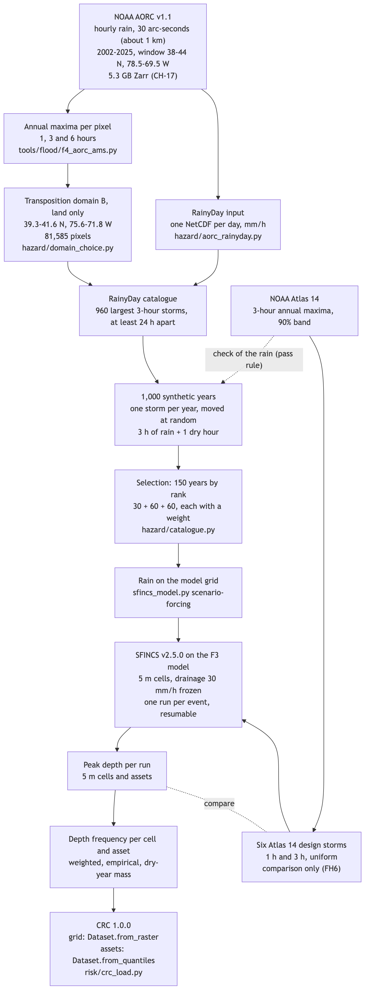

*Diagram source: [`figures/diagrams/events-chain.mmd`](figures/diagrams/events-chain.mmd) (Mermaid; `just flood-diagrams` redraws the image).*

## 3. Step by step

### 3.1 Rainfall record

NOAA's Analysis of Record for Calibration, version 1.1: "one-hour accumulated surface-precipitation (APCP)
ending at the 'top' of each hour" **[S]** (NOAA OWP, AORC v1.1 methods, §4.1). Each year's store holds
stamps from 00:00 on 1 January to 23:00 on 31 December, UTC. Under that convention the first stamp of a
year covers the last hour of the year before, and the converter places each hour by its stamp. RainyDay
uses the same convention: "All date/time stamps correspond to the end of the accumulation period" **[S]**
(RainyDay tutorial, Appendix D).

Gaps: 44,271 pixels of the domain rectangle have no data at all (open sea). Beyond those, eight days have
gaps: 16-18 August 2002, 17-18 June 2024 (almost all of the 18th), 27 November 2024, 1 June 2025 and the
last hour of 2025. RainyDay counts a gap as no rain, so a storm in a gap cannot enter the catalogue.

### 3.2 Transposition domain

Storms may be moved only within a region where "storm-producing factors are substantially comparable"
(Chow 1964, quoted in the RainyDay tutorial **[S]**). The tutorial gives no number for "comparable". This
stage measures it: each pixel's mean annual-maximum rainfall, smoothed over 25 km **[P]**, divided by the
study area's value. A candidate region is scored by the share of its land pixels within ±15% **[P]**.

| Candidate | Land within ±15%, 3-hour | 1-hour | No data (sea) |
| --- | --- | --- | --- |
| A, coastal, small | 94.8% | 90.7% | 30% |
| **B, coastal, medium (chosen)** | **94.2%** | **90.2%** | **36%** |
| C, coastal, large | 87.8% | 86.5% | 37% |
| E, New York Bight, small | 94.5% | 90.1% | 27% |
| D, whole download window | 48.0% | 50.2% | 31% |

B is the largest candidate that stays alike. RainyDay is given B's land as an irregular outline: it places
a storm only where the whole study box falls on land with data. A rectangle with sea in it would put a
third of all placements on pixels with no rain record.

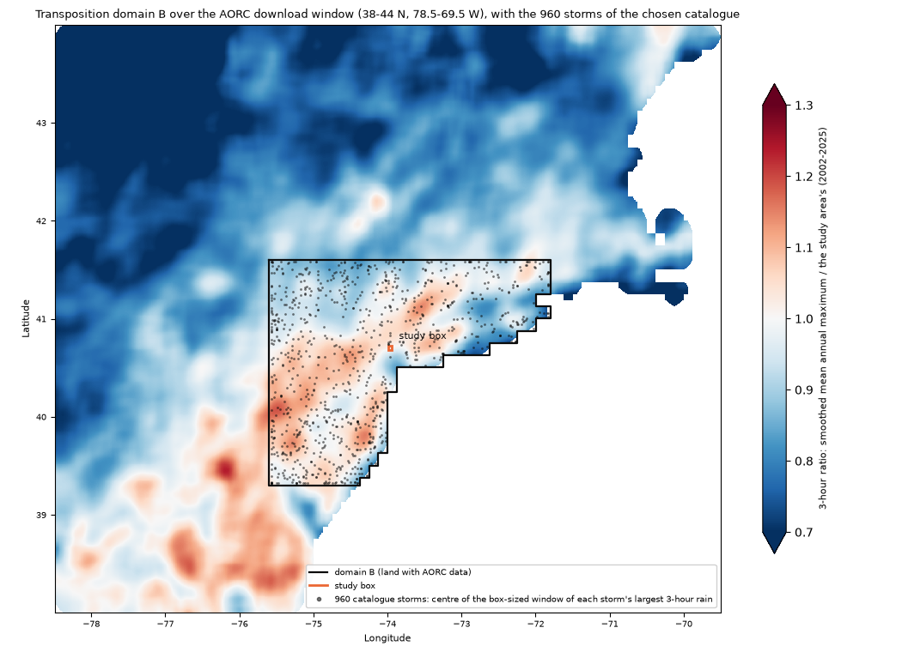

*The 3-hour ratio map, domain B and the 960 catalogue storms, each at the centre of its wettest box-sized
window.*

### 3.3 Catalogue and synthetic years (RainyDay)

RainyDay at commit `ff2b809` (MIT; no release or tag exists **[S]**, data card `rainyday`), in its own
Python 3.8 environment. Settings, all recorded in `catalogue_n960/params.json`:

| Setting | Value | Why |
| --- | --- | --- |
| DURATION | 3 h | Urban response is short, and the 30 mm/h allowance makes the wettest hours decisive. Solver cost is about 1 to 1.5 minutes per simulated hour **[P]** |
| PADSCENARIOS | 1 h | Water routes after the rain stops |
| NSTORMS | 960 (40 a year) | The 2- to 10-year rainfall barely moves from 20 to 40 a year (section 5) |
| TIMESEPARATION | 24 h | Stops one storm system from taking two places (Ida and Henri did, at the 3-hour default) **[P]** |
| NYEARS, NPERYEAR | 1,000, 1 | One storm per synthetic year: its annual maximum |
| TRANSPOSITION, DOMAINTYPE | uniform, irregular | Every land position in B equally likely |
| Study box | 40.6865-40.7230 N, 73.9882-73.9403 W | The F1 square, reprojected to lat/lon |

RainyDay sorts the synthetic years by the 3-hour rain on the study box. Rank *r* of 1,000 has return
period 1000 / *r* years (its own plotting rule). Each year's file holds the parent storm's own dates and
the 3 hours that rained most on the box, plus one dry hour.

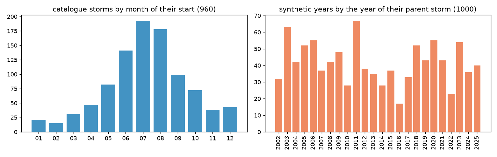

*Left: the 960 catalogue storms by month; most fall in June to September. Right: how many of the 1,000
synthetic years come from each observed year. 427 of the 960 storms are drawn at least once. The most
drawn are 4 August 2020 (18 years), 8 October 2005 (16), 28 August 2011 (16), 2 September 2021, Ida (13),
and 6 September 2008 (11).*

### 3.4 Which events are run

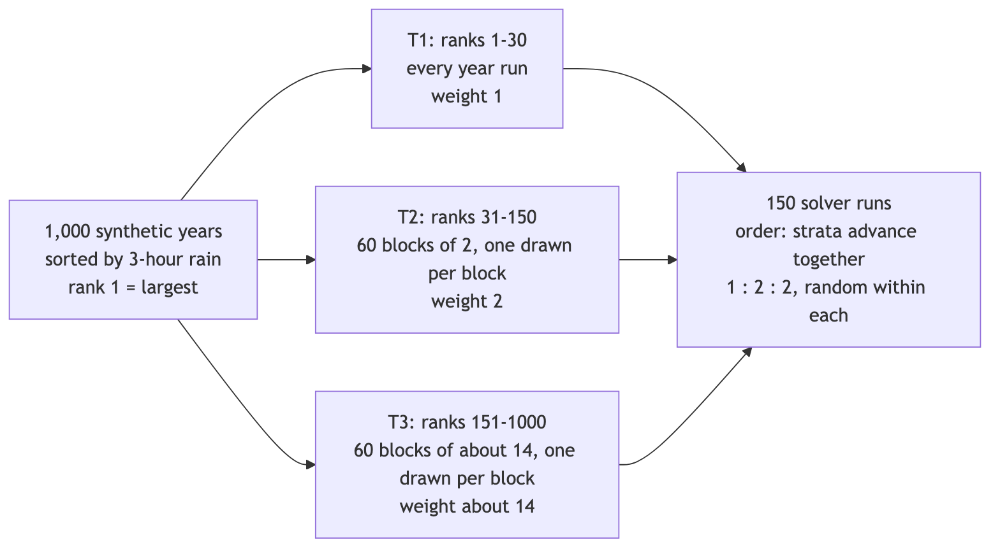

*Diagram source: [`figures/diagrams/events-selection.mmd`](figures/diagrams/events-selection.mmd) (Mermaid; `just flood-diagrams` redraws the image).*

Running all 1,000 would take about 80 hours. The years are split by rank and sampled, so that each run
stands for its block of years. This is stratified sampling: the estimate of any per-cell statistic is
unbiased whatever the link between rain and depth. Its error is smallest where depth follows rain. The
seed is fixed (`20261126`), so the selection can be reproduced.

**Why every rank band is sampled, not only the top 150.** The ranking is by 3-hour rain, but flooding
depends on the wettest hour against the 30 mm/h allowance. Some modest 3-hour years have a sharp hour,
and the right panel below shows them below rank 150.

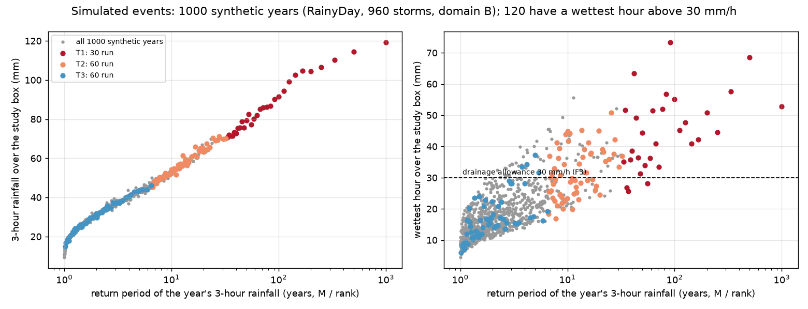

*All 1,000 synthetic years. Left: 3-hour rain on the box; right: the wettest hour. Coloured: the 150 years
selected, by stratum. 120 years have a wettest hour above 30 mm/h; 61 of them are among the 150.*

Before a stratum is complete, its finished runs stand for the whole stratum (weight = years in the stratum
/ runs finished). Interim figures say so.

### 3.5 One simulated event

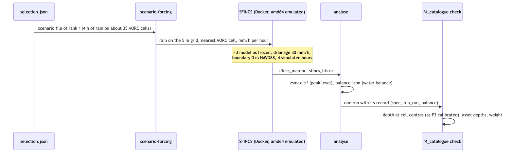

*Diagram source: [`figures/diagrams/events-one-run.mmd`](figures/diagrams/events-one-run.mmd) (Mermaid; `just flood-diagrams` redraws the image).*

Each run keeps its whole peak-depth grid and its storm descriptors (parent storm, dates, box total,
wettest hour, how far it was moved). These are F9's training data (requirements §15). Solver wall time:
4 to 6 minutes per event so far.

### 3.6 From runs to frequency, and into CRC

For a cell with depth *D*ᵢ in run *i* of weight *w*ᵢ (weights sum to *M* = 1,000), the annual probability
of a depth at least *d* is Σ *w*ᵢ [*D*ᵢ ≥ *d*] / *M*. A cell is dry in a run below 0.05 m **[P]**. The
depth at return period *T* is the largest *d* reached with probability at least 1/*T*. It is empirical:
no fitted distribution, no interpolation between storms. Code: `flood_lab.hazard.catalogue`,
documented in its module text.

CRC 1.0.0 gets the result twice (FH7):

- **Grid**, `Dataset.from_raster`: one GeoTIFF per probability (2 to 500 years), the same eight
  probabilities for every cell. A cell's dry-year mass falls between two of them.
- **Assets**, `Dataset.from_quantiles`: each asset's own knots: (0, 0), the dry-year mass, then one knot
  per distinct storm depth. CRC interpolates linearly in probability between knots.

Both are read back and compared value by value (`flood_lab.risk.crc_load`).

## 4. Design storms (FH6), the comparison

Six NOAA Atlas 14 return periods (2, 5, 10, 25, 100, 500 years), annual-maximum series, at the study
area's centre **[S]** (Atlas 14 Volume 10 Version 3, `data/cache/flood/f3/atlas14/`). Each is held
uniform for 1 hour (as the city's maps assume) and for 3 hours (as the catalogue's storms last), followed
by 1 dry hour.

| Return period | 1 h depth (mm) | 3 h depth (mm) | 3 h as a rate (mm/h) |
| --- | --- | --- | --- |
| 2 | 30.2 | 45.5 | 15.2 |
| 5 | 40.1 | 59.7 | 19.9 |
| 10 | 48.0 | 70.4 | 23.5 |
| 25 | 57.9 | 84.6 | 28.2 |
| 100 | 73.2 | 106.2 | 35.4 |
| 500 | 94.0 | 136.7 | 45.6 |

Spread evenly over 3 hours, every storm up to 25 years rains more slowly than the 30 mm/h allowance. These
storms wet no cell, and neither does the 1-hour 2-year storm. A uniform design storm cannot show the
sharp hour inside a real storm; this is why the catalogue, not the design storms, sets the frequency (D9).

## 5. Expected results, and the check of the rain

**Rainfall.** The plan's proposed rule: the catalogue's 3-hour rain on the box lies within Atlas 14's 90%
band from 2 to 100 years.

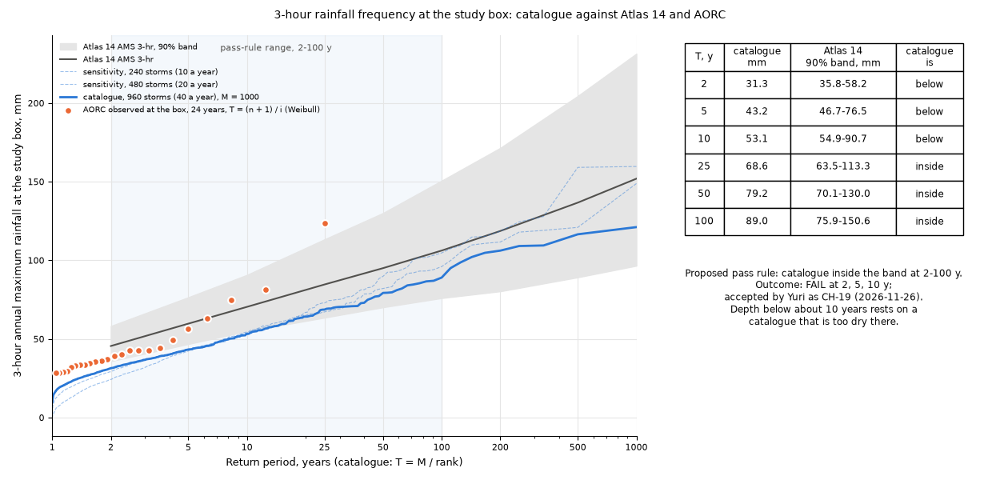

| Return period | Catalogue, 960 storms | Catalogue, 480 | Catalogue, 240 | Atlas 14 (90% band) | Inside? |
| --- | --- | --- | --- | --- | --- |
| 2 | 31.3 | 29.1 | 24.2 | 45.5 (35.8-58.2) | no |
| 5 | 43.2 | 43.2 | 42.5 | 59.7 (46.7-76.5) | no |
| 10 | 53.1 | 53.9 | 54.3 | 70.4 (54.9-90.7) | no |
| 25 | 68.6 | 72.8 | 67.1 | 84.6 (63.5-113.3) | yes |
| 50 | 79.2 | 89.8 | 82.1 | 95.0 (70.1-130.0) | yes |
| 100 | 89.0 | 104.7 | 96.0 | 106.2 (75.9-150.6) | yes |

The catalogue is too dry at 2 to 10 years. The record is not the cause: AORC observed on the box itself
(24 years, no transposition) has a median annual maximum of 38.1 mm, inside the 2-year band. Adding storms
barely closes the gap. Yuri accepted the catalogue with this shortfall on 2026-11-26 (CH-19). The 2- to
10-year storms produce little flooding under the 30 mm/h allowance, so the shortfall touches mainly
shallow, frequent depths.

The tail is a sample: between catalogues, the 500-year value moves from 117 to 159 mm. A depth at 500
years rests on the two or three largest synthetic years. Requirements §10 asks the page to say so.

**Depth (interim until the batch completes).** What to expect, and what the figures will test:

- Cells wet at 10 years should be few. They should lie where water gathers: low streets, the Navy Yard
  edge, the slips. At 100 and 500 years the wet area should grow, but stay below the 1-hour design storm
  of the same return period, because a real storm's wettest hour is lower than the design hour.
- Depth must not fall as the return period grows: in 99% of cells before the clean-up and in every cell
  after it (FH7). An empirical quantile cannot fall, so the clean-up is expected to change no cell.
- Both CRC read-backs must equal what was written.

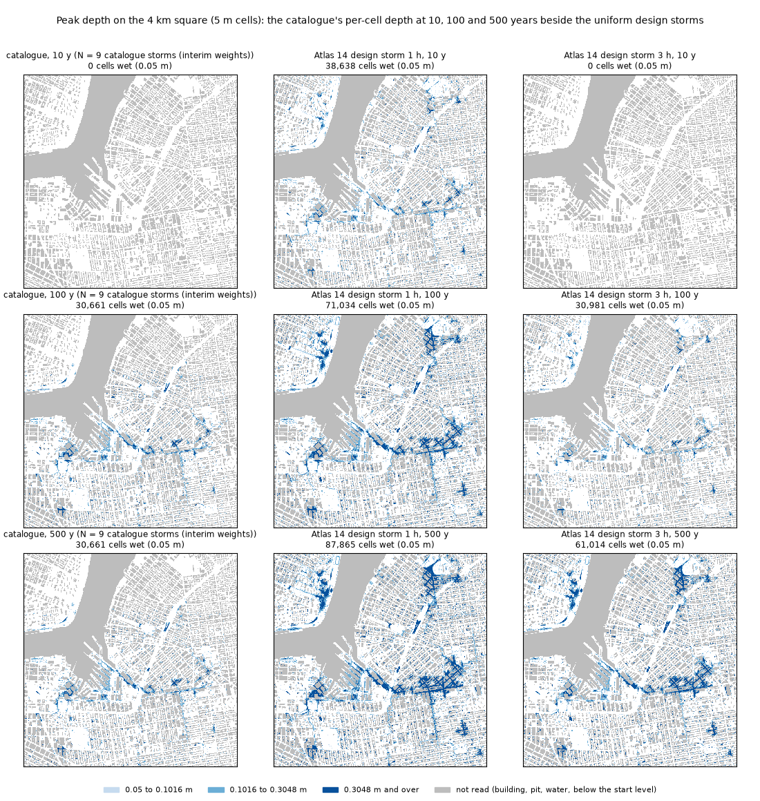

*Peak depth at 10, 100 and 500 years: catalogue (top), 1-hour design storms, 3-hour design storms. The
number of catalogue runs is printed on the figure.*

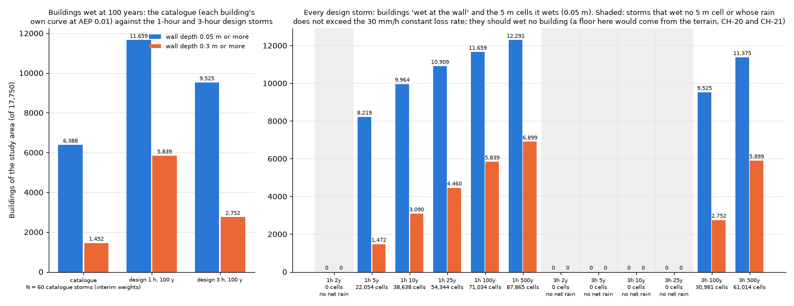

*Buildings with water at the wall at 100 years, by method. Also shown: the count in storms that wet no
cell (a floor, from pits in the 1 m terrain beside walls; see section 6).*

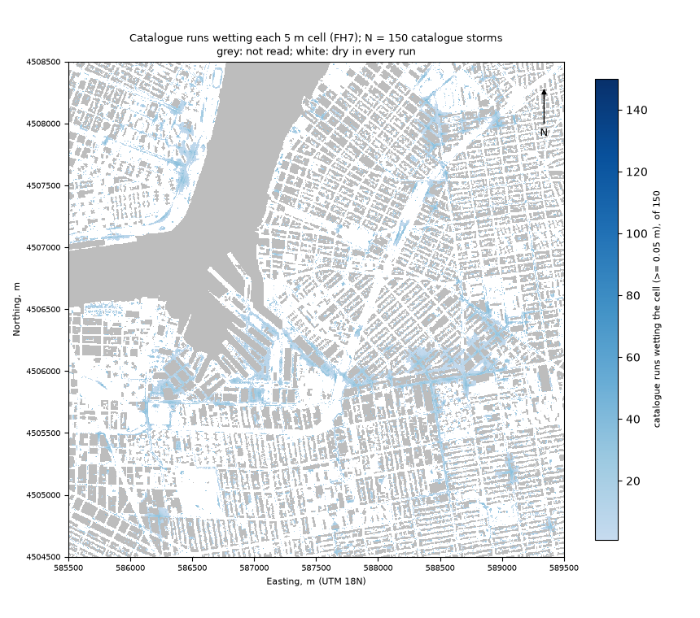

*How many catalogue runs wet each cell (FH7 asks that this is reported).*

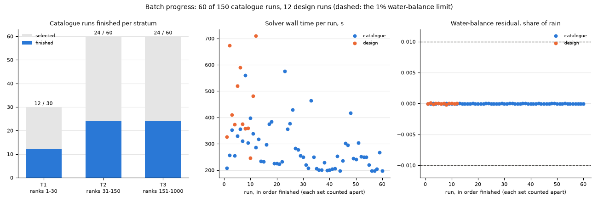

*Runs finished per stratum, solver time and water-balance residual per run (the rule is 1%).*

## 6. Limits

- **One storm per synthetic year.** A year's worst flood is taken to be from its rainiest 3-hour storm.
  A second, sharper storm in the same year is not run.
- **3-hour storms.** Rain outside the wettest 3 hours of a storm is not simulated; Ida's rain lasted
  longer. Hourly rain is held constant within each hour, smoothing peaks inside an hour.
- **Rain too low at 2 to 10 years** (section 5, CH-19).
- **The tail is a sample** of a few synthetic years, all drawn from 24 observed years.
- **Uniform placement.** RainyDay's tutorial notes that relaxing homogeneity "could introduce bias"
  **[S]**. B was chosen to keep 94% of its land within 15%, not 100%.
- **Gaps in AORC** count as no rain (section 3.1).
- **Buildings' wall depth** reads about 2,900 buildings as wet even in storms that wet no 5 m cell. These
  are pits beside walls in the 1 m terrain, from F3's definition (`hazard/at_assets.py`). Before F6 uses
  wall depths, this needs a decision (F4 report).
- **The flood model's own limits** (F3): drainage as one allowance, no inflow from outside the square,
  screening-grade depths.

## 7. Files and commands

| What | Where |
| --- | --- |
| Annual maxima, domain scores | `just flood-f4-ams`; `data/cache/flood/f4/ams/`, `domain/domain.json` |
| RainyDay input | `just flood-f4-aorc-input`; `data/cache/flood/f4/rainyday/input_B/` (2.6 GB, manifest with checksums) |
| Catalogue | `just flood-f4-rainyday <params> <log>`; `data/cache/flood/f4/rainyday/catalogue_n960/` |
| Selection, queue, batch | `tools/flood/f4_select.py`; `just flood-f4-queue`; `just flood-f4-batch data/cache/flood/f4/queue_catalogue.json` |
| Check, figures, record | `uv run --with matplotlib python -m flood_lab.checks.f4_catalogue`; `site/flood/tests/records/f4.json` |
| Figures of this document | `uv run --with matplotlib python -m flood_lab.checks.f4_events` |

## 8. References

Read for this stage, with the address used. A reference marked "not read" is cited only as quoted in one
that was.

1. NOAA Office of Water Prediction. *Analysis of Record for Calibration (AORC) version 1.1: methods*,
   section 4.1. https://www.weather.gov/media/owp/operations/aorc_v1_1_methods.pdf (read 2026-11-26).
2. NOAA AORC on the AWS Registry of Open Data. https://registry.opendata.aws/noaa-nws-aorc/ (read
   2026-11-26). Data: `s3://noaa-nws-aorc-v1-1-1km` (Zarr, one store per year).
3. Fall, G. et al. (2023). The Office of Water Prediction's Analysis of Record for Calibration, version
   1.1. *JAWRA*. doi:10.1111/1752-1688.13143 (linked from the registry; not read).
4. RainyDay, HydroclimateExtremesGroup, commit `ff2b80913657b6dfad8380b8bc998ab6362be03e`, MIT.
   https://github.com/HydroclimateExtremesGroup/RainyDay. The tutorial `UserGuide/RainyDay_Tutorial.ipynb`
   (read 2026-11-26): input format (Appendix D), parameters, and the section "Defining a Meteorologically
   Homogeneous Transposition Domain".
5. Wright, D. B., Yu, G. & England, J. F. (2020). Six decades of rainfall and flood frequency analysis
   using stochastic storm transposition: review, progress, and prospects. *Journal of Hydrology*.
   https://www.sciencedirect.com/science/article/pii/S0022169420308793. Not read: the publisher refused
   automated access. Cited through reference 4, which says it reproduces this paper.
6. Chow, V. T. (1964), on homogeneous regions for storm transposition. Not read; quoted in reference 4.
7. NOAA Atlas 14, Volume 10, Version 3 (Northeastern States), point precipitation frequency at 40.7048 N,
   73.9642 W, annual-maximum series. Saved with checksums in `data/cache/flood/f3/atlas14/` (F3).
8. SFINCS v2.5.0, Deltares (2026-11-02). doi:10.5281/zenodo.23883210 (requirements FH2; F0).
9. Kasaei et al. (2025), the Jamaica Bay Ida model, for a single drainage rate as precedent (requirements
   FH3; F0 data card `jamaica-bay-ida-depth-map`).
10. The lab's own decisions: `docs/flood/changes.md` CH-16 (allowance 30 mm/h), CH-17 (AORC 2002-2025),
    CH-19 (catalogue accepted); `docs/flood/reports/F3-solver.md` (model, run time, Atlas 14 brackets).
