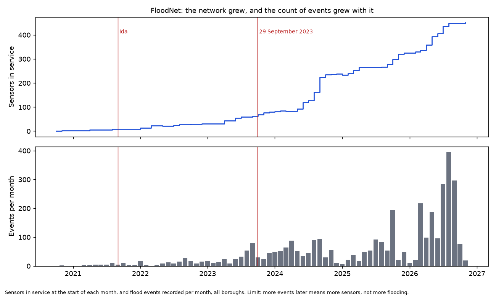
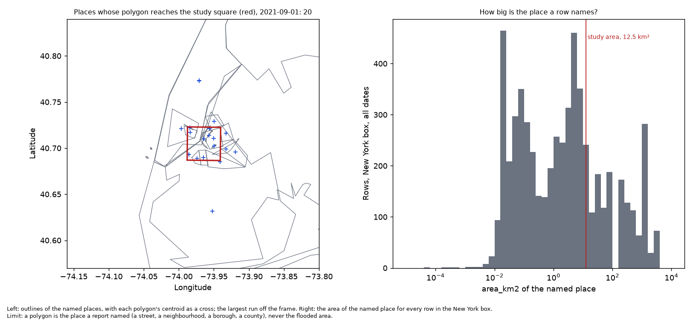
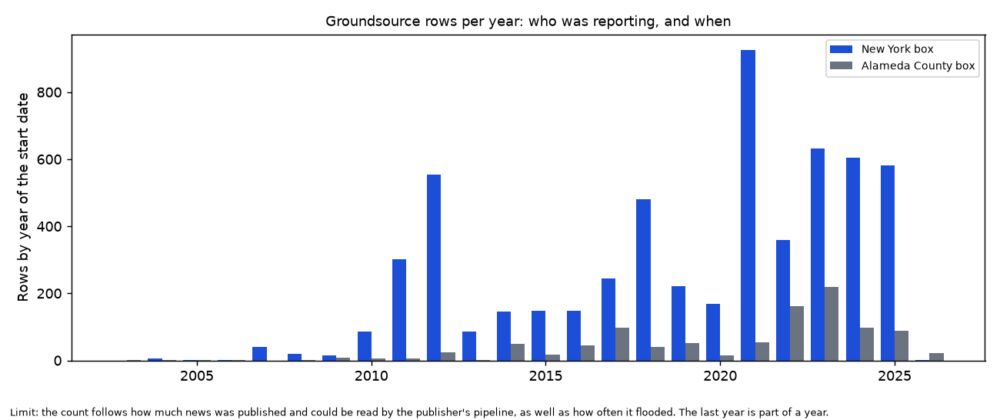

# Primer: sensor readings and news reports as evidence of a flood

Written 2026-11-25 for stage F2 of the flood lab (requirement FS5), on crc-sdk 1.0.0 and crc-framework
1.0.0. The older primer `event-sources-in-crc.md` describes the 0.11 interface; this one does not extend
it.

Every number here comes from the record `site/flood/tests/records/f2-primer.json`, written by

```sh
uv run --with matplotlib python -m flood_lab.checks.f2_primer    # offline, from data/cache/flood/
```

which also draws the figures. The two sources are described on their data cards
(`docs/flood/data-cards/floodnet-flood-events.md`, `floodnet-sensors.md`, `groundsource.md`).

## The short version

The flood lab has two kinds of evidence that a street flooded on a given day, and neither is a map of
the flood.

- **A FloodNet sensor** measures the depth of water under itself, at one point, about every minute. It is a
  measurement, with a time and a depth. It says nothing about the next street.
- **A Groundsource row** says that a news report placed a flood in a named place on given days. It is a
  report, with no depth, and its polygon is the outline of the place named, not of the water.

Both answer one question well: *did something happen here on this day?* Neither can answer *how deep was
it over the area* or *how often does this happen*. Those need a model and a long record, which is what
the rest of the lab builds, and what CRC's curves hold.

## What CRC holds, and where these two fit

CRC 1.0.0 keeps three different things apart, and the lab follows it.

| In CRC | What it is | In the flood lab |
| --- | --- | --- |
| A dataset of curves (`Dataset`) | For a place, the distribution of a yearly value: "the deepest water in a year here". Assets are evaluated against it | The depth-frequency curves from the storm catalogue (stage F4) |
| Observations (`Observations.from_table`) | Dated values at points, with a station. They cannot be evaluated against assets | FloodNet events |
| A map layer (`Layer.from_table`) | Shapes with an attribute, no time and no curve | The city's stormwater flood-map classes |

A fourth thing has no home in CRC 1.0.0: **a record with a date range and a polygon**. That is what a
Groundsource row is, so it stays a table of the lab (`flood_lab.sources.groundsource`). The F2 report says
what a CRC type for it would need.

## FloodNet: a measurement at a point

The city publishes one row per flood event a sensor recorded (start, end, largest depth, a depth profile)
and one row per sensor (position, dates of service). The lab's table has one row per sensor and event:
start and end in GMT, the New York calendar day of the start, peak depth in metres, duration in minutes,
longitude and latitude.

Loaded into CRC, each event is one observation: the sensor is the station, the start is the time, the
peak depth is the value. All 3,611 events read back from CRC equal to what was put in. CRC returns them
with the columns `support_id`, `station_id`, `time`, `value` and `geometry` among others. Duration and end
time have no place in an observation and stay in the lab's table.

Three things to keep in mind when reading it.

**The clock.** Times are GMT. Ida's rain fell on the evening of 1 September 2021 in New York, which is
2 September in GMT, so a reader that takes the date as written puts the storm on the wrong day. The lab
counts days in New York time.

**The network grew.** There were 9 sensors in service at Ida, 68 on 29 September 2023 and 452 in the
latest month of the table. More events later means more sensors, not more flooding.



*Sensors in service and events per month. Limit: the count of events follows the count of sensors.*

**No event is not "no flood".** A sensor with no event on a day may have been dry, offline, or mounted
above the water; the tables do not say which. And a sensor sits where it could be mounted, usually over
the pavement and above the lowest point of the street. The median peak depth over all events is 0.09 m
and the largest 1.17 m.

## Groundsource: a report about a place

Groundsource is a table Google built by reading news articles with a language model: each row is a place
where an article said it flooded, with the first and last day. The file has 2,646,302 rows worldwide,
5,772 of them touching the New York box the lab uses.

**What a row is.** `uuid`, `start_date`, `end_date`, a polygon, and `area_km2`. Nothing about depth,
damage or cause.

**What `area_km2` means.** It is the area of the *named place*, not of the flood. If an article says
"flooding in Brooklyn", the row's polygon is Brooklyn. In the New York box the median place is 2.2 km²,
27% of rows name a place larger than the whole study area (12.5 km²), and the largest is 3,439 km².



*Left: the 20 places whose polygon reaches the study square on 2021-09-01. Right: the size of the named
place for every row in the New York box. Limit: an outline is a place a report named, not a flood extent.*

**Centroid against polygon.** Of those 20 places, 10 have their centre inside the square. The other 10 are
larger places (a borough, the city, Long Island) that merely contain or touch it. Counting by centroid
keeps reports about this neighbourhood; counting by polygon also keeps every report about a larger place
that includes it. The lab keeps both and says which it used.

**How accurate.** The publisher reviewed 400 random rows by hand: 60% were accurate in both place and
dates, a further 22% approximately right, and 18% wrong. So a single row is weak evidence; several
independent rows for one neighbourhood on one day are better.

**Who reports and who does not.** A row exists only if someone wrote an article and the pipeline read it.
Places with local news are covered; places without are silent. Rows per year in the New York box run from
a few or a few dozen before 2010 to several hundred in recent years, with 926 in 2021, the year of Ida. That curve
follows news coverage as much as flooding.



*Rows by year of the start date. Limit: the count follows how much news was published and read.*

**The latest dates.** The file's last end date is 2026-02-03, and its last weeks are thin: the fall at
the end is where the file stops being filled. A day near the end with no row is not a dry day.

## What may be asked of them, and what may not

The same question put to both sources for the lab's study square (4 km by 4 km in north Brooklyn), on the
two storm days and on one ordinary day chosen in advance:

| Local day | FloodNet sensors in service in the square | With an event | Largest peak depth, m | Groundsource rows reaching the square | Naming a place of 16 km² or less |
| --- | ---: | ---: | ---: | ---: | ---: |
| 2021-09-01 (Ida) | 1 | 0 | – | 20 | 16 |
| 2023-09-29 | 7 | 5 | 0.637 | 26 | 22 |
| 2022-06-15 (ordinary day) | 1 | 0 | – | 0 | 0 |

Read row by row: on the day of Ida the one sensor in the square recorded nothing, while 16 reports named
places in or around it. On 29 September 2023 five of seven sensors recorded water, up to 0.64 m, and 22
reports agree. On the ordinary day both are silent. The two sources see different things, and on Ida only
the reports saw anything here.

| May be asked | May not be asked |
| --- | --- |
| Did water stand at this sensor on this day, how deep and for how long (FloodNet) | How deep the water was a block away |
| Was a flood reported in or around this neighbourhood on this day (Groundsource) | How large the flooded area was: `area_km2` is the place |
| Do the two agree that something happened here on this day | How often it floods here: both records are short and grew over time |
| Where a model's wet cells have a witness and where they do not | That nothing happened where neither source has a record |

## How this relates to CRC's curves

A curve answers "how deep, how often" for a place. It is built from a long, even record or from a model
run over many storms. Neither source here is that: FloodNet's record is six years long on a network that
grew fiftyfold, and Groundsource has no depth at all.

So in the lab they are **witnesses, not inputs to curves**. The curves come from the storm catalogue and
the flood model (F3, F4). FloodNet depths and the surveyed high-water marks check the model's depths at
points (F5). Groundsource and FloodNet together give the "did it flood here that day" labels against which
the trigger of F8 is scored. Keeping the three CRC forms apart (curves, observations, layers) is what
stops a sensor reading or a news report from being mistaken for a return period.
