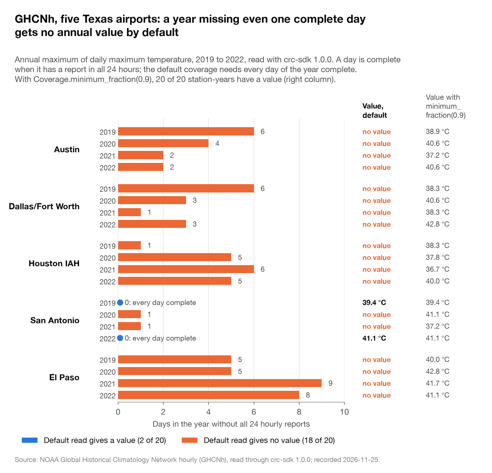
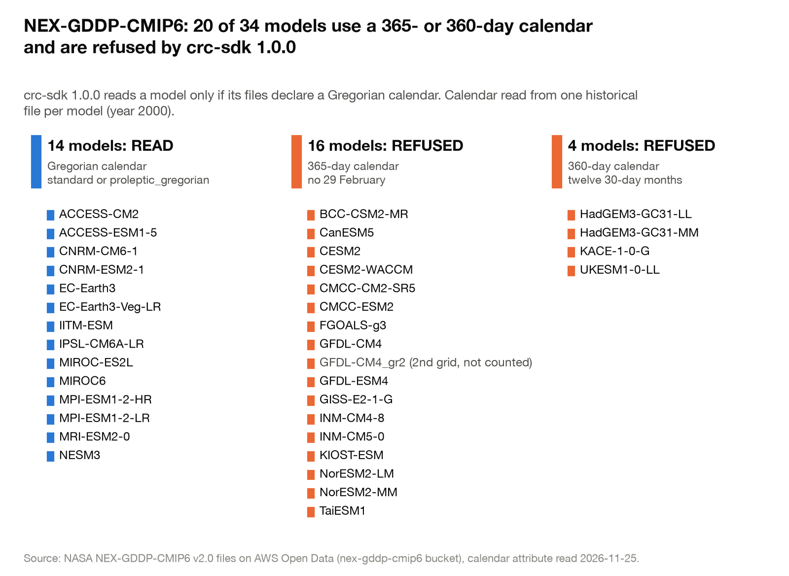
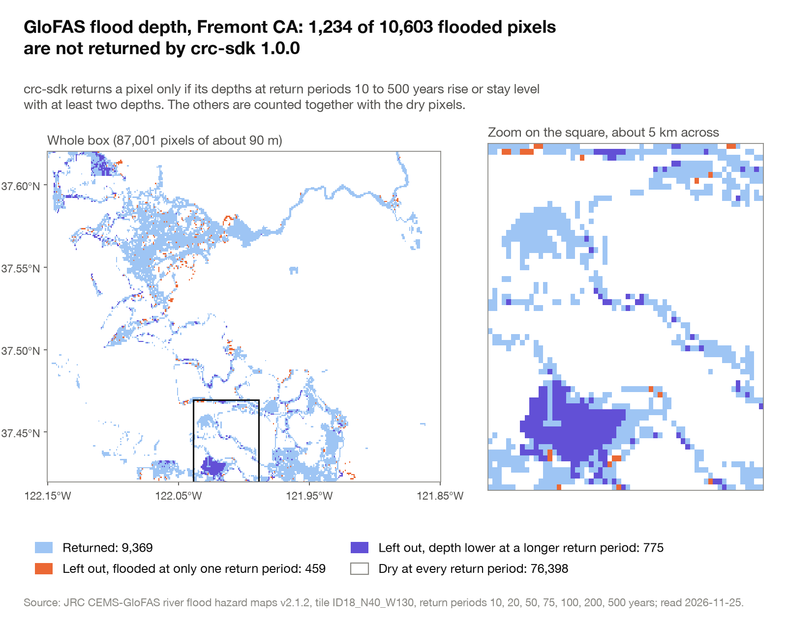

# crc-sdk 1.0.0 and crc-framework 1.0.0: observations from an independent check

Date: 2026-11-25 · crc-sdk 1.0.0, crc-framework 1.0.0 · Python 3.12, macOS arm64

This page lists what an independent check of four data sources found in the first two days after the
1.0.0 release. It is written for the maintainers of crc-sdk and crc-framework and for anyone reviewing the
issues and pull requests that refer to it.

## How the observations were made

crc-lab's source validation project reads each publisher's original files with its own readers, which
share no code with crc-sdk, recomputes what crc-sdk's documentation says a read returns, and compares
value by value. What the project is and what it has checked is in
[`docs/validation/overview.md`](https://github.com/shlyakh/crc-lab/blob/main/docs/validation/overview.md); the method is in [`docs/validation/method.md`](https://github.com/shlyakh/crc-lab/blob/main/docs/validation/method.md); the records of
every run are on the [assessments page](https://shlyakh.github.io/crc-lab/validation/).

On 1.0.0 the comparison of values found no difference in any of the four sources:

| Source | What was compared | Differences |
| --- | --- | --- |
| IBTrACS (all agencies) | 233,822,080 values | 0 |
| GHCNh (1,000 station-years) | 13,885,491 hourly reports and their annual reductions | 0 |
| NEX-GDDP-CMIP6 | 17,264 cell values | 0 |
| JRC flood maps (GloFAS and EFAS, five areas including a Texas box) | 75,534,400 depths at 11,510,034 pixels | 0 |

The observations below are about what surrounds the values: which rows are returned, what is recorded
about a source, defaults, messages and run time.

## How to reproduce one

Each observation has one script under [`tools/repro/`](https://github.com/shlyakh/crc-lab/tree/main/tools/repro). A script declares its own
dependencies and needs only [uv](https://docs.astral.sh/uv/):

```sh
uv run tools/repro/crc_024_jrc_outside_coverage.py
```

It prints the installed versions, the call, an `expected:` and an `observed:` line, and ends with
`REPRODUCED` or `NOT REPRODUCED`. The output of each script on 1.0.0 is kept in
[`tools/repro/out/`](https://github.com/shlyakh/crc-lab/tree/main/tools/repro/out); for the five with a proposed fix, also the output on the
fix. Most scripts make a small real request to the publisher; the table says where the input is
constructed.

## Summary

| # | Source | Observation | Kind | Proposed | Link |
| --- | --- | --- | --- | --- | --- |
| 1 | GHCNh | Resources are attributed to NOAA NCEI "and NOAA CO-OPS" | defect | pull request | [#53](https://github.com/RiskThinking/crc-sdk/pull/53) |
| 2 | NEX | No licence is recorded; `cmip6_license` is not read | defect | pull request | [#54](https://github.com/RiskThinking/crc-sdk/pull/54) |
| 3 | JRC | A box outside a product's coverage returns an empty, complete, valid result | defect | pull request | [#55](https://github.com/RiskThinking/crc-sdk/pull/55) |
| 4 | NEX | A year the source does not publish gives rows without values and no message naming it | defect | pull request | [#56](https://github.com/RiskThinking/crc-sdk/pull/56) |
| 5 | GHCNh | One unusable report stops the read of every selected station | design question, fix offered | issue | not yet opened |
| 6 | GHCNh | With the default coverage, one incomplete day leaves a station-year without a value | default | issue | [#57](https://github.com/RiskThinking/crc-sdk/issues/57) |
| 7 | NEX | 20 of 34 models use a 365- or 360-day calendar and are refused | regression from 0.11 | issue | [#58](https://github.com/RiskThinking/crc-sdk/issues/58) |
| 8 | JRC | 4 to 12% of flooded pixels are left out and are counted together with dry pixels | reporting | issue | [#59](https://github.com/RiskThinking/crc-sdk/issues/59) |
| 9 | IBTrACS | An agency's wind is placed at the combined position, not the agency's own | question | issue | not yet opened |
| 10 | IBTrACS | Every point is returned for every agency; up to 99% of rows have no value | design | issue | not yet opened |
| 11 | NEX | The file version read cannot be chosen and is not in the output's fields | question | issue | not yet opened |
| 12 | all remote reads | The checksum of a file read by window is of crc-sdk's cut-out | documentation | issue | not yet opened |
| 13 | crc-framework | A Gumbel quantile fit converges or not by the number format of the same values | defect | issue | not yet opened |
| 14 | all remote reads | A connection the publisher drops ends the read; nothing is tried twice | robustness | issue | not yet opened |
| 15 | JRC | A state-sized box: 2 h 31 min and 5.5 GB | performance | note | not yet opened |

## 1. GHCNh resources are attributed to NOAA CO-OPS

- **Observed.** Every GHCNh (and ISD) resource carries the attribution "NOAA National Centers for
  Environmental Information and NOAA CO-OPS; original source records retained."
  (`crc_sdk/_observed_sources.py:118-122`). CO-OPS is NOAA's tides and currents service; GHCNh and ISD are
  published by NCEI.
- **Reproduce.** `uv run tools/repro/crc_037_ghcnh_attribution.py` (one station, 2020; a few seconds).
- **Proposed fix.** An NCEI-only attribution for the GHCNh and ISD station lists and hourly files; 6 lines
  and a test. The water-level providers keep the combined text, where it names NCEI without need; that is
  left for the maintainers.

```
expected: every resource attributed 'NOAA National Centers for Environmental Information; original source records retained.'
observed: ['NOAA National Centers for Environmental Information and NOAA CO-OPS; original source records retained.']
REPRODUCED
```

## 2. No licence is recorded for NEX files

- **Documented.** `docs/data-licences.md`: "When known, its `license`, `attribution`, and timezone-aware
  `retrieved_at` retain the source's actual terms".
- **Observed.** `license` is null on every NEX resource. The reader looks for a global attribute `license`
  or `licence` (`crc_sdk/_climate_sampling.py:1856`); NASA's files carry `cmip6_license`. For ACCESS-CM2
  the precipitation files say `CC-BY 4.0` and the temperature files `CC-BY-SA 4.0`. crc-sdk 0.11 recorded
  the model licence and warned on a share-alike one; 1.0 has no such warning.
- **Reproduce.** `uv run tools/repro/crc_033_nex_licence.py` (about 5 minutes; the read is slow, not the
  script).
- **Proposed fix.** Read `cmip6_license` when neither `license` nor `licence` is present; 5 lines and a
  test. It records the value and adds no warning.

```
expected: license='CC-BY 4.0' (global attribute cmip6_license in that file)
observed: license=None
REPRODUCED
```

## 3. A box outside a product's coverage looks like a dry area

- **Observed.** EFAS covers Europe. Asked for a box in California it returns 0 rows, counts 0/0/0, no
  diagnostic, `complete=True`, `valid=True`. A wrong product or a mistyped box cannot be told from a
  covered area without flooding.
- **Reproduce.** `uv run tools/repro/crc_024_jrc_outside_coverage.py` (25 seconds).
- **Proposed fix.** A warning diagnostic `area_outside_coverage` when the area meets no tile or raster of
  the product; 18 lines and a test for EFAS and GloFAS. `complete` and `valid` are not changed; whether
  such a read should count as complete is a question for the maintainers.

```
call: JRC(product=JRC.Product.EFAS).select(area=Bounds(west=-122.15, south=37.42, east=-121.85, north=37.62)).read()
rows: 0; counts: requested=0 produced=0 skipped=0; complete=True valid=True
observed: 0 diagnostic(s)
REPRODUCED
```

## 4. A year the source does not publish gives rows without values

- **Observed.** The historical run of NEX ends in 2014. A read for 2015 returns one row per cell with no
  value; the only diagnostic says the rows "do not meet the explicit completeness policy". The 2014 file
  (about 250 MB) is read to learn the grid.
- **Reproduce.** `uv run tools/repro/crc_034_nex_missing_year.py` (about 5 minutes).
- **Proposed fix.** A warning `source_year_unavailable` naming the years asked for and the years
  published; 23 lines, a sentence in `docs/sources.md` and a test. The rows are kept, as crc-sdk does on
  purpose for gridded sources. Two things to know: the change is in the shared gridded read, so ERA5 and
  CMIP6 get the same warning; and the neighbouring year's file is still downloaded.

```
rows: 9, years ['2015'], with a value: 0
  diagnostic incomplete_year [warning, reduction]: 9 annual source observations do not meet the explicit completeness policy.
observed: none names it
REPRODUCED
```

## 5. One unusable report stops the read of every selected station

- **Observed, on constructed input.** A real NOAA file for one station with its first report written twice,
  read together with a second, untouched station: the annual read raises `ValidationError: duplicate
  evidence record` and returns no row for either station. This has not been seen on NOAA's files as
  published.
- **Reproduce.** `uv run tools/repro/crc_036_ghcnh_bad_report.py` (a few seconds; feeds the file by
  patching `crc_sdk._source_io._download`).
- **Offered.** A branch that turns the station-year into an `UnavailableStationYear` diagnostic and returns
  the other stations. It sets a whole station-year aside for one report, and only in the annual recipes;
  the raw `observations()` read still fails. This is a design choice, so it is raised as an issue first.

## 6. With the default coverage, one incomplete day leaves a station-year without a value

- **Documented.** `docs/sources.md`: the default is `Coverage.complete()`; a day needs 24 hourly reports.
- **Observed.** Together the two rules give a value only for a year in which every day has every hour.
  At five major Texas airports, 2019 to 2022, 2 of 20 station-years have an annual maximum temperature by
  default, both with 365 of 365 complete days; the other 18 have 356 to 364 complete days and no value.
  All 20 have a value with `Coverage.minimum_fraction(0.9)`. On the first 40 USW stations of a Texas box,
  2000 to 2024: 0 of 592 by default, 339 at 0.9. `Coverage` relaxes the year, not the day: a day with 23
  reports is discarded at any setting. crc-sdk 0.11 required 18 of 24 hours and 90% of days.
- **Reproduce.** `uv run tools/repro/crc_035_ghcnh_default_coverage.py` (about 30 seconds).
- **Questions.** Could the hours required per day be part of `Coverage`? Could the documentation of the
  default say what it does to hourly station data?



## 7. NEX models on a 365-day or 360-day calendar are refused

- **Observed.** A read of BCC-CSM2-MR raises `ValidationError: NEX source does not use its published
  Gregorian calendar` (`crc_sdk/_climate_sampling.py:1815-1817`). The file's `time:calendar` is `365_day`.
  `NEX().inspect()` lists the model. One file per model was read from NASA's bucket (historical, year
  2000): 14 models declare `standard` or `proleptic_gregorian`; 16 declare `365_day` and 4 `360_day`. That
  is 20 of 34 models refused. crc-sdk 0.11 read them.
- **Reproduce.** `uv run tools/repro/crc_032_nex_calendar.py` (one model, about a minute);
  `uv run python tools/probes/nex_calendars.py` (all models, 8 minutes).
- **Question.** Is the refusal intended? If so, inspection could mark such models and the message could
  name the calendar found. If not: an annual maximum or minimum does not depend on the calendar.



## 8. Flooded pixels are left out and counted together with dry pixels

- **Documented.** `docs/sources.md`: JRC gives "original pixels and quantile knots".
- **Observed.** A pixel is returned only when it has at least two depths and no depth is lower than one at
  a shorter return period. The others are reported in one number that also holds every dry pixel:
  "Skipped N source supports whose values are not a quantile curve". Counted from JRC's own files:

| Area | Skipped, as reported | Dry | One depth | Decreasing | Flooded pixels left out |
| --- | --- | --- | --- | --- | --- |
| Texas box, GloFAS | 190,688,191 | 190,071,292 | 424,212 | 192,687 | 616,899 of 11,686,210 (5.3%) |
| Houston, GloFAS | 1,045,703 | 1,019,627 | 22,086 | 3,990 | 26,076 of 278,654 (9.4%) |
| Austin, GloFAS | 336,778 | 335,707 | 931 | 140 | 1,071 of 25,494 (4.2%) |
| Fremont, GloFAS | 77,632 | 76,398 | 459 | 775 | 1,234 of 10,603 (11.6%) |
| Rhine, EFAS | 2,440,888 | 2,433,343 | 6,815 | 730 | 7,545 of 161,898 (4.7%) |

- **Related.** `Dataset.from_raster` on rasters where one pixel decreases fails the whole read, and the
  error does not name the pixel (`uv run tools/repro/crc_025_from_raster_decreasing.py`, constructed
  3 by 3 rasters).
- **Reproduce.** `uv run tools/repro/crc_023_jrc_skipped_pixels.py` (Fremont; about a minute).
- **Requests.** Report the three groups apart, or leave dry pixels out of the count; say in the
  documentation which pixels are not returned.



## 9. An agency's wind is placed at the combined IBTrACS position

- **Observed.** `IBTrACS(agency=IBTrACS.Agency.TOKYO)` returns Tokyo's wind and pressure at the file's
  combined `LAT`/`LON`. The file also has `TOKYO_LAT`/`TOKYO_LON`. Of Tokyo's 51,285 rows with a wind
  value, 40,012 carry a position that differs from Tokyo's own, 31,292 of them by more than 0.1 degree.
- **Reproduce.** `uv run tools/repro/crc_028_ibtracs_position.py` (downloads the 333 MB file; 2 minutes).
- **Question.** Is the combined position intended? If so, `docs/sources.md` could say it. A smaller point
  on the same line of the documentation: it speaks of "an explicit `Agency`", while `IBTrACS()` has a
  declared default, `Agency.USA`.

## 10. Every point is returned for every agency

- **Observed.** Each agency read returns all 1,461,388 rows (two per storm point). For New Delhi 1,443,316
  of them (98.8%) have no value and the failure `source_no_data`.
- **Reproduce.** `uv run tools/repro/crc_029_ibtracs_empty_rows.py`.
- **Request.** A way to keep only points the agency reported, so that counts describe the agency and small
  agencies are cheap to read.

## 11. The NEX file version cannot be chosen

- **Observed.** For ACCESS-CM2 precipitation 2014 NASA serves three files: unversioned, `_v1.1` and
  `_v2.0`. crc-sdk reads the highest. `NEX(...)` has no version parameter, and the version appears only
  inside a file name in the resource URIs, not in a field of the output.
- **Reproduce.** `uv run tools/repro/crc_031_nex_version.py` (8 minutes the first time).
- **Question.** Should a result state the version it was read from, and should an earlier one be
  selectable, so that results made on version 1.x can be repeated?

## 12. The checksum of a file read by window is of crc-sdk's cut-out

- **Documented.** `docs/data-licences.md`: "A `ResourceIdentity` carries its URI and full content SHA-256
  identity."
- **Observed.** For a raster or NetCDF file read by window (URI ending `#crc-window=...`), the checksum is
  of the bundle crc-sdk wrote for that window. Two boxes inside the same JRC file give two checksums, and
  neither is the checksum of JRC's file. A file read whole does match.
- **Reproduce.** `uv run tools/repro/crc_027_window_checksum.py` (about 45 seconds).
- **Request.** Say so in the documentation; the recorded value cannot be compared with a publisher's own
  checksum.

## 13. A Gumbel quantile fit converges or not by the number format of the same values (crc-framework)

- **Observed.** Depths that are flat and then rise at the two longest return periods, fitted with
  `fit_quantiles(..., QuantileFit(family=DistributionFamily.GUMBEL_RIGHT))`: as 32-bit values they converge
  (54 and 87 iterations); as the decimal values of the same depths they do not (362 and 300 iterations).
  In crc-framework 0.6.0 it was the other way round.
- **Reproduce.** `uv run tools/repro/crc_026_fit_float32.py` (offline, one second).

## 14. A connection the publisher drops ends the read

- **Observed.** A download is one `urlopen` call with a 60-second timeout (`crc_sdk/_source_io.py:280`).
  Remote rasters are opened through GDAL without `GDAL_HTTP_MAX_RETRY` or `GDAL_HTTP_RETRY_DELAY`
  (`crc_sdk/_climate_io.py:407-420`). On a local server that closes the first connection and serves the
  second, `IBTrACS(...).read()` makes one request and raises `RemoteDisconnected`; repeated, it returns its
  rows. In two days this was met with three publishers: JRC (the Texas box was read on the fifth try; of the
  four earlier tries, one ended on a connection reset when the machine woke from sleep, and three ended
  within 90 seconds: on a connection reset after 38 s, on `RemoteDisconnected` after 83 s, and on a file GDAL
  did not recognise after 26 s; [log](texas-tries-2026-11-25.txt)), NOAA (seven resets among 1,000 GHCNh station-years) and NASA (the NEX scripts on this page
  complete only with a retry around the standard library call).
- **Reproduce.** `uv run tools/repro/crc_no_retry.py` (offline, a few seconds; points IBTrACS at the local
  server by setting one private name). The raster path was read in the code and seen failing on JRC; it
  was not exercised on a constructed server.
- **Request.** A bounded retry on transport errors. For rasters the two GDAL options may be enough.

## 15. A state-sized JRC box takes hours

- **Observed.** GloFAS for a Texas box (201,757,502 pixels in four tiles, 11,069,311 rows): 9,081 s and a
  peak of 5.5 GB on an arm64 Mac with 16 GB. crc-sdk 0.11.2 took 1,604 s for the same box including a fit
  per pixel. Houston (1.3 million pixels) took 111 s. Nothing of a read that stops is kept unless a cache
  is configured.
- **Not a script.** The numbers are in the JRC flood record of the assessments page.

## What was not checked

- ERA5, CMIP6, EDO, CRC Open, the Cropland Data Layer and the water-level providers were not assessed on
  1.0.0.
- Explicit fits (`fit(...)` on JRC curves or GHCNh samples) were not assessed; only what a read returns by
  default.
- Observations 5 and 14 rest on constructed input; 14 is also seen on real publishers.
- All runs are from one machine and one network.
